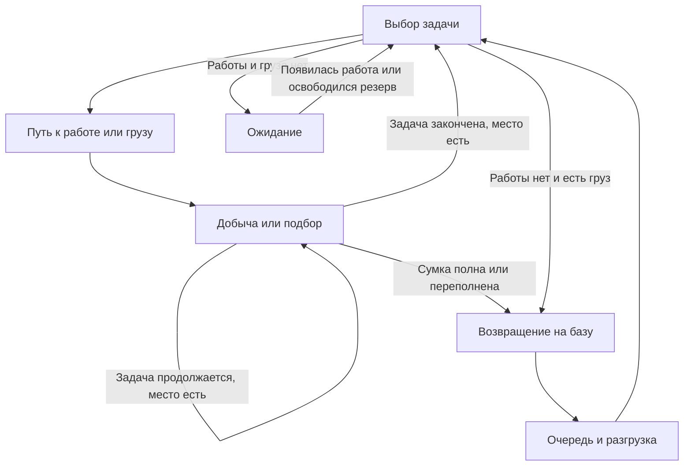

# Cat Miners ТЗ на переход к автоматической инкрементальной игре

Версия 2.1 · 8 октября 2026 года, дополнения 9–15 октября 2026 года · Задание исполнителю Opus 5.5 · Unity 6000.3.11f1 · Android portrait

Мы перерабатываем существующую игру про котиков-копателей. Новый основной референс игрового цикла — экономический режим **Idle Outpost**. Котики самостоятельно находят препятствия, добывают монеты, наполняют сумки, возвращаются на базу и разгружаются. Игрок вкладывает доставленные монеты в развитие всей команды. После завершения шахты локальные улучшения сбрасываются, а экипировка, карточки, их улучшения и эликсир сохраняются.

Этот документ можно целиком передать Opus 5.5 вместе с текущим Unity-проектом и исходным `json-data.json`. Он описывает новый игровой цикл, перенос существующих уровней, стартовый баланс, интерфейс, техническую реализацию и критерии готовности.

### 0. Статус и комплект передачи

**Это полное ТЗ на разработку нового режима, а не заявление о готовности игры.** При подготовке версии 2.1 прочитаны исходное ТЗ 2.0, JSON и существенные части существующего кода; выполнены независимые проверки геометрии и контрольных формул. Unity, новый планировщик работников и игровой темп в этой проверке не запускались.

Обязательный комплект: этот файл, существующий проект и `Assets/Game/Data/Source/json-data.json`. Исходник версии 2.0 сохранён в `Docs/TZ/source/Cat_Miners_Auto_Incremental_TZ_v2.0.md`; замечания и обоснования исправлений — в `Docs/TZ/REVIEW_Outpost_v2.0_to_v2.1.md`. Для реализации достаточно настоящего документа; архивные задания не должны возвращать отменённые механики.

**Возвращение карточек (9 октября 2026 года, задание «Cat Miners возвращение карточек»).** Указания удалить карточки, manager-карты и эликсир отменены. Полная система 61 карточки источника возвращена как постоянная пассивная прогрессия рядом с экипировкой: §10.4 и `Docs/Rework/CARD_EFFECT_MAPPING.md`. Автоматический цикл не меняется: котики сами добывают и относят монеты, карточки не нужны для работы.

**Дополнение 9 октября 2026 года** (решение владельца продукта): первая шахта заполнена целями почти целиком — именованный override `zone1-full-arena-1` (§8.5); игрок может бить камни тапом или кликом — удар кирки игрока (§5, §6.6, профиль баланса `outpost-2.1-b2`). Исходный JSON по-прежнему не меняется.

**Топология 10 октября 2026 года.** Новое прямое задание владельца продукта отменяет сохранение прямоугольных арен и перезапуск активной шахты при смене геометрии. Приоритет — настоящие ветвящиеся тоннели с постоянными стенами (§8), сохранение состава экономики и текущего прогресса. Подробности — `Docs/Rework/MINE_TOPOLOGY.md`.

**Уточнение 11 октября 2026 года (решение владельца продукта).** Работники продолжают добычу не больше трёх реальных часов за одно отсутствие. Этот потолок действует сразу и для сохранённых шахт; карточки его не увеличивают. «Лежанка» (`ca051`) вместо дополнительных часов даёт +5% к скорости разгрузки за уровень, сохраняя уровень и копии. Актуальные конфигурации — `outpost-2.1-b3` и `cards-2`; прежние отчёты темпа относятся к указанным в них версиям.

**Аудит баланса 11 октября 2026 года (профиль `outpost-2.1-b4`).** Замер всей кампании настоящим ядром с моделями игрока показал перевёрнутую кривую: шахты к концу кампании становились короче (5 → 3 мин) при ориентире 8–15 мин, в поздних шахтах 59 % золота оставалось неистраченным. Реализационных ошибок не найдено. Исправлены открытые параметры: удорожание местных улучшений с глубиной `CostZoneStep = 1/10` (§12.2), рост прочности `ZoneHpStep = 1/25` (§12.4), «Разгрузка» +20 % за уровень, предел «Оценки добычи» 40 с порогами 10/25/40 (§9, §12.2). Поэтапные ориентиры и замеры — §12.6, отчёт — `Docs/Rework/BALANCE_AUDIT.md`. Шахта 1 и исходный JSON не меняются; текущая шахта сохранения доигрывается по своему снимку.

**Обучение убрано 15 октября 2026 года (решение владельца продукта).** В игре нет обучения: ни реплик наставника с лапкой и рамкой, ни кнопки «Skip tutorial», ни строки «Tutorial hints» в настройках. Игрок сразу играет на шахте 1; механики, баланс и интерфейс остальных окон не меняются (§15). Учебная карточка ca001 при первой доставке — награда, а не урок, и остаётся (§10.4). Старые сохранения совместимы: поле `Profile.Tutorial` хранится, но игра его не читает (§17). Playable-сборка ведёт игрока своими квестами (`Docs/Playable/PLAYABLE_TZ.md`).

**Заводы вместо месторождений 15 октября 2026 года (решения владельца продукта, ТЗ 2.2).** Месторождения `s` стали добывающими заводами товаров (Milk, Wood, Steel, Cat Food…), закованными в цепи. Котики и игрок разбивают цепи как обычную цель, монет цепи не дают. Открытый завод остаётся стоять на прежнем footprint 2×3 и работает циклами длительностью из `MineShafts` JSON. Готовую партию игрок отправляет кнопкой «Deliver»; если уровень карточки из токена `s` (`cardId`, `cardLevel`) не ниже требования, завод доставляет сам. Партия идёт по своей трубе завода к складу товаров (Warehouse) во дворе лагеря, рынок (кнопка «Market») продаёт товар за золото — это второй источник золота шахты. 39 manager-карточек стали карточками заводов (`cards-3`, +выпуск товара). Топология — `wide-branching-mines-3`, сохранения — схема 3 (§8.5, §17).

Решения владельца: **Р1** — длительности циклов как в JSON (8 с – 8 ч), без сжатия; баланс прохождения владелец меняет отдельным заданием. **Р2** — цепи монет не дают, вся ценность завода — в продаже товара. **Р3** — товар местный, как золото: непроданный пропадает при переходе. **Р4** — Common и Uncommon карточки завода одинаково увеличивают выпуск товара своего типа, бонусы складываются; автодоставка — по требованию токена каждой шахты. **Р5** — Market — шестая кнопка нижней панели. **Р6** — 20 заводов, 20 товаров и 39 карточек с английскими названиями приложения A ТЗ 2.2. **Р7** — заводы есть и в playable, квесты не расширяются, ничего не публикуется. **Р8** — улучшение заводов за золото (`UpgradeCost*`, `GeneratorObjectives` JSON) в эту версию не входит. **Р9** — игры ещё нет в сторе: сохранение прежней версии архивируется, игра начинается заново, миграций прогресса нет. Изменения перенесены в §3–§8, §10–§14, §16, §17, §19 и §20; подробности — `Docs/TZ/Cat_Miners_Factories_TZ_v2.2.md`. В вопросах заводов, товаров, труб, склада, рынка, карточек заводов и сохранений приоритет у ТЗ 2.2.

**Магазин 14 октября 2026 года (решение владельца продукта).** Скидка на гемы (hard-валюту) убрана: у пакетов гемов больше нет бонуса первой покупки — плитки показывают обычное количество и цену, без бейджа «+N%», зачёркнутого числа и плашки «Available: 1». Каталог `store-3` (§10.5); механизм бонуса в коде остаётся и включается только данными.

**Магазин и сундуки 13 октября 2026 года (решения владельца продукта).** Тайм-скипы сокращены до 10 / 30 / 60 минут: шахта рассчитана на 4–12 минут игры (§12.6), а котики без единой покупки проходят её за 16 минут (шахта 1) – 1,9 часа (шахта 144), поэтому прежний скип на 1 час почти всегда завершал шахту целиком, а 4 и 12 часов — всегда. Цены, ID плиток и стартовый набор (3 коротких и 1 средний скип) прежние. Окно сундука показывает выпавшие карточки картинками; сундук шахты с новой карточкой открывает то же окно (§10.5). С кнопки «Base» убрана подпись «For this mine»; в самой панели «База» она остаётся (§9).

**Магазин 12 октября 2026 года (решение владельца продукта).** Добавлен магазин (§10.5): сундуки (Wooden — за рекламу с таймером 4 ч), тайм-скипы на 1/4/12 ч (13 октября сокращены до 10/30/60 мин), пакеты эликсира и гемов. Soft-валюта — эликсир, hard — гемы. Кнопка «Store» стоит слева в нижней панели (Store · Cards · Base · Equipment · To base). Реклама и платежи работают в тестовом режиме: награда выдаётся сразу; удвоение офлайн-дохода (§13) тоже работает. Стартовый набор — 3 коротких тайм-скипа и 1 средний (с 13 октября — 10 и 30 минут). Цены и шансы хранятся в JSON (`store_catalog.json`, `card_rules.json`).

**Уточнения 10 октября 2026 года.** Согласованы эффекты карточек с ударом игрока, пределом офлайна, стартовыми котиками, переходом, составом сохранения и критериями приёмки. Актуальные результаты Unity и баланса находятся в `Docs/Rework/VALIDATION_V2.md` и `BALANCE_V2.md`; первоначальная подготовка ТЗ и последующая проверка реализации описаны отдельно.

Основные исправления 2.1: точный контракт JSON и секторов, удаление старых блокировок кузницы/пушки, однозначные задачи и груз, порядок одновременных событий, точные денежные суммы, версии сохранений и обработка часов. Стартовый предел «Кирок» изменён с 60 на 20 с порогами 10/20, «Оценки добычи» — с 60 на 50 с порогами 10/25/50 (в профиле b4 после аудита — 40 с порогами 10/25/40). Остальные исходные коэффициенты сохраняются как проверяемый стартовый профиль; измеренные правки b4 перечислены выше и в §12.

## 1. Задание исполнителю

Переделай существующий проект в соответствии с этим ТЗ. Начни с изучения кода, сцен, данных, сохранений и инструкций репозитория. Используй пригодные компоненты проекта. Результат — запускаемая игра с новым циклом во всех 144 шахтах.

Работай самостоятельно, последовательно реализуй системы и проверяй их в Unity. Не заканчивай на плане, отдельных скриптах или демонстрационной сцене. После компиляции проверь реальные действия и исправь найденные проблемы. Для длинной сессии веди `REWORK_PROGRESS.md` с выполненными этапами, проверками и точкой продолжения.

Приоритеты:

1. Автономная добыча, перенос и сдача монет без ручного назначения работников.
2. Понятные улучшения базы и корректное разделение временного и постоянного прогресса.
3. Проходимость всех исходных планировок в новых правилах.
4. Рабочие экипировка, сохранение, офлайн-симуляция и переходы.
5. Баланс первых уровней и проверка поздних карт.
6. Цельные пиксель-арт, анимации, интерфейс, музыка и звуки.

### Приоритет документов

Этот документ полностью задаёт правила нового режима и имеет приоритет над `Docs/TZ/Cat_Miners_Unity_Core_TZ_v1.3.md`, прежним визуальным заданием и текущим кодом. Его дополняет `Docs/TZ/Cat_Miners_Factories_TZ_v2.2.md`: в вопросах заводов, товаров, труб, склада, рынка, карточек заводов и сохранений приоритет у ТЗ 2.2. Из `Docs/Visual/ART_DIRECTION.md`, `Docs/Art/PIXEL_STYLE_GUIDE.md` и `Docs/Audio/SOUNDS.md` сохраняются совместимые художественное направление, материалы, UI-компоненты и звук. Их описания merge, индивидуальных уровней и оружия по циклу уровней, старой экономики, ручного назначения и бесплатных доставок в новом режиме не действуют. Ни имя исполнителя, ни текст ТЗ не меняют настройки модели в среде запуска.

Исходный JSON сохраняется побайтно как источник. **Сохраняются исходные ID, состав объектов, footprint, HP-ранги и награды. Новая игровая геометрия задаётся отдельно в `mine_topology.json`: разветвлённые тоннели и камеры заменяют прямоугольные арены во всей кампании.** Старый баланс Gold & Goblins не объявляется подходящим для новой логистики.

Исходный JSON: 2 254 970 байт, SHA-256 `8975a5a09dce8e2675d06b751c50b5cac80da3988f8ed098910492c442f85ee5`. Проверять хэш при импорте, включая Android-сборку. Конфигурации нового режима не записывать обратно в источник.

Числа ниже — явно заданная стартовая настройка нашего прототипа, которую исполнитель должен проверить и откалибровать. Изменение коэффициентов фиксировать новой версией профиля и отчётом; правила доставки, разделения прогресса и сохранности ресурсов от настройки темпа не меняются.

## 2. Что берём из Idle Outpost

Официальное описание Trade Mode связывает развитие локации с открытием и улучшением производственных точек, наймом работников и повторным вложением дохода. Описание Trade Gear предусматривает экипировку с бонусами к прибыли, производительности и скорости работников. Эти принципы используем как референс [1][2].

Наша реализация переносит эти принципы в шахту с котиками. Автоматическое разрушение препятствий, физическая доставка добычи на базу, правила завершения шахты и конкретные формулы ниже — **решения для Cat Miners**, а не утверждение о точном устройстве Idle Outpost.

В текущий объём входят шахта, база, автоматические работники, локальные улучшения, постоянная экипировка и последовательное прохождение. Fight Mode, зомби, бои, арена, торговые посетители, события, ферма и отдельный город сейчас не реализуются. Дополнение владельца от 14.10.2026 расширяет Android-версию для Google Play реальными покупками и SDK (§10.5); тестовый магазин сохраняется для редактора и браузерного прототипа.

## 3. Новый игровой цикл

1. Игрок начинает шахту с работающей базой и двумя котиками.
2. Котики сами выбирают доступные цели и идут к ним.
3. Во время добычи появляются порции монет. Котики складывают их в сумки.
4. Наполнив сумку, котик возвращается на базу и разгружается.
5. Только сданные на базу монеты становятся доступными для покупок. Второй источник золота — продажа товара заводов на рынке (§7.3, ТЗ 2.2 §6).
6. Игрок улучшает силу, численность, перемещение, сумки, разгрузку и ценность добычи.
7. Команда расчищает текущий сектор, автоматически открывает ворота и продолжает работу выше.
8. После полной расчистки и доставки всей добычи игрок получает постоянную награду.
9. Игрок переходит в следующую шахту. Локальная экономика начинается заново; экипировка продолжает усиливать команду.

Без действий игрока котики должны продолжать работу и в конечном счёте завершать текущую шахту. Улучшения заметно ускоряют этот процесс. Прогресс не требует обязательного ручного сбора, кликов по камням, назначения целей или merge.

Игрок управляет эффективностью потока: увеличить добычу, ускорить доставку, расширить сумки, разгрузку или команду. Характерное поведение игры должно быть видно на поле: работающие котики, наполненные сумки, маршруты к базе и сдача монет.

## 4. Что изменить в существующей игре

| Система | Новое поведение |
|---|---|
| Покупка отдельных котиков заданного уровня | Улучшение «Команда» добавляет работника с общими характеристиками |
| Merge котиков | Удалить из обычного игрового режима, UI и подсказок |
| Ручное перетаскивание и назначение | Заменить автоматическим планировщиком работ |
| Индивидуальные уровни котиков | Заменить общим локальным развитием команды; индивидуального опыта нет |
| Ожидание после разрушения цели | Автоматически подобрать следующую работу или отвезти груз |
| Мгновенное начисление награды камня | Создавать физически переносимый груз; начислять после разгрузки |
| Шахты с пассивным доходом | Заводы товаров в цепях (ТЗ 2.2): котики разбивают цепи как цель, монет цепи не дают; открытый завод циклами производит свой товар, партии идут по трубе на склад лагеря и продаются на рынке (§8.2) |
| Карточки автоматизации | Котикам автоматизация не нужна: добыча и доставка монет работают с начала игры. Автодоставку завода включает карточка завода не ниже уровня из его токена `s` (`cardId`/`cardLevel`, §8.1, §10.4) |
| Исходные manager-карты и эликсир | Возвращены (§10.4): 39 карточек заводов дают +выпуск товара своего типа, `ca001` — разгрузку; эликсир — валюта улучшения карточек; экипировка и детали остаются |
| Бесплатная доставка котика по старому таймеру | Отключить; число котиков задаётся локальным наймом |
| Старые случайные доставки и динамит | Отключить в первой версии переработки |
| Бонусы старых ворот | Заменить открытием следующего сектора и добычей по новой конфигурации |
| Сохранение | Новая версия и отдельный профиль режима |
| Офлайн | Продолжение всей автоматической цепочки до завершения текущей шахты |

Переиспользуй геометрию, импорт, готовые спрайты, музыку, сервисы UI и пригодные части сохранения. Старые системы не должны продолжать начислять доход или бонусы невидимо для игрока. В новом режиме отключить их команды, таймеры, обработчики наград и подписки, включая старый автосбор добычи через 30 секунд. Простого скрытия кнопок недостаточно. Старые `GameSession`, `ZoneLayout`, валидатор и ScenarioBot не считаются реализацией нового цикла без адаптации; допускается оставить их в изолированном режиме разработки.

## 5. База и управление

База — компактный шахтёрский лагерь внизу уровня. Это функциональный центр текущей шахты, без отдельной сцены города и строительства по свободным клеткам.

В базе находятся:

- Приёмный склад с двумя местами разгрузки и видимыми ящиками с монетами.
- Доска найма, представляющая размер команды.
- Верстак инструментов, представляющий силу добычи.
- Стеллаж сумок и транспортное оборудование, представляющие логистику.
- Шкаф постоянной экипировки.
- В шахтах с заводами — склад товаров (Warehouse, ТЗ 2.2 §6.1): к нему приходят трубы заводов, на нём копится товар до продажи. Слово depot остаётся за приёмным складом монет.

Все улучшения доступны через единую панель «База». Постройки отражают развитие визуально, но не требуют отдельно обходить и открывать несколько одинаковых меню. Кнопка «К базе» возвращает камеру к лагерю из любой части шахты. Панель улучшений можно открыть, не возвращая камеру вручную. Тап по складу товаров открывает рынок, тап по остальным постройкам — «Базу»; рынок открывает и кнопка «Market» нижней панели (§10.5).

Камера прокручивается вертикально. Тап по котику показывает сведения и текущую задачу. Тап или клик мышью по цели текущего сектора — удар кирки игрока (§6.6); удержание пальца или кнопки на цели (0,45 с без сдвига) показывает её сведения, как и тап по цели, которую сейчас ударить нельзя (за закрытыми воротами). Тап по монетам на земле не зачисляет их: они являются грузом работников. Перетаскивание фона двигает камеру, а не назначает работу. В первой версии нет ручного управления отдельным котиком и обязательного выбора приоритетной цели.

## 6. Автоматическое поведение котика

### 6.1. Общие характеристики

У всех котиков одинаковые эффективные характеристики команды. Различаются внешность, текущая позиция, задача, заполнение сумки и фаза анимации. Котик не теряет свою индивидуальность визуально, но игроку не нужно отдельно прокачивать каждого.

Характеристики: урон за удар, интервал удара, скорость перемещения, вместимость сумки, скорость разгрузки. Ценность монет — общий параметр экономики команды.

### 6.2. Состояния



В коде раздели выбор задачи, движение, добычу, подбор, возвращение, ожидание свободного места разгрузки, разгрузку и ожидание работы. Не запускай несколько конкурирующих корутин поведения одного котика.

Обязательные состояния: `ChoosingTask`, `MovingToWork`, `Mining`, `MovingToCargo`, `PickingUp`, `Returning`, `WaitingDepot`, `Unloading`, `Idle`. Для каждого хранить одну активную задачу и её таймер/прогресс. `Mining` сохраняет текущую цель после удара, пока цель жива, рабочая клетка корректна и есть место в сумке. Прибытие к новой цели не наносит мгновенный удар: первый удар через полный интервал в 1 секунду. `Idle` не создаёт доход.

### 6.3. Правила выбора задачи

На старте, после окончания работы и после разгрузки котик выбирает задачу автоматически:

1. Если `cargoCount >= FinalCapacity` — сразу направиться к базе; подбор и добыча запрещены до доставки.
2. Если доступен свободный груз, подобрать подходящую порцию с учётом оставшегося места.
3. Иначе выбрать добываемую цель в открытом секторе с достижимой рабочей позицией.
4. Если достижимой работы нет, а сумка непустая, — сдать частичный груз.
5. Если работы и груза нет — ожидать открытия сектора либо завершения шахты.

Существующие доступные грузы имеют приоритет перед созданием новых. Выбор выполняется только для котиков, которым нужна задача, в порядке возрастания `workerId`. Для груза сортировка: длина кратчайшего пути, номер создания партии, ключ партии, индекс клетки. Для добычи рассматривай пары «цель — рабочая клетка»: длина пути, число уже назначенных работников этой цели, числовой индекс якоря цели, индекс рабочей клетки. Первую допустимую пару резервируй атомарно. Порядок строкового перечисления словарей не определяет результат.

В конечной карте грузы не исчезают по таймеру: после расчистки планировщик обязан перебрать и доставить все партии, включая удалённые. Если работы временно нет из-за чужих резервов, котик с частичной сумкой возвращается на базу; пустой ждёт события. Освобождение резерва будит ожидающих. Недоступность из-за бронирования нельзя диагностировать как геометрический тупик.

Рабочие позиции находятся в свободных клетках по сторонам footprint цели. Добыча по диагонали, через стены, из другого сектора или с произвольного расстояния запрещена. На одной цели допускается до четырёх работников при наличии четырёх доступных рабочих позиций. Одна рабочая позиция закрепляется за одним добывающим котиком.

Уже работающий котик не бросает цель из-за появления чуть более выгодного кандидата или груза. Перепланирование требуется после разрушения цели, заполнения сумки, потери пути или завершения собственной задачи. Открытие сектора добавляет задачи и будит ожидающих, но само по себе не отменяет корректную добычу и возврат остальных работников.

### 6.4. Пути и предотвращение зависаний

Используй навигацию по клеточной сетке адаптированной шахты с перемещением по четырём направлениям. Постоянная маска `PlayableCells` исключает структурную породу; живые footprint целей и закрытые клетки ворот добавляют временные блокировки. Footprint открытого завода (ТЗ 2.2 §4.1) — постоянная блокировка, как структурная порода: по нему не ходят и на нём не лежит груз; временными остаются только живые цели и закрытые ворота. После разрушения всех целей структурные стены и стоящие заводы сохраняются. Для небольшого поля достаточно A* либо BFS с кэшированием. Физическая симуляция толпы не нужна.

При равных путях порядок соседей: вверх (`row-1`), влево, вправо, вниз (`row+1`). Версию навигации менять при освобождении footprint/открытии ворот. Сохраняй выбранный действующий путь и текущий индекс ребра либо восстанавливай тот же путь однозначно; открытие более короткого прохода не пересоздаёт ещё корректный путь автоматически. Иначе разное разбиение времени/загрузка может менять возвращение.

У новых шахт каждой рабочей ветви присвоен `Branch`. Для выбора новой задачи используется оценка `distance + BranchCrowdingPenalty * assignedWorkersInBranch` (`BranchCrowdingPenalty = 8` рёбер), затем фактическое расстояние, загрузка цели, ID и рабочая клетка. Учитываются только назначенные добывающие этой ветви; доставка груза сохраняет приоритет, текущая добыча не прерывается. Это позволяет котикам одновременно работать в разных доступных ветвях без принудительного ожидания. Для старых сохранённых карт сохраняется прежний выбор по расстоянию.

Котики не являются непроходимыми препятствиями друг для друга. Разреши им расходиться визуально с небольшим смещением внутри прохода; это смещение не меняет логический путь. Узкий коридор не должен создавать встречную блокировку.

Бронируй рабочие позиции, количество порций груза и места разгрузки с владельцем `workerId/taskId`. На одну рабочую клетку — один добывающий работник; чужие работники могут проходить через неё. В партии допускаются непересекающиеся резервы порций для нескольких котиков. Снимай резервы при отмене задачи, заполнении сумки, потере пути, уничтожении цели, выполнении подбора и завершении разгрузки. Резервирование груза не должно создавать второй экземпляр награды. Инвариант: сумма зарезервированных порций не больше наличия в партии; один котик не обслуживает два места склада одновременно.

В состоянии движения после 3 секунд симуляционного времени без продвижения пересчитай путь один раз и освободи некорректную задачу. Ожидание очереди и нормальная добыча не считаются зависанием движения. Если при незавершённой карте 60 секунд не изменяются HP, груз, положение движущихся котиков, разгрузка или доступные задачи, запиши диагностику с `runId`, зоной, целями, резервами и блокирующими клетками. После диагностики не выдавай деньги, не разрушай недоступную цель и не телепортируй котика для сокрытия ошибки.

Когда вся добыча закончена, отправь в лагерь и пустых котиков, оставшихся на поле. Их декоративное возвращение не должно создавать новый доход или задерживать уже заслуженную награду, если весь груз доставлен.

### 6.5. Время и одновременные события

Логическое время — целые микросекунды (`1_000_000` тиков/с), отдельно от UTC. Навигация проходит одно ребро за `ceil(TicksPerSecond / FinalMoveSpeed)` тиков. Смена обуви или локальной скорости сохраняет долю уже пройденного ребра и пересчитывает оставшееся время. Стандартный подбор с земли — 0.25 с на порцию, параметр `PickupSecondsPerUnit`; появившиеся во время собственного удара порции поступают в свободные места сумки без отдельной задержки. Визуальные смещения и покачивания время пути не меняют.

Для текущего ребра и обслуживаемой порции хранить точный рациональный прогресс `p = numerator/denominator` в диапазоне 0…1, длительность полного действия при текущей скорости и будущий deadline. За `deltaTicks` прогресс увеличивается на `deltaTicks / fullDurationTicks`, до 1. При смене скорости после обработки событий отметки новая длительность `D` даёт остаток `ceil((1-p) * D)`; при `p=1` действие уже завершено и новый таймер не создаётся. При save/load восстанавливаются прогресс, длительность и прежний deadline, без нового округления остатка. Вычисление и сериализация дроби должны быть точными (например, BigInteger numerator/denominator); визуальное представление доли может быть float. Это правило общее для движения и разгрузки, а не отдельная UI-интерполяция.

На одинаковой временной отметке ядро выполняет порядок:

1. Завершить перемещения до логических клеток.
2. Собрать все запланированные удары; по каждой цели суммировать урон, один раз обновить HP, выпустить новые порции и обработать разрушение. Цели сортируются по индексу якоря.
3. Завершить ранее назначенные подборы с земли.
4. Завершить обслуживание целых порций на складе и зачислить их, по номеру места разгрузки.
   - **4б** — заводы (ТЗ 2.2 §4.5). Сначала партии с `ArriveTick ≤ now` поступают на склад товаров: по `ArriveTick`, затем по ID завода, затем по номеру партии. Потом завершаются циклы с `CycleEnd ≤ now`: по `CycleEnd`, затем по ID завода; партии автоматических заводов уходят в трубу. В `ReadyToContinue` шаг 4б не выполняется.
5. Открыть разрушенные ворота, определить `DrainingCargo`/завершение и применить единственную награду завершения.
6. Выполнить команды игрока по порядку поступления после всех событий этой отметки (в том числе «Deliver» и «Sell» заводов).
7. Освободить завершённые резервы, обновить характеристики и назначить нуждающимся котикам задачи по `workerId`.

Сроки заводов — события ядра. В фазах `Running` и `DrainingCargo` ближайшая отметка (`NextEventTick`) учитывает минимальный `CycleEnd` работающих заводов и минимальный `ArriveTick` партий в трубах; отметка, на которой срабатывает только шаг 4б, проходит все фазы 1–7. В `ReadyToContinue` эти сроки не учитываются, иначе `Advance` зациклится на необработанной партии. Циклы и прибытия не считаются изменением для watchdog (§6.4): он по-прежнему ловит застрявших котиков и при работающих автоматических заводах. Поэтому, пока у заводов есть такие сроки и watchdog не сработал, `NextEventTick` учитывает и отметку `LastChangeTick + WatchdogTicks + 1` (решение этапа 1 ТЗ 2.2); без неё при цикле до 8 ч застревание обнаружилось бы только к концу цикла.

Новая задача назначает событие на будущую отметку; нулевые переходы не могут зациклить ядро. Урон рассчитывается по экипировке, локальному уровню и активным карточкам на момент удара, а цена груза — на момент выпуска порций. Команда покупки, улучшения карточки или смены шляпы на этой же отметке применяется к последующим событиям. Один и тот же порядок действует онлайн, офлайн, после загрузки и в тестах.

### 6.6. Удар кирки игрока

Игрок помогает команде: тап по экрану или клик мышью по цели наносит небольшой урон «киркой из воздуха». Это команда `Strike(targetId)` фазы 6 (§6.5), а не работник: она не занимает рабочую клетку, не резервирует цель и не меняет задачи котиков.

- Доступные цели: живые `r/s/x` текущего сектора (`sector == gatesOpened`; у `s` — цепи закрытого завода) с рабочей стороной, достижимой от базы; для сохранённых старых карт сохраняется прежнее правило удара по любой цели сектора; очередные ворота — только когда в их секторе не осталось `r/s/x`. За закрытыми воротами, по разрушенной цели, в `DrainingCargo`/`ReadyToContinue` и офлайн удара нет (отказы `locked`, `destroyed`, `phase`).
- Урон: `TapDamageUnits = max(1, RoundHalfUp(FinalDamage · TapDamageFactor · (1 + CardTapDamage) · 10^6))` долей HP, где `FinalDamage` — общий урон удара котика с локальными «Кирками», надетой киркой и общим бонусом карточек (§10.4, §12.2–12.3), `CardTapDamage` — бонус карточки к удару игрока, `TapDamageFactor = 1/4` (профиль `outpost-2.1-b2`; 0 выключает удары). Специалисты по ресурсу, бонусы урона по виду цели/воротам и крит котиков не увеличивают удар игрока. Покупка той же отметки до удара уже учтена. На старте без карточек удар игрока — 1,25 HP: камень zone1 на 20 HP — 16 ударов, котик — 4 удара.
- Порции выпускаются по формуле §7.1 с ценой на момент выпуска; все порции одного удара — одна новая партия на земле. Клетка партии: BFS по слоям от footprint цели (у ворот — от клеток их строки) через любые клетки не выше барьера; в первом слое с проходимыми клетками — достижимая от точки приёма с наименьшим путём, затем наименьший индекс; если в слое только замкнутые карманы — карман с наименьшим индексом (откроется расчисткой, весь груз сдаётся до итогов). Груз разрушившего удара ложится в освобождённый footprint. Удар не начисляет золото: монеты приходят только сдачей на склад (§7.3), сумма золота шахты не меняется. У цепей завода груза нет (ТЗ 2.2 §4.2): удар по ним только снимает HP.
- Разрушение ударом — как от котиков: footprint освобождается (кроме завода: цепи разбиты, завод открывается и остаётся стеной, §6.4), добывающие эту цель перепланируются (§6.2). Сразу после такой команды выполняются проверки фазы 5: ворота открываются, при полной расчистке начинается `DrainingCargo`.
- Отказ ничего не меняет. Между принятыми ударами игрока — минимум **0,4 с реального времени** (решение владельца 11 октября 2026 года). Интервал общий для всей шахты, мыши и всех пальцев; смена цели, частые тапы и ускорение debug его не обходят. Новая анимация не начинается до завершения предыдущей. Лишние касания во время паузы поглощаются: не наносят урон, не попадают в очередь, не продлевают паузу и не открывают сведения вместо удара.
- Представление: в точке касания появляется золотая кирка (кадры `fx_strike_pick_0…3`: замах, взмах, удар, отскок, около 0,26 с). Команда выполняется в кадр удара; тогда же цель вздрагивает, летят сколы, звучит удар по материалу. Удар не вызывает немедленную запись: состояние уходит в обычное автосохранение (§17).

Замер темпа до возвращения карточек (zone1 с override арены, два котика без покупок): 638,4 с без ударов, 431,2 с при пяти ударах в секунду по ближайшей к базе цели; Σ золота одинакова — 1258. Актуальные замеры с cards-1 — `Docs/Rework/BALANCE_V2.md`.

## 7. Добыча, сумки и доставка монет

### 7.1. Монеты появляются по мере добычи

Прочный объект должен постепенно давать груз. Игрок получает возможность улучшать команду до его окончательного разрушения.

У каждой цели есть:

- `MaxHp` и `RemainingHp`.
- `TotalCargoUnits` — целое число порций груза на весь объект.
- `ReleasedCargoUnits` — сколько порций уже создано.
- Базовая стоимость одной порции.
- Стабильный ID объекта и счётчик порций.

После нанесения урона рассчитай, сколько порций уже должно быть выдано:

```text
progress = clamp((MaxHp - RemainingHp) / MaxHp, 0, 1)
expectedReleased = floor(TotalCargoUnits * progress)
newUnits = expectedReleased - ReleasedCargoUnits
```

При окончательном разрушении принудительно выдай оставшиеся порции до `TotalCargoUnits`. Защити вычисление от погрешности на границах. Совместная добыча несколькими котиками изменяет один общий объект и один счётчик выдачи.

Вычислять выпуск без дробного `progress`: храни HP в целых миллионных долях (`HpUnits = MaxHp * 1_000_000`), урон округляй один раз до ближайшей миллионной доли HP, половины вверх, минимум 1 доля. Тогда `expectedReleased = floor(TotalCargoUnits * (MaxHpUnits - RemainingHpUnits) / MaxHpUnits)` целочисленно. Избыточный урон от совместного удара не переносится на другие цели. `ReleasedCargoUnits` монотонно растёт и не превышает `TotalCargoUnits`.

Это деление общей награды на части. Отдельная полная награда поверх уже выданных порций при разрушении не начисляется.

**Цепи завода — цель без груза** (ТЗ 2.2 §4.2, адаптер `adapter-2`): `TotalCargoUnits = 0`, удары и разрушение порций не выпускают. Котик бьёт цепи до разрушения и не ждёт добычи; ядро, планировщик, итоги шахты, офлайн-сводка и инварианты допускают такую цель. Когда HP цепей падает до 0, на этой отметке по порядку: сундук `rewardId`, событие `FactoryUnlocked`, проверка автодоставки (§10.4). Footprint не освобождается: открытый завод остаётся стеной (§6.4), цель считается разрушенной в счётчике расчистки.

### 7.2. Груз имеет физическое состояние

Одна порция — условный мешочек с монетами, занимающий одно место в сумке. **Вместимость измеряется числом порций, а не числовой суммой золота.** Поздние большие денежные значения не должны автоматически уменьшать число переносимых порций.

Груз проходит состояния `OnGround → Carried → Delivered`. Резервирование — подстатус груза на земле, а не дополнительная копия. Часть порций разрешено объединять в один визуальный мешок, сохраняя корректный учёт количества и стоимости.

После общего удара сформируй порции с ключами `(runId, sourceGridIndex, unitOrdinal)` и фиксированной стоимостью. Заполни свободные места сумок наносивших удар котиков в порядке `workerId`. Оставшиеся порции помести в одну учётную партию на рабочую клетку котика с наименьшим ID среди наносивших удар. Эта клетка должна быть свободна, принадлежать открытому сектору и иметь путь к базе; нарушение — ошибка ядра. Груз не блокирует навигацию и не появляется внутри footprint ещё живого объекта.

Резерв подбора создаётся **при назначении** задачи, до пути к партии, не больше свободной вместимости. При прибытии котик проверяет существующий резерв и забирает по одной порции после каждого полного интервала подбора; второго резерва при прибытии нет. Деление партии сохраняет исходные порядковые номера и цену; визуальное объединение не меняет идентичность. Если появился новый груз, уже назначенный подбор не получает его повторно через старый резерв.

Если цель разрушена, а сумка неполная, котик может подобрать соседние монеты и продолжить работу. При отсутствии следующей доступной задачи он везёт частичный груз. После полной расчистки все оставшиеся мешочки должны быть доставлены, включая остаток меньше полной сумки.

### 7.3. Когда начисляется золото

Золото монет зачисляется в доступный кошелёк только во время разгрузки на базе. В полёте к счётчику иконки показывают уже совершённую транзакцию.

Второй источник золота — продажа товара заводов на рынке (ТЗ 2.2 §6.3–§6.4). Команда ядра `SellGoods` (один товар или «Sell all») сразу зачисляет `Sold × Price(t, z)`, где `Price(t, z) = ceil(CoinBase × S(z) × PriceFactor[t])` фиксируется при создании шахты (§12.7). Бонусы цены монет («Оценка добычи», шляпа, карточки) на товар не действуют. Золото продаж учитывается отдельно (`Run.GoodsSoldGold`) и в `TotalCredited` не входит: `TotalCredited` по-прежнему равен стоимости сданных монет.

Стоимость порции фиксируется при её создании с учётом действующего бонуса ценности добычи. Последующее улучшение или смена шляпы влияют на новые порции. Существующий груз на земле, в сумке и в очереди не пересчитывается.

Каждая порция или учётная партия имеет уникальный ключ. Повторный callback анимации, перезапуск игры и повторный обработчик разгрузки не зачисляют её второй раз. Начислением управляет симуляция, а не Animation Event.

Инварианты учёта:

- Созданные порции = порции на земле + в сумках + уже сданные порции.
- Все порции объекта = ещё не выпущенные + на земле + в сумках + сданные. Очередь склада не является дополнительной копией груза.
- Стоимость созданного груза = стоимость на земле + в сумках + суммарно зачисленная стоимость этого груза.
- Текущий кошелёк учитывается отдельно: зачисления монет + бонусы (`BonusCredited`, §13) + золото продаж (`GoodsSoldGold`) − покупки.
- Товар (ТЗ 2.2 §10.2): у каждого завода произведено = готовая партия + отправлено; по каждому товару отправлено = в трубах + пришло на склад; пришло (+ отладочная выдача) = на складе + продано.

### 7.4. Разгрузка

У базы два параллельных места разгрузки. Очередь FIFO хранится логически, котики визуально ждут рядом. Они не перекрывают вход в лагерь.

Возвращение сначала ведёт к точке приёма `(3, DepthCells+1)`, прибытие задаёт время FIFO. При выделении места работник выходит из очереди, резервирует его и проходит путь до его клетки; в это время место уже занято резервом. Обслуживание начинается после прибытия, не в момент назначения места. Ожидание/подход не создают копию груза. Для подхода допускается подзадача состояния `Returning`; она различается с обычным возвратом по `taskId/slotId`.

Одна порция обслуживается за `ceil(TicksPerSecond / FinalUnloadRate)` тиков. До полного обслуживания её золото остаётся в сумке, после — вся фиксированная стоимость зачисляется одной транзакцией и порция помечается `Delivered`. При улучшении сохраняй долю обслуживания текущей порции; скорость каждого из двух мест одинакова и не зависит от числа котиков в очереди. Сумка разгружается в порядке ключей порций. FIFO определяется временем прибытия, при равенстве — `workerId`; место с меньшим номером выделяется первым. Закрытие панели базы не влияет на процесс.

## 8. Перенос 144 уровней и препятствий

### 8.1. Что берём из JSON

Состав шахт загружается из `Zones`, по порядку `zone1 … zone144`. `CrusherGrids` не используются. Сохрани исходные ID, типы, уровни, награды и размеры footprint объектов. Исходные размеры и якоря служат для импорта и стабильных ID; новые размеры поля, размещение, постоянные стены и сектор каждой клетки задаёт `Assets/Game/Resources/Outpost/mine_topology.json`. Геометрия воспроизводима, случайная генерация при загрузке запрещена.

Проверенные значения источника: 144 карты, ширина всех карт 7 клеток, глубина 12–64; 16 614 `r`, 1 232 `s`, 4 283 `x`, 280 `p`, по 144 `e` и `c`. Всего обязательных целей `r/s/x/p` — 22 409. Таблицы содержат 26 типов `Rocks` размером 1×1, 20 типов `MineShafts` размером 2×3 и 20 типов `Obstructions` разных размеров. Все 140 объектов 2×2 — завалы `block2x2`, не обычные камни.

`Zones[].Grid` — строка с токенами через запятую, ровно `WidthCells * DepthCells` токенов. Разделять сначала по запятой, затем по двоеточию. Схема:

| Токен | Поля |
|---|---|
| `.` | Только точка |
| `r` | `r:typeId:level` |
| `s` | `s:typeId:level:rewardId:cardId:cardLevel` |
| `x` | `x:typeId` |
| `p`, `e` | `kind:typeId:level:rewardId` |
| `c` | `c:typeId:level` |

`typeId` проверять по `Rocks`, `MineShafts`, `Obstructions` либо специальным `checkpoint/exit/spawningcart`. Ссылка `rewardId` токенов `s/p/e` задаёт сундук карточек этого объекта (§10.4). `cardId/cardLevel` токена `s` — требование автодоставки завода (ТЗ 2.2 §4.4): карточка завода этого типа (Common или Uncommon) и её минимальный уровень. Импорт проверяет, что `typeId` есть в `MineShafts` с footprint 2×3, `cardId` — manager-карточка, `TargetIds` которой содержит `typeId`, и `1 ≤ cardLevel ≤` максимум её редкости (Common 14, Uncommon 12); при ошибке — номер шахты и индекс токена. Из 1 232 требований 649 указывают Common-карточку, 583 — Uncommon. Уровень токена сохраняется для адаптации исходных HP, но не является уровнем новой команды и не показывается как её требование.

Линейный индекс разбирается так:

```text
column = index % WidthCells
row = index / WidthCells       // целочисленно, row 0 сверху
occupied = (column + dx, row - dz)
```

Последняя формула — footprint для `r/s/x`: якорь в нижней левой клетке объекта. Например, `amethyst` в `zone2` с якорем `(0, 5)` и размером `2 × 3` занимает столбцы 0–1 и строки 3–5. Сначала импортируй все footprint, потом отмечай свободные клетки. `.` означает отсутствие якоря и не гарантирует свободное место.

### 8.2. Новое значение токенов

| Токен | Поведение в новой игре |
|---|---|
| `r` | Обычный добываемый объект; постепенно выдаёт груз и освобождает footprint после разрушения |
| `x` | Добываемый завал; раньше был недобываемым препятствием, теперь получает HP и груз из новой конфигурации |
| `s` | Завод товара в цепях (ТЗ 2.2): тип JSON задаёт завод и товар (приложение A ТЗ 2.2). Цепи — цель с HP по §12.4 и без груза (§7.1); при разрушении — сундук своего `rewardId`, завод открывается и стоит на footprint стеной (§6.4). Открытый завод циклами `MineShafts.GenerationDelaySecBase` производит товар, партии идут по своей трубе на склад лагеря (`cardId`/`cardLevel` — требование автодоставки, §8.1); карточки завода увеличивают выпуск (§10.4) |
| `p` | Ворота сектора; становятся задачей после расчистки нижнего сектора, затем открываются автоматически |
| `e` | Маркер завершения и выхода; отдельной покупки или ручной добычи выхода нет |
| `c` | Исходная отметка стартового узла; связывается с новой базой, старый генератор и спавнер отключены |
| `.` | Свободная клетка только после учёта всех footprint |

Все сундуки и камни с эликсиром/картами в прежнем оформлении — обычные новые цели `r`: золото дают только монетным грузом. Их `RewardCycle` восстановлен для карточек и эликсира (§10.4): запись `Gacha` открывает сундук, `Soft` даёт эликсир, `Core` больше не начисляет золото мгновенно. `MimicId` используется только для оформления, исходный `typeId` остаётся ключом таблицы HP. Названия и иконки не обещают динамит или сезонную валюту; карточки и эликсир такие камни снова дают по `RewardCycle` (§10.4). У `waterfall*` и `wall*` нужна понятная анимация расчистки завала; их части вне карты являются декором.

Все игровые `r/x/s` обязательны к расчистке (у `s` — цепи завода; сам завод после открытия остаётся). Нельзя оставить обычные `x` навсегда неразрушимыми. Структурная порода внутри и вне игровой сетки недобываема, отмечена постоянной маской и не входит в счётчик прогресса. Она отделяет соседние ветви и камеры и остаётся после полной расчистки.

Разрушенный `x` освобождает только свой footprint на проходимой площади. Структурные стены не представлены токенами `x`, котики и удары игрока не могут их разрушить. Требование сохранять исходную прямоугольную игровую геометрию отменено решением владельца продукта 10 октября 2026 года.

### 8.3. Размещение базы

Под адаптированной картой добавь три строки площадки базы: `Depth … Depth + 2`. Для новых шахт ширина массива составляет 25–53 клетки; доступная площадка занимает девять центральных столбцов. Спавн и приём груза — `(Width/2, Depth+1)`, места разгрузки — соседние клетки слева и справа. Площадка соединяется с устьем основного тоннеля; по бокам остаётся структурная порода. Очередь отображается без блокировки путей, совместное нахождение котиков в клетке разрешено. Сохранения прежних схем со старыми якорями не продолжаются (§8.5, §17).

Под площадкой — двор лагеря (строки `Depth+3 … Depth+5`, те же девять столбцов) с постройками базы; в навигации их нет. В шахтах с заводами склад товаров стоит в заднем ряду двора, в столбце `baseCol + 4` (`baseCol = Width/2`), рядом со стеллажом. Трубы заводов приходят в точку приёма `(Width/2, Depth+1)`, отрезок от неё до склада декоративный (ТЗ 2.2 §5, §6.1). Раскладка лагеря на девять столбцов — `Docs/Rework/ART_NAMES.md` §3.2.

Старые `c` и `e` — проходимые маркеры; убрать **всю** старую искусственную занятость: footprint кузницы 2×3, выхода 3×1, клеток пушки и зоны merge. Не переносить сдвиг якоря `c` из прежнего `ZoneLayout`. Принадлежащие реальным `r/s/x` клетки по-прежнему заняты до разрушения. Декоративные здания новой базы не перекрывают рабочие пути; `c` не создаёт второй генератор или вторую базу.

### 8.4. Секторы и ворота

Секторы представляют группы ветвей и камер, связанные проходами с воротами. Порядок ворот берётся из исходной кампании; принадлежность каждого исходного объекта сектору сохраняется при переносе. Вычисление `count(sourceGateRow > maxSourceOccupiedRow)` используется только при импорте источника. После переноса расположение объекта или строки не определяет сектор: используется `MapTarget.Sector` и явные `CellSectors`.

У новых ворот есть `BarrierCells` — клетки реального прохода. Закрытые ворота блокируют только эти клетки; структурная порода вокруг прохода исключает обход в следующий сектор. Котики работают с соседних проходимых клеток уже открытого сектора, которые не входят в барьер. Сектор может содержать несколько камер и ответвлений на разных строках. Затемнение следует маске клеток сектора, не горизонтальному прямоугольнику.

После уничтожения всех `r/s/x` текущего сектора очередные ворота становятся задачей; после обнуления HP открывается проход и выпадает положенный груз. Предварительная сдача всего груза, покупка или ручное нажатие не требуются. Условия ворот должны выполняться в уже доступной области. Число одновременно назначенных котиков и резервирование рабочих клеток остаются общими правилами планировщика.

Стоящие заводы не дают обойти ворота и не отрезают пол сектора: это проверяет валидатор §8.5 на каждом этапе открытия ворот. Сохранения прежних схем (< 3), в том числе шахты без `MapTopology` с барьером по строке, не продолжаются: файл архивируется и начинается новая кампания (ТЗ 2.2 §10.3, §17).

### 8.5. Проверка доступности

Для каждой зоны выполни проверку последовательной расчистки: от площадки базы найти достижимые рабочие стороны, удалить доступные цели в копии карты, открыть подходящие ворота, повторить до выхода. Все обязательные цели должны оказаться достижимыми.

**Проходимость со стоящими заводами (ТЗ 2.2 §4.1).** Валидатор всех 144 шахт (`OutpostReachability`: EditMode-тесты, ядро и `OutpostValidatorCli`) проверяет два случая. Первый — волновая расчистка выше: открытый завод в тот же момент становится стеной. Второй — итоговая карта: `r/x/p` сняты, ворота открыты, заводы стоят. В обоих случаях у всех обязательных целей есть достижимая рабочая позиция, груз доходит до базы, ворота не обходятся, каждая клетка пола связана с базой, у каждого завода есть свободная соседняя клетка, связанная с `IntakeCell`, и маршрут трубы. Топология `wide-branching-mines-2` в 38 шахтах эту проверку не проходила, поэтому действует `wide-branching-mines-3` (ниже и `Docs/Rework/MINE_TOPOLOGY.md`).

Статическая BFS-проверка настоящих правил прошла 144/144 карты, освободила 22 129 `r/s/x` и открыла 280 ворот; геометрические overrides не потребовались. С правилом стоящих заводов ТЗ 2.2 исходные карты проходят ту же проверку с теми же числами; эталон пересчитан скриптом (груз `s` = 0), прежний сохранён как `Docs/TZ/analysis/outpost_v2_audit_2.1.json`. Воспроизведение: `python3 Docs/TZ/analysis/outpost_v2_audit.py Assets/Game/Data/Source/json-data.json --out Docs/TZ/analysis/outpost_v2_audit.json`. Это доказательство геометрической доступности, не прогон реального планировщика или офлайна. Прежний `BalanceValidator.ReachabilityCheck` проверяет другие правила и не заменяет эту проверку.

Если обнаружена проблема, исправляй адаптер или добавляй именованный проверяемый override с ID зоны. Новые маски и размещения компилируются детерминированно из источника в отдельный файл; повторная загрузка использует сохранённый снимок, а не новую случайную генерацию. Все исключения перечисли в отчёте. Пустой fallback и мгновенная победа при ошибке загрузки недопустимы.

**Override арены zone1.** По решению владельца продукта (9 октября 2026) первая шахта заполнена почти целиком. В источнике цели zone1 стояли в рядах 0–5 и в нижнем ряду 11, а ряды 6–10 пустовали — бывшая площадка кузницы и мержа. Override `zone1-full-arena-1` в `Assets/Game/Resources/Outpost/level_overrides.json` добавляет 36 целей на свободные клетки рядов 5–10: 32 камня тех же типов и уровней, что уже есть в зоне (`rockonboardingmine1:1/2`, `rocksoftcurrencysmall:2`), и 4 завала; блок 1×2 закрывает бывшую метку `c`. Итог zone1: 56 обязательных целей, Σ HP 3018, 306 порций, 1258 базового золота. Исходные объекты, выход и HP-ранги зоны не меняются.

Правила override: только добавление целей `r/s/x` токенами формата `Zones[].Grid` на якоря `.`; footprint не пересекает исходные объекты и другие добавления, не закрывает выход `e` и не лежит в строке ворот `p`; HP, груз и сектор — по общим правилам §8.2–8.4, §12.4. Аудит проверяет override независимо: `python3 Docs/TZ/analysis/outpost_v2_audit.py Assets/Game/Data/Source/json-data.json --overrides Assets/Game/Resources/Outpost/level_overrides.json --out Docs/TZ/analysis/outpost_v2_audit.json`. Записи `zones` аудита остаются исходными, итог с override — в `level_overrides`. С override статическая проверка освобождает 22 165 `r/s/x` и открывает те же 280 ворот.

Run хранит копии override состава (`OutpostRun.MapOverride`) и полной топологии (`OutpostRun.MapTopology`). Сохранённая шахта строится по этим копиям. Сохранения прежних схем (< 3) — с прямоугольными картами, `branching-mines-1` или `wide-branching-mines-2` — не мигрируют: по решению владельца (Р9) файл архивируется в `pre-factories/` и начинается новая кампания с тостом (ТЗ 2.2 §10.3, §17). Это явный сброс, объявленный игроку; **скрытый сброс шахты и прогресса по-прежнему запрещён.** Код `MineTopologyMigration` (перенос `branching-mines-1` в текущую версию, тесты `MineTopologyMigrationTests`) остаётся без изменений, но в сохранениях схемы 3 таких снимков нет.

**Большие ветвящиеся шахты 11 октября 2026 года.** Все 144 шахты используют асимметричные маски тоннелей, отдельные боковые галереи, камеры с существующими ресурсами и тупики. Ширина — 25–53 клетки; ветви выходят за локальный вид камеры. Обратные галереи образуют петли внутри сектора, без обхода закрытых ворот. После полной расчистки остаётся сеть тоннелей. Игрок осматривает карту по обеим осям, удерживая и перемещая мышь либо смахивая пальцем; свайп не вызывает удар киркой. Камера показывает около десяти столбцов в игровом масштабе, имеет упоры по всей карте и кнопку возврата к базе. Генератор — `Tools/Topology/build_topology.py`, описание и актуальная проверка — `Docs/Rework/MINE_TOPOLOGY.md`. Итоги аудита выше относятся к исходным картам и сохранены как эталон состава и баланса.

**Топология `wide-branching-mines-3` (15 октября 2026, ТЗ 2.2 §4.1).** В `wide-branching-mines-2` стоящий завод в 38 шахтах оставался без свободной соседней клетки, связанной с базой, или отрезал карман пола. Генератор получил шаг исправления только для этих шахт: завод меняется местами с блоком `r/x` того же сектора. ID, состав целей, footprint, сектора, ворота, выход и исходный JSON не меняются. Остальные 106 шахт побайтно прежние, кроме поля `Version`. Список изменённых шахт, камер и заводов — `Docs/Reports/topology/factories.json`.


## 9. Временные улучшения базы

Все покупки выполняются за золото текущей шахты. Они применяются ко всей команде, включая котиков, нанятых позднее. Уровень каждой ветки начинается с 0.

| Ветка | Что меняет | Старт | Стартовый предел уровня |
|---|---|---:|---:|
| Команда | Число работников | 2 котика | 10 улучшений, итого 12 котиков |
| Кирки | Урон за удар | 5 | 20 |
| Обувь | Скорость перемещения | 2.5 клетки/с | 15 |
| Сумки | Вместимость | 4 порции | 16 |
| Разгрузка | Скорость на одно место | 2 порции/с | 20 |
| Оценка добычи | Стоимость новых порций монет | Множитель 1 | 40 |

Таблица задаёт базовые пределы без постоянных карточек. С карточками число котиков
равно `2 + Run.ExtraWorkers + L[Team]`, а максимальный покупаемый уровень «Команды» —
`10 + CardTeamCap − Run.ExtraWorkers`. «Золотая каска» (`ca038`) даёт `CardTeamCap = L`
(до +5, итого 17 котиков); «Плакат найма» не расширяет этот предел.

«Кирки» и «Обувь» в этой панели — местная подготовка команды. Постоянные предметы находятся в отдельной вкладке «Экипировка». В UI явно показывай разницу: «На эту шахту» и «Сохраняется между шахтами».

Покупка нового работника мгновенно создаёт котика в базе и включает его в планировщик. Дополнительное назначение или подтверждение не требуется. Уменьшения численности за обычные действия нет.

Обновление характеристик применяется с ближайшего корректного шага симуляции. Скорость не телепортирует по пути; новый урон действует со следующего удара; вместимость не удаляет груз. Анимация улучшения не блокирует производство.

Сделай покупку ×1, ×10 и «Макс» там, где у ветки достаточно уровней. Стоимость пакетной покупки равна сумме точных последовательных цен. Последовательные бонусы на порогах учитываются. Для найма достаточно ×1.

×10 покупает **до** десяти доступных уровней: столько, сколько одновременно позволяют кошелёк и cap; перед нажатием показывает фактическое число и общую цену. «Макс» покупает все доступные уровни до cap. Если доступных уровней ноль, кнопка неактивна. Пакет — одна атомарная команда, применение порога не запускает повторную покупку. У каждой из шести веток показывай шкалу купленного уровня до фактического предела: `clamp(L / cap, 0, 1)`; учитывай действующий предел с бонусами карточек. Она не показывает уровни ещё не купленного пакета и не сбрасывается на промежуточных порогах. На cap оставляй полную зелёную шкалу, показывай «Макс.» и убирай цену; до cap заливка золотая. Отдельных шкал и подписей порогов у «Кирок» и «Оценки добычи» нет.

Это пределы профиля, а не обязательная цель каждой шахты. На короткой карте не требуется успеть купить каждый уровень. Сила выше HP оставшихся объектов может перестать сокращать число ударов; показывай реальный эффект и не обещай линейного ускорения от любой покупки. При балансировке не оставлять рекламируемые высокие пороги, которые систематически недостижимы или не меняют игру.

## 10. Постоянная экипировка

### 10.1. Экипировка команды

Используй **один общий комплект на всю команду**. Игрок выбирает предметы в базе, все котики получают бонусы и соответствующие визуальные детали. Индивидуальный инвентарь каждого работника сейчас не нужен.

| Слот | Основной эффект | Визуальная связь |
|---|---|---|
| Шляпа или каска | Ценность добычи | Головной убор с открытым силуэтом ушей |
| Кирка | Урон добычи | Новый инструмент в лапах |
| Рюкзак | Вместимость | Видимый рюкзак и заполнение сумки |
| Обувь | Скорость движения | Рабочие ботинки и детали одежды |

В первой версии каждый предмет даёт один понятный основной бонус. Подготовь четыре редкости для каждого слота: обычная, редкая, эпическая и легендарная, всего 16 записей и различимых иконок. Случайные дополнительные свойства, комплекты, рецепты и отдельный герой-командир не нужны.

В стартовом каталоге ровно 16 игровых записей: один предмет на пару «слот × редкость», например `pickaxe.common`, `hat.rare`, `backpack.epic`, `boots.legendary`. Состав и порядок слотов фиксированы: кирка, шляпа, рюкзак, обувь; редкости: common, rare, epic, legendary. Добавление иных предметов требует новой версии каталога и отдельного правила выбора, а не скрытого изменения веса. Если слот пуст, используется базовая визуальная экипировка без бонуса. Индивидуальные уровни и старый цикл восьми инструментов не определяют внешний вид нового режима; предметы выбранного комплекта имеют явные записи в визуальном каталоге.

Предметы, их уровни, собранные детали и выбранный комплект сохраняются после перехода. Экипировка не требует локального золота для повторного надевания и не исчезает вместе с нанятыми котиками.

### 10.2. Получение

Постоянная награда выдаётся за первое завершение каждой шахты:

- Шахта 1: гарантированная обычная кирка.
- Шахта 2: гарантированная обычная шляпа.
- Шахта 3: гарантированный обычный рюкзак.
- Шахта 4: гарантированная обычная обувь.
- Далее: один предмет из новой таблицы наград и детали для улучшений.

Детали выдаются при каждом первом завершении, включая шахты 1–4, по формуле раздела 12.3.

На шахтах 10, 25 и 50 награда гарантирует соответственно редкую, эпическую и легендарную кирку; эта гарантия заменяет обычный случайный предмет данного завершения.

Стартовая таблица для остальных шахт: слот выбирается равновероятно; редкости имеют вероятности 70% / 24% / 5% / 1%. Это наша конфигурация прототипа. Не используй непроверенные веса старого `Gacha`.

Результат награды определяй и сохраняй один раз в транзакции завершения. Повторное открытие окна не меняет предмет. Сундуки карточек (§10.4) выдают только карточки и эликсир — второй награды предметом экипировки нет.

Для случайной награды переиспользуй сериализуемый `Pcg32` из `Assets/Game/Scripts/Core/Numbers/Pcg32.cs`, зафиксируй `rewardRngVersion = 1` и отдельный поток с номером 5, не связанный с декором и звуком. Seed нового профиля создаётся один раз и сохраняется; генератор хранит `State/Inc`. Сначала `NextInt(4)` выбирает слот, затем `NextInt(100)` выбирает редкость: 0–69 обычная, 70–93 редкая, 94–98 эпическая, 99 легендарная. Гарантии шахт 1–4/10/25/50 выбирают предмет напрямую и не продвигают поток. Награда помечается ключом `(modeId, zoneId, firstCompletion)`; `runId` не даёт права получать её заново. Перезапуск окна или приложения не является новым броском.

Pity, ручной разбор, рецепты, скидки и повышение редкости отключены. Легендарный предмет выдаётся готовым, не чертежом; система пяти редкостей и crafting из референса не переносится. Случайные выпадения не гарантируют полный легендарный комплект за кампанию, и он не может быть условием проходимости. Новый предмет добавляется в коллекцию; надеть его можно вручную или кнопкой «Надеть лучшее», автоматической смены комплекта при награде нет.

### 10.3. Дубликаты и улучшения

Коллекция хранит одну запись каждого предмета. Повторное получение того же предмета превращается в постоянные «Детали»: 5 / 15 / 40 / 120 по редкости. Первая копия добавляется в коллекцию на уровне 1. Максимальный уровень предмета — 20.

Детали тратятся на повышение уровня выбранного предмета. Надевание бесплатно. Повышение редкости через merge предметов и расходование надетой экипировки в этой версии не реализуются. Это осознанное упрощение относительно систем предметов референса.

На карточках экипировки шкала накопления деталей не отображается. Если полученный предмет ниже уровня 20 можно улучшить за текущий общий запас деталей, в правом верхнем углу карточки показывается красный пин без числа. На кнопке «Экипировка» такой же пин виден, пока доступно хотя бы одно улучшение. Индикаторы пересчитываются после получения или расходования деталей и улучшения предмета; открытие экрана их не снимает. При недостатке деталей, максимальном уровне или временной недоступности команд пин скрывается. Отметка «надето» расположена отдельно, внизу карточки. Цена улучшения показана в окне предмета.

**Окно предмета.** Слева — карточка предмета, справа сверху вниз: имя, «редкость · уровень», строка бонуса, отметка или сравнение, детали. Строка бонуса устроена как в окне карточки (§10.4): текущая величина, зелёная стрелка вправо и величина после улучшения — например, «Damage +8.4% ➜ +8.8%»; на максимальном уровне — только текущая величина, без стрелки. Отдельной строки «После улучшения» нет. Надетый предмет помечен одним словом «Equipped» («Надето»), без пояснения «на всю команду»: общий комплект описан на экране «Экипировка». У ненадетого предмета вместо отметки — сравнение с надетым в этом слоте в том же виде: бонус надетого и величина этого предмета («Now: Damage +8.4% → with this: +60%»). Ниже — счётчик деталей «Parts: имеется/цена» или «Max level».

Сделай сравнение «сейчас → после замены», фильтр по слотам и кнопку «Надеть лучшее». При одном основном свойстве она выбирает наибольший итоговый бонус каждого слота. Замена не требует выбора каждого котика.

При равном эффекте оставить уже надетый предмет, иначе выбрать по стабильному ID. Сравнивать величину бонуса с учётом уровня, не один цвет редкости: обычный рюкзак уровня 20 даёт +20 порций, легендарный уровня 1 — +10. Предмет уровня 20 улучшать нельзя; детали за дубликаты продолжают начисляться. Ручного преобразования первой копии предмета в детали нет.

Если после смены рюкзака текущий груз превышает новую вместимость, он сохраняется. Котик завершает доставку, затем использует новую вместимость. Экипировка не пересчитывает уже созданные порции золота.

### 10.4. Карточки

Полная система 61 карточки из `Cards` и `CardUpgradeCosts` исходного JSON — постоянные пассивные улучшения, работающие вместе с местными улучшениями и экипировкой. Подробная таблица по каждой карточке, сундуки и формулы — `Docs/Rework/CARD_EFFECT_MAPPING.md`.

- **Каталог.** Исходные `Id`, `Rarity`, `MineUnlock`, `SortingWeight`, `TargetIds`, `IsManager` и параметры модификатора импортируются без изменений: 61 карточка (40 manager), редкости `1→21, 2→19, 3→9, 4→6, 5→5, 6→1`, `MineUnlock` 1–138; `ca061` нет, `ca062` есть. Имена, описания и арт хранятся отдельно от ID.
- **Доступность.** `HighestZone ≥ MineUnlock`, где `HighestZone` — максимальная шахта, в которую игрок вошёл. На шахте 1 доступны 10 карточек. Снятие замка не выдаёт копию; полученная карточка не блокируется повторно. Отладочный выбор шахты работает только в debug-профиле.
- **Копии и уровни.** Первая копия даёт уровень 1, следующие копятся. Переход L → L+1 списывает `Duplicates[L−1]` копий и `SoftCurrency[L−1]` эликсира своей редкости; максимум — `1 + длина массива`. Улучшение — атомарная команда ядра с немедленной записью. Эликсир — отдельная постоянная валюта; золото шахты и детали экипировки не тратятся.
- **Карточки заводов (`cards-3`, ТЗ 2.2 §7.1).** 39 manager-карточек с `TargetIds` типа завода — 20 Common «… Foreman» и 19 Uncommon «… Manager» (у `sunstone` Uncommon нет), имена — приложение A ТЗ 2.2. Обе карточки типа одинаково увеличивают выпуск товара за цикл своего типа, бонусы складываются: `Output(L) = 1/10 + 1/20·(L − 1)` (уровень 1 — +10 %, Common 14 — +75 %, Uncommon 12 — +65 %), `Units = floor(UnitsPerCycle × (1 + Output(Common) + Output(Uncommon)))`; длительность цикла карточки не меняют. Прежние «цена порций месторождения» (Common) и «урон по месторождению» (Uncommon) больше не действуют. Выпуск считает одна функция ядра `FactoryMath.UnitsPerCycle` на отметке конца цикла, а не `TeamStats`.
- **Автодоставка** (ТЗ 2.2 §4.4). Завод доставляет сам, если уровень карточки `cardId` его токена `s` не ниже `cardLevel`: в одной шахте нужна Common, в другой — Uncommon, у каждой шахты свой уровень. Требование проверяется при открытии завода, при каждом росте уровня карточки (первая копия из сундука цели, выхода или магазина, учебная выдача, улучшение) и при загрузке. Готовая партия при включении сразу уходит в трубу; в пределах шахты флаг не снимается. Карточка уровня 0 требованию не удовлетворяет.
- **Эффекты.** Каждая карточка влияет на реальную систему и учитывается один раз: карточки заводов — в выпуске товара (выше), остальные — в общем расчёте характеристик (`TeamStats`): `ca001` — разгрузка; остальные 21 — по одной механике (крит, скорость, найм, предел «Команды», стартовые котики, сумки, подбор, ворота, завалы, удар игрока, сундуки, разгрузка, детали). Коды без подтверждённого смысла помечены как новые правила Cat Miners; их числа — в `Assets/Game/Resources/Outpost/card_rules.json`, отдельно от источника. Котики «Плаката найма» (`ca036`) приходят из предела «Команды» и не увеличивают его; предел увеличивает только «Золотая каска» (`ca038`, +L). Темп с карточками измерен ботом C с жадными улучшениями (BALANCE_V2.md, «Карточки cards-1»): шахты 1–10 быстрее на 1–16 %, 50 — на 37 %, поздние — на 43–46 %, вся кампания — на 38 %.
- **Получение.** Сундуки при разрушении камня (`RewardCycle`), цепей завода `s` и ворот `p` (их `rewardId`) и при завершении шахты (выход `e`). Состав: гарантированные карточки записи `Gacha`, эликсир с множителями зоны, случайные карточки по нормализованным шансам Cat Miners из открытого по прогрессу пула. С заводами шансы и выбор карточки не меняются; поля JSON `ManagerChanceMult` и `LowCardChanceMult` не применяются (ТЗ 2.2 §7.1). Новый профиль получает `ca001` при первой доставке (однократно).
- **Переход и офлайн.** Уровни, копии, эликсир, открытость и бонусы сохраняются между шахтами; местные улучшения сбрасываются как раньше. Сундуки и бонусы участвуют в офлайне тем же ядром.
- **Сохранения.** Профиль расширен полями карточек; профили, созданные раньше, мигрируют один раз с копией сохранения в `pre-cards/`. Карточки и эликсир прежнего режима переносятся один раз по стабильным ID; более новые данные нового профиля не перезаписываются. С ТЗ 2.2 сохранения схемы < 3 не мигрируют, а архивируются с началом новой кампании (§17).
- **Интерфейс.** Экран «Карты» с полным каталогом с самого начала. У закрытой карточки арт остаётся узнаваемым, но вместе с фоном портрета заметно затемнён (60 % чёрного); яркий замок рисуется поверх затемнения. Рамка, название и подпись «Откроется на шахте N» сохраняют обычную яркость; тап открывает подробности. Это оформление одинаково в коллекции и окне сведений. После разблокировки замок и затемнение исчезают, возвращая полную яркость арта. Состояния: закрыта, доступна в сундуках, собрано X/Y, активна, можно улучшить, максимальный уровень.
- **Окно карточки.** Для всех 61 карточек одна крупная разметка: карточка занимает примерно верхнюю половину экрана; на ней — арт, имя, уровень, короткий текущий бонус и один увеличенный счётчик копий X/Y с иконкой карточки. Ниже у полученной карточки до максимума — текущая величина бонуса, зелёная стрелка вправо и величина следующего уровня (например, «+5% → +6%»). Проценты, целые бонусы и множители показываются в своих единицах из `CardDef.EffectAt`. Цена в эликсире и кнопка «Улучшить» увеличены. Отдельные абзацы редкости, «Сейчас / После улучшения», достигнутой шахты, копий и причин «Нужно копий» убраны. Условие шахты открытия остаётся только на закрытой карточке; у доступной неполученной — «Доступна в сундуках»; на максимуме — «Макс. уровень», без сравнения, счётчика затрат и кнопки. Причина недоступного улучшения показывается при нажатии на отключённую кнопку. Окно адаптируется к портретным форматам 9:16 и 9:20. У карточки завода под строкой сравнения — блок завода (ТЗ 2.2 §7.1): «Factory: Dairy (Milk)», строка эффекта («+N Milk per cycle», в сетке «Milk +10%») и строка текущей шахты — нужный уровень автодоставки или «auto delivery: on»; если завода этого типа в шахте нет, строки шахты нет. Если улучшение или новая копия включили автодоставку, появляется тост «Dairy now delivers automatically».
- **Арт.** Портреты — запечённые сцены `card_art_<id>` 48×44 (`Tools/PixelArt/sprites/card_art.py`, `Docs/Art/PIXEL_STYLE_GUIDE.md` §6.3а). У 39 карточек заводов — котик-работник у своего цеха (Foreman) и с готовым товаром (Manager), без самоцветов; арт `ca001` и 21 глобальной карточки не изменился (ТЗ 2.2 §7.2).

### 10.5. Магазин

Решение владельца продукта 12 октября 2026 года. Структура — по образцу магазина Zombie Merge, без ZM Club. Цены, количества, таймер, стартовый набор и переключатель тестового режима хранятся в `Assets/Game/Resources/Outpost/store_catalog.json` (версия `store-3`, свой `StoreHash`). Этот хэш не входит в `CatalogHash`: смена цен не делает сохранения несовместимыми. Шансы редкости сундуков — общие с сундуками шахты: `card_rules.json → ChestChances`.

**Дополнение Android-релиза от 14.10.2026.** Приняты постоянный package `com.multicastgames.catscuteminer`, аудитория с детьми младше 13 лет, нейтральный выбор возрастной группы и отдельные документы игры. Не выбранный/неизвестный возраст и группы младше 16 лет остаются в защищённом режиме без инициализации AppMetrica, Adjust, Meta, MAX и без рекламы; обычная игра доступна. Для старшей группы разрешения необязательных сервисов выбираются отдельно, принятие условий не подменяет согласие на аналитику/рекламу. Автоматическое включение Meta и автоматический учёт денежных покупок отключены. Обязательные интеграции Android: AppMetrica, Adjust, Meta App Events, MAX rewarded, Unity IAP и серверная валидация Multicast. Наличие кода или SDK ID не подтверждает их работу на устройстве; фактические состояния регистрации, сборки, проверок и публикации ведутся отдельно в `release/google-play/profile.json` и `status.md`.

Шесть расходуемых Google SKU: `gems_handful`, `gems_sack`, `gems_bag`, `gems_crate`, `gems_cart`, `gems_pile`. Количество и базовые USD цены — таблица ниже, без скидок/бонусов; региональные цены формирует Google. Android показывает фактическую локализованную цену из Google Billing и блокирует checkout, пока SKU/цена не получены. Google-состояние pending/deferred, закрытие интерфейса магазина и возврат из оплаты не дают награды. Кристаллы выдаются только после подтверждения покупки Multicast и проверки точного содержимого серверной награды; кошелёк и платёжный журнал сохраняются атомарно до claim/consumption. Claim и consumption повторяются независимо, повтор receipt/платежа не даёт второй награды. Перед денежным checkout защищённой группы показывается отдельный родительский барьер; он не объявляется юридически подтверждённым родительским согласием. Подробный контракт — `Assets/Game/Scripts/Runtime/Purchasing/README.md`.

В Android rewarded-выдача требует настоящего reward callback MAX, проверки идентичности предложения/прохождения и атомарного сохранения однократной награды. Закрытие рекламы, отсутствие fill или ошибка не считаются просмотром с наградой. В защищённом режиме предложение рекламы недоступно. Не создаются симулированные события дохода: для нового проверенного production платежа используется снимок локализованной цены перед оплатой и отдельный durable marker каждого разрешённого получателя; sandbox, restore и replay не создают новую продажу. Неопределённая отправка не пересылается вслепую; локальный handoff не объявляется доставкой в кабинет. Контракт — `Docs/Reports/google-play-manual-iap-revenue.md`.

- **Вход.**
  - Кнопка «Store» с иконкой прилавка `icon_store` — крайняя слева в нижней панели. Порядок шести кнопок: **Store · Cards · Base · Market · Equipment · To base** (Market с иконкой `icon_market` открывает рынок товаров заводов — решение Р5, ТЗ 2.2 §6.2). Слева Store и Cards, справа Market, Equipment и To base, «Base» занимает остаток: боковые кнопки сужены, ширины и минимальный размер «Base» — ТЗ 2.2 §6.2.
  - Красная точка на кнопке: рекламный сундук готов.
  - Магазин открывается в любой фазе, как «Карты». Back закрывает сначала верхнее окно, затем магазин.
- **Валюты.**
  - Наверху экрана — эликсир (soft) и гемы (hard). Эликсир — та же постоянная валюта карточек (§10.4). Гемы — новая постоянная валюта профиля (`Gems`, стартовое значение `StartGems = 0`).
  - «+» у счётчика прокручивает к разделу пакетов этой валюты.
  - Золото шахты в магазине не тратится и не продаётся.
- **Разделы.** Сверху вниз, плитки по три в ряд:

| Раздел | Плитка | Цена | Содержимое |
|---|---|---|---|
| Special offers | Wooden Chest | реклама, затем таймер 4 ч (`CooldownMinutes = 240`) | `GachaWooden`: 7 карточек × множитель зоны, эликсир 45–55 × множитель зоны |
| | Iron Chest | 145 гемов | `GachaIron`: 14 карточек, эликсир 90–110 (× множители зоны) |
| | Mythical Chest | 3 500 гемов | `GachaMythical`: 300 карточек, эликсир 3 900–4 100 (× множители зоны) |
| Time skip | Short / Medium / Huge Time Skip | свой — бесплатно, иначе 50 / 150 / 350 гемов (покупка сразу применяется) | 10 / 30 / 60 мин работы текущей шахты |
| Elixir | Bottle / Box / Wagon of Elixir | 60 / 500 / 4 500 гемов | 1 000 / 10 000 / 100 000 эликсира |
| Gems | Handful / Sack / Bag / Crate / Cart / Pile of Gems | $1.99 / 5.99 / 11.99 / 22.99 / 59.99 / 119.99 | 160 / 500 / 1 200 / 2 500 / 6 500 / 14 000 гемов |

  Состав сундуков масштабируется множителями шахты из `RankMultipliers` источника — так же, как у сундуков шахты (§10.4). У обычных сундуков (Wooden, Iron) число карточек умножается на 0,1 на шахте 1, на 1 — на шахте 10, на 4 — с шахты 100; эликсир — от ×0,35 до ×6. Mythical (премиальный) — карточки ×1…1,3, эликсир ×1…1,5. На шахте 1: Wooden — 1 карточка и 15–19 эликсира, Iron — 1 карточка и 31–38, Mythical — 300 карточек и 3 900–4 100. Окно «i» показывает значения для текущей шахты.

  Скидки на гемы нет (решение 14 октября 2026 года): у пакетов гемов нет бонуса первой покупки, каждая покупка даёт обычное количество. До 14 октября (`store-2`) пакеты, кроме Handful, при первой покупке давали 600 / 1 700 / 4 000 / 12 000 / 28 000 гемов с бейджами +20 / 40 / 60 / 85 / 100 %. Механизм остаётся: бонус задаётся полями `BonusAmount` и `BonusPercent` плитки и выдаётся один раз на профиль (`StoreBonusUsed`).
- **Цвета и подписи плиток.**
  - **Зелёная** — бесплатно сейчас:
    - готовый рекламный сундук: «OPEN!» с телевизором `icon_ad_tv`;
    - свой тайм-скип: «USE» и плашка «Available: N».
  - **Синяя** — покупка: цена в гемах (красная, если гемов не хватает) или «$N.NN».
  - **Тёмная** — рекламный сундук на таймере: часы и оставшееся время.
  - Пакет с неиспользованным бонусом (только если бонус задан в каталоге; в `store-3` бонусов нет): бейдж «+N%», обычное количество зачёркнуто, плашка «Available: 1».
  - У сундуков — кнопка «i». Она открывает окно шансов: число карточек и диапазон эликсира в текущей шахте, шансы редкостей.
- **Покупка.**
  - Бесплатное срабатывает сразу.
  - Трата гемов или денег — только после подтверждения (Cancel / Buy).
  - Если гемов не хватает, окно подтверждения не открывается. Игрок видит причину «Not enough gems», а экран прокручивается к разделу Gems.
  - Покупка — атомарная команда ядра `StoreBuy(itemId, utcMs)` с немедленной записью. Отказ ничего не меняет.
  - Причины отказа: `gems`, `cooldown`, `unavailable` (реклама и платежи выключены), `unknown`.
  - Таймер рекламного сундука считается по UTC: `StoreCooldownUntilUtcMs`.
- **Лутбокс.**
  - Сундук магазина открывается тем же `CardChestService` и тем же детерминированным `CardRng` профиля, что и сундуки шахты.
  - Состав: гарантированные карточки записи `Gacha`, случайные карточки по шансам редкости из открытого по прогрессу пула, эликсир с множителем зоны.
  - Событие `ChestOpened` получает источник `OutpostIds.StoreSource = −2`.
  - Сундук магазина не входит в счётчики забега: итоги шахты и офлайн-сводку.
  - Окно результата (13 октября 2026) — карточки картинками, как в коллекции «Cards»:
    - сверху арт сундука, заголовок — имя сундука, строка «Cards: N»;
    - плитки по три в ряд: рамка и фон портрета по редкости, арт карточки, число копий «×N» в углу портрета, имя под ним, золотой бейдж «NEW» у впервые полученной;
    - порядок: новые первыми, затем по редкости и числу копий; до 6 плиток (два ряда), остальные — строкой «+N more cards»;
    - ниже строка эликсира и кнопка «Great»; Back закрывает окно;
    - окно шире обычного (поля по 3 % ширины экрана); на узком экране (9:20) фон портрета обрезается по ширине плитки, арт виден целиком.
  - Сундуки шахты (камни, цепи заводов, ворота, выход) открываются автоматически: 1–4 за шахту на шахтах 1–3 и 35–65 с 20-й. Тем же окном показывается сундук шахты, в котором выпала новая карточка (`ChestOpened.Extra > 0`); остальные — коротким сообщением «Chest: cards +N, elixir +M», как раньше.
    - Пока окно сундуков шахты открыто, следующие сундуки шахты добавляются в него: копии одной карточки складываются, заголовок — «N Chests».
    - Окно сундука магазина сундук шахты не подменяет: такой сундук показывается сообщением.
    - Учебная карточка первой доставки — не сундук: она остаётся сообщением.
    - Сундук выхода открывается вместе с завершением шахты; «Итоги шахты» открываются после закрытия окна сундука.
  - Шансы редкости случайных карточек:

| Сундук | Common | Uncommon | Rare | Epic | Legendary | Majestic |
|---|---|---|---|---|---|---|
| Wooden | 80 % | 15 % | 4 % | 0,8 % | 0,18 % | 0,02 % |
| Iron | 70 % | 20 % | 7 % | 2 % | 0,85 % | 0,15 % |
| Mythical | 20 % | 28 % | 25 % | 17 % | 8 % | 2 % |

- **Тайм-скип.**
  - Игрок сразу получает то, что база и котики заработали бы и раскопали за N минут: золото, расчистку, сундуки шахты, карточки и эликсир. Покупок во время скипа нет: котики работают с уже купленными улучшениями.
  - Длительности — 10 / 30 / 60 минут (`StoreItemDef.Minutes`, решение владельца 13 октября 2026). Прежние 1 / 4 / 12 часов почти всегда завершали шахту: эталонный игрок проходит её за 4–12 минут (§12.6), котики совсем без покупок — за 16 минут (шахта 1) – 1,9 часа (шахта 144). Замер настоящим ядром (`Tools/CoreTests/Drafts/TimeSkipStrengthDraft.cs`), доля расчищенных целей при скипе в начале шахты без покупок:

| Скип | Шахты 1–3 | Шахты 5–30 | Шахты 50–144 |
|---|---|---|---|
| 10 мин | 42–86 % | 25–48 % | 19–36 % |
| 30 мин | 100 % | 58–95 % | 43–76 % |
| 60 мин | 100 % | 90–100 % | 71–100 % |

  - После двух минут обычной игры (купленные улучшения) тот же скип расчищает больше: 10 минут — 45–100 %, 30 минут — 85–100 %.
  - ID плиток `skip_1h`, `skip_4h`, `skip_12h` прежние: по ним в сохранениях хранятся расходники. Уже выданные скипы действуют по новым длительностям.
  - Расчёт идёт тем же ядром, что и офлайн (§13). Лимит офлайна 3 ч на тайм-скип не действует.
  - Реальное время не сдвигается: `lastProcessedUtcMs` остаётся «сейчас».
  - Порядок оплаты: сначала свой тайм-скип (`Consumables`), потом гемы.
  - Списание и результат выполняются на одной копии состояния и записываются одной транзакцией.
  - Во время расчёта видно окно «Time skip» со шкалой («The cats work 10m in a flash…»). После него — итог «Time Skip: 10m»: «Gold earned» крупно, расчищено, карточки и эликсир, «Mine completed».
  - Если шахта завершилась раньше, расчёт останавливается на `ReadyToContinue`, затем открываются итоги шахты.
  - На завершённой шахте (`ReadyToContinue`) тайм-скип недоступен: причина `phase`.
- **Стартовый набор.**
  - Один раз на профиль (`StoreVersion` 0 → 1, `StoreService.MigrateProfile`): 3 × Short (10 мин) и 1 × Medium (30 мин).
  - Набор получают новые и уже существующие профили.
  - Повторная загрузка набор не выдаёт. Сброс прогресса создаёт новый профиль, и он получает набор заново.
- **Тестовый режим.**
  - Только в редакторе/браузерном прототипе при `TestPurchases = true` просмотр рекламы и оплата засчитываются сразу. Это не Google Billing и не доказательство работы SDK.
  - В этом тестовом контексте при `false` рекламные и денежные плитки показывают «Soon», а команда отвечает `unavailable`. Покупки за игровые гемы работают в обоих режимах.
  - В нативном Android этот флаг не разрешает мгновенную денежную или рекламную выдачу. Используются реальные платформенные интеграции и проверки из дополнения выше; без необходимых настроек/согласий/товаров операция недоступна.
  - Debug-профиль: кнопка «Gems» панели разработчика (+10 000 гемов).
- **Сохранения.**
  - Поля профиля: `Gems`, `Consumables`, `StoreCooldownUntilUtcMs`, `StoreBonusUsed`, `StoreVersion`; схема 2 добавляет обязательные `Payments` и `PendingPurchase` (§17).
  - Поле забега: `BonusCredited` — золото за рекламу (§13). Кошелёк: `TotalCredited + BonusCredited + GoodsSoldGold − TotalSpent` (`GoodsSoldGold` — продажа товара, ТЗ 2.2 §6.4). `TotalCredited` по-прежнему равен стоимости доставленного.
  - Магазин не менял `SchemaVersion`; текущая схема и сброс прежних сохранений — §17.

## 11. Сброс и завершение шахты

### 11.1. Условие завершения

Шахта завершена, когда уничтожены все обязательные `r/x/s`, открыты все ворота, на земле нет груза и все сумки разгружены. Маркер выхода становится доступным автоматически. Котики собираются в лагере.

У `s` обязательны цепи заводов; работа заводов и непроданный товар завершение не задерживают (ТЗ 2.2 §4.6). В `ReadyToContinue` заводы останавливаются (`Stopped`): новые циклы и прибытия партий не обрабатываются, доставка и продажа недоступны с причиной «Mine complete» (`outpost.reason.phase`). Товар на складе и в трубах пропадает при переходе (Р3).

Фаза доставки остатков начинается после уничтожения всех `r/x/s` и открытия всех `p`. Последний обычный камень при оставшихся закрытых воротах ещё не запускает эту фазу. Во время неё запрещено создавать новые задачи добычи, но подбор, движение и разгрузка продолжаются. UI показывает «Доставляем оставшиеся монеты».

После доставки один раз выдай постоянную награду и открой итоговое окно. Переход в следующую шахту выполняется по кнопке «Следующая шахта» в итоговом окне или «Перейти на следующую шахту» в основном HUD. Кнопка HUD запускает переход напрямую. Она занимает ширину экрана с полями Safe Area, имеет высоту 168 единиц Canvas при эталоне 1080×1920 и крупную надпись размером 56 с переносом строк. Кнопка доступна только при `CanContinue` и доступных командах; во время перехода повторный тап блокируется. На последней шахте вместо перехода открывается завершение кампании. Автоматический переход между уровнями и автоматические покупки не входят в первую версию.

### 11.2. Что сбрасывается

| Состояние | При переходе |
|---|---|
| Золото текущей шахты | Обнуляется; конвертации в постоянную валюту нет |
| Локальные уровни шести веток | Сбрасываются до 0 |
| Число работников | Сбрасывается до двух стартовых котиков (карточка «Плакат найма» добавляет котиков с начала шахты в счёт предела «Команды») |
| Местная сила, скорость, сумки и разгрузка | Возвращаются к базовым значениям и заново получают постоянные бонусы |
| HP, открытые клетки, ворота и задачи | Создаются по следующей карте |
| Груз и очередь разгрузки | На переходе уже пусты; не копируются |
| Заводы, трубы, склад, непроданный товар и счётчики товара | Сбрасываются вместе с золотом (Р3, ТЗ 2.2 §4.6); новая шахта создаёт свои заводы в цепях со снимком `factory_rules` |
| Экипировка и уровни предметов | Сохраняются |
| Надетый комплект и детали | Сохраняются |
| Уровни и копии карточек, эликсир, максимальная достигнутая шахта | Сохраняются; пассивные бонусы пересчитываются из постоянного профиля |
| Счётчики циклов камней, PRNG карточек и ключи однократных выдач | Сохраняются; переход не повторяет прежние сундуки и учебную карточку |
| Пройденные шахты и выданные постоянные награды | Сохраняются |
| Настройки и косметика | Сохраняются |

Новая шахта сразу запускает двух базовых котиков и дополнительных от «Плаката найма» в счёт предела «Команды», с учётом экипировки и карточек. Если карточка стартовых котиков получена или улучшена в текущей шахте, новые котики от неё появляются при следующем создании шахты; `Run.ExtraWorkers` не меняется задним числом. Возврат локальных уровней к нулю не требует повторно обучать игрока всем действиям.

Окно итогов показывает «Gold delivered: N» (`TotalCredited`) и под ним «Goods sold: N gold» (`GoodsSoldGold`, только если больше 0). Текст сброса: «Local base upgrades, hired cats and unsold goods will reset. Equipment, items, parts and cards are kept.»

### 11.3. Транзакция перехода

Фазы: `Running → DrainingCargo → ReadyToContinue → Transitioning → Running`.

`ReadyToContinue` включает уже сохранённую постоянную награду. Храни ID завершённой шахты и факт выдачи независимо от открытости окна. Повторный тап, загрузка после выдачи и закрытие приложения во время перехода не создают дубликаты.

При `ReadyToContinue` не должно оставаться продуктивных задач, резервов груза и рабочих мест, очереди разгрузки либо частично обслуживаемых порций. Экономическое ядро останавливается; декоративное возвращение пустых котиков отображается по доступным путям отдельно и не меняет валюту, PRNG или условия перехода. Если игрок нажал переход раньше конца этой анимации, заверши отображение и начни следующую шахту.

Команда перехода получает `transitionId`, блокирует повторный тап и подготавливает следующий снимок в памяти: прежний постоянный профиль с однократной наградой плюс новый `runId` и полностью инициализированная следующая шахта. Сохрани этот снимок целиком **до** смены сцены/камеры. При аварии до commit загружается прежнее `ReadyToContinue`, после commit — следующая `Running`. `Transitioning` — временное состояние контроллера, не половина записанного профиля. При неудаче записи остаются прежняя шахта и кнопка повтора; награда не бросается заново.

После `zone144` сохрани `CampaignComplete`, номер 144 и итоговую награду. Покажи завершение доступной кампании и возможность просмотреть экипировку/настройки; кнопки следующей шахты нет. Не создавай `zone145`, не запускай автоматически первую карту и не выдавай повторно награду за последнюю шахту. Повторное прохождение кампании и prestige сейчас отсутствуют.

## 12. Стартовая модель баланса

Все значения этого раздела — **новый настраиваемый баланс прототипа**. Не выдавай их за восстановленные формулы Gold & Goblins или Idle Outpost. Храни параметры в `OutpostBalanceConfig`, а не внутри UI и отдельных prefab.

### 12.1. Обозначения и начальное состояние

- `z` — номер шахты от 1 до 144.
- `L` — текущий уровень локальной ветки, начиная с 0.
- `qItem` — уровень предмета от 1 до 20.
- `S(z) = 1.20^(z - 1)` — масштаб денежных значений шахты.
- Стартовое золото — 0; два котика и работающая база бесплатны.
- Интервал удара — 1 секунда. Эта версия улучшает урон за удар, а не сокращает анимацию до бесконечной частоты.
- Удар кирки игрока — `TapDamageFactor = 1/4` урона удара котика (§6.6), профиль `outpost-2.1-b2`.
- `CostZoneFactor(z) = 1 + (z - 1) / 10` — удорожание местных улучшений с глубиной шахты (профиль `outpost-2.1-b4`).

`S(z)` увеличивает порядок отображаемых денежных сумм. Без округления он сохраняет отношение цен к наградам; после `ceil` это приблизительная инвариантность, особенно на первых шахтах и дешёвых порциях `x`. Поэтому одного `S(z)` недостаточно: груз поздних шахт в 11 раз больше, чем в первой, и при одинаковой относительной цене дерева поздние шахты покупали все улучшения за первую половину. `CostZoneFactor(z)` делает местные вложения заметными во всей кампании; цены шахты 1 не меняются. Реальная длительность зависит от карты, препятствий, маршрутов, улучшений и экипировки.

### 12.2. Стоимость следующего локального улучшения

```text
NextCost(z, L) = ceil(S(z) * CostZoneFactor(z) * BaseCost * Growth^L * (1 - Discount))
CostZoneFactor(z) = 1 + CostZoneStep * (z - 1),   CostZoneStep = 1/10
```

| Ветка | BaseCost | Growth | Эффект без экипировки |
|---|---:|---:|---|
| Команда | 50 | 1.90 | `Workers = 2 + L` без карточек; с ними `+ Run.ExtraWorkers`, предел по §9 |
| Кирки | 20 | 1.18 | `Damage = 5 * 1.22^L * PickaxeMilestone(L)` |
| Обувь | 25 | 1.30 | `MoveSpeed = 2.5 * (1 + 0.08 * L)` |
| Сумки | 25 | 1.32 | `Capacity = 4 + L` |
| Разгрузка | 20 | 1.28 | `UnloadRate = 2 * (1 + 0.20 * L)` на одно место |
| Оценка добычи | 30 | 1.24 | `ValueMultiplier = 1.10^L * ValueMilestone(L)` |

Без карточек `Discount = 0`. Для «Команды» скидка — сумма `HireDiscount`, для
остальных веток — сумма `BranchDiscount`; обе ограничены `MaxDiscount = 9/10`
из `card_rules.json`. Скидка входит в произведение до единственного `ceil`,
пакетная покупка суммирует уже точные цены каждого уровня.

`PickaxeMilestone(L) = 2^count(L >= threshold)` для порогов `[10, 20]`. `ValueMilestone(L)` рассчитывается аналогично для `[10, 25, 40]`. Эти массивы задаются отдельно; у остальных веток пороговых множителей нет. Множитель применяется один раз при достижении и восстанавливается расчётом из уровня, не накоплением событий. Порог cap 20/40 действует при покупке последнего уровня, после чего UI показывает «Макс.» и полную зелёную шкалу. В панели базы пороги не отображаются: у всех веток единая шкала общего прогресса `L/cap` (§9).

Изменение против 2.0 основано на расчёте: все новые цели имеют 20–961 HP, прежние кирки уровня 24 дают уже 1182.05 урона без экипировки; пороги 25/50 не могли ускорять уже уничтожаемые одним ударом цели. У прежней «Оценки добычи» уровень 60 превышал даже оптимистичный ресурсный бюджет всех 144 карт. Новый cap 50 также недостижим на 80 картах даже с максимально усиленной шляпой; на 64 картах необходимая бюджетная граница допускает его, но не доказывает достижимую последовательность покупок. Cap — ограничение системы, не обещание игроку достигнуть его в каждой шахте. Полезность оставшихся порогов, а для этих 64 карт и фактическая достижимость 50, ещё проверяются динамической симуляцией. По результатам допускается изменить открытые параметры, а не добавить скрытую помощь.

**Профиль b4 (аудит 11 октября 2026).** Динамическая проверка выполнена: уровень 50 достигался только из-за избытка золота поздних шахт; после исправления цен (`CostZoneFactor`) максимум любой модели игрока — 38–40. Предел «Оценки добычи» — **40** с порогами **10/25/40**: он достигается в крупных поздних шахтах (до 18 шахт за кампанию у эталонного игрока), но не в каждой. «Разгрузка» даёт +20 % за уровень вместо +15 %: с двумя местами склада большие команды теряли до 16 % времени в очереди.

Эти бюджетные оценки относятся к предварительному аудиту **без карточек**.
Их бонусы цены и скидки меняют доступность уровней; результат с карточками
измеряется отдельно и записывается в `Docs/Rework/BALANCE_V2.md`.

Базовые caps задаются таблицей раздела 9; у «Команды» учитывается дополнение карточек из того же раздела. Покупка выше эффективного максимума невозможна. Масштабирование цены и её округление выполняет один общий сервис; проверка доступности и списание используют одно и то же значение.

Десятичные коэффициенты денежных формул трактовать точно, например `1.20 = 6/5`, `1.24 = 31/25`, `1.10 = 11/10`. Вычислять степень и произведение до единственного итогового `ceil`; не округлять каждый промежуточный множитель. Денежные значения — целые с точным сложением/списанием; рекомендуемый тип `BigInteger`, формат сохранения — десятичная строка без локализованных разделителей. Можно использовать иной тип, если он доказывает те же инварианты в полном диапазоне профиля. `double` и существующий `GameNumber` без точной целой арифметики не подходят для кошелька и учёта порций. Источник HP и форматирование допускают отдельные числовые средства.

### 12.3. Бонусы постоянных предметов

Для шляпы, кирки и обуви:

```text
ItemBonus = RarityBaseBonus * (1 + 0.05 * (qItem - 1))
RarityBaseBonus = [0.08, 0.18, 0.35, 0.60]

FinalDamage = LocalDamage * (1 + PickaxeBonus)
FinalMoveSpeed = LocalMoveSpeed * (1 + BootsBonus)
FinalValueMultiplier = LocalValueMultiplier * (1 + HatBonus)
```

Отсутствующий предмет даёт бонус 0. Проценты указаны в долях: `0.18` означает +18%.

Формулы предметов здесь даны без карточек. С активными карточками общий урон,
скорость и цена дополнительно умножаются на `1 + сумма` соответствующих общих
бонусов; разгрузка — аналогично, вместимость получает целый бонус `Capacity`.
Бонусы по виду цели применяются отдельно к её урону
и цене, а не повторно к общим характеристикам. Карточки заводов (`cards-3`) характеристик
команды не меняют: они увеличивают выпуск товара (§10.4). Виды эффектов и правила
округления — `Docs/Rework/CARD_EFFECT_MAPPING.md`.

У рюкзака используй целую прибавку к вместимости, чтобы первое получение и каждое улучшение имели понятный эффект:

```text
BackpackExtra = RarityBaseCapacity + (qItem - 1)
RarityBaseCapacity = [1, 3, 6, 10]
FinalCapacity = LocalCapacity + BackpackExtra
```

Если рюкзак не надет, прибавка равна 0. Два разных предмета одного слота одновременно бонус не дают. Повторная загрузка сцены не добавляет тот же процент заново.

Стоимость улучшения предмета с уровня `qItem` на следующий:

```text
PartsCost = ceil(6 * 1.17^(qItem - 1) * RarityCostMultiplier)
RarityCostMultiplier = [1, 1.5, 2.5, 4]
```

Количество деталей за первое завершение шахты:

```text
CompletionParts(z) = 10 + 5 * floor(z / 5)
```

Эти детали выдаются вместе с предметом независимо от того, новая это копия или дубликат. Конвертация дубликата добавляется к указанной награде.

### 12.4. Новые HP и груз объектов

Прямое сохранение старых огромных HP при удалении merge непригодно. Создай воспроизводимый адаптер `OutpostLevelBalanceAdapter`, который использует относительную сложность исходных объектов.

Для каждого `r/s/p` получи исходный HP **из `MiningTargetHealths[typeId][level - 1]`**. Таблицы `Rocks`, `MineShafts`, `CheckPoint` сами не содержат HP целей. Отсутствующий тип, неположительный HP или уровень вне диапазона — ошибка данных с зоной и индексом токена. Для `x` исходного HP не требуется: он задаётся новым правилом. У `e` прежний HP не участвует в новом балансе; `c` не является целью.

В каждой зоне собери отсортированные уникальные исходные HP всех `r/s/p`. Для объекта с индексом `j` в этом списке:

```text
rank01 = j / (uniqueCount - 1)
```

Если уникальное значение одно, `rank01 = 0`. Для всех `x` начальное `rank01 = 0.5`. Таким образом сохраняется относительный порядок прочности исходных добываемых объектов, без переноса их прежнего экспоненциального масштаба.

Стартовая формула:

```text
ZoneHpFactor = 1 + 0.04 * (z - 1)
AreaFactor = min(2.5, sqrt(footprintCellCount))
MaxHp = ceil(20 * ZoneHpFactor * (1 + 5 * rank01) * AreaFactor * TypeHpFactor)
TotalCargoUnits = max(2, ceil(MaxHp / 10))
```

| Тип | TypeHpFactor | BaseCoinValueFactor |
|---|---:|---:|
| `r` | 1.0 | 1.0 |
| `x` | 0.8 | 0.5 |
| `s` | 2.0 | 2.0 |
| `p` | 2.5 | 1.0 |

Шаг 0.04 (профиль b4) делает прочность и груз шахты 144 в 6.7 раза больше, чем у тех же объектов шахты 1 (при шаге 0.005 — в 1.7 раза). Порции по-прежнему следуют за HP: поздние шахты дольше и по добыче, и по доставке, а не только богаче. Постоянные бонусы экипировки и карточек ускоряют поздние шахты примерно втрое; без роста прочности кампания становилась короче к концу (§12.6).

Для ворот `AreaFactor = 1`: ширина логического барьера не является площадью добываемого объекта. `c` и `e` не участвуют в этих формулах.

**Цепи заводов (`s`, ТЗ 2.2 §4.2, адаптер `adapter-2`).** HP цепей считается по этой формуле с `TypeHpFactor = 2`, но груза у них нет: `TotalCargoUnits = 0` вместо `max(2, …)`, `BaseCoinValueFactor` строки `s` не используется. Ценность завода — только в продаже товара (§12.7).

`ceil` HP вычислять **математически точно**. `ZoneHpFactor = 1 + (z-1)/25` (профиль b4; в b1–b3 было `1 + (z-1)/200`), `rank01` и коэффициенты типа — рациональные числа; обозначь их произведение с 20 и `(1+5*rank01)` как положительную несократимую дробь `a/b`. Для целой площади `n >= 7` результат `ceil(5*a / (2*b))`. Для `1 <= n <= 6` результат — минимальное целое `h`, удовлетворяющее `h*h*b*b >= a*a*n`; это точно `ceil((a/b)*sqrt(n))` без приближённого sqrt. Для ворот `n=1`. Использовать целочисленный sqrt/поиск и проверку произведений без переполнения. Прямой `Math.Ceiling` над double-выражением запрещён: например, цель `zone13` с индексом 78 (ворота, rank01 = 1) должна иметь ровно 444 HP (в b1–b3 — 318), а вычисление через `double` даёт 444.00000000000006 и после `ceil` — 445.

Стоимость каждой создаваемой порции:

```text
CargoGoldValue = max(1, ceil(5 * S(z) * BaseCoinValueFactor * FinalValueMultiplier * (1 + CardTargetValue + CardKindValue)))
```

`CardTargetValue` — сумма бонусов специалистов для `TypeId` данного месторождения
(в `cards-3` таких карточек нет, слагаемое равно 0),
`CardKindValue` — сумма бонусов для вида `r/s/x/p`; оба равны 0 без соответствующих
карточек. Общий бонус цены карточек уже входит в `FinalValueMultiplier` и второй
раз здесь не применяется. Все множители входят в один итоговый `ceil`.

В `BaseCoinValueFactor` не включать `AreaFactor` повторно: площадь уже повлияла на HP и количество порций. У `x` используются только его размеры, фиксированный `rank01 = 0.5` и коэффициенты строки `x`. Старое поле Gold не переносится: готовой денежной награды каждого объекта в исходном JSON нет.

`MaxHp`, `TotalCargoUnits`, базовый тип/коэффициент и версия адаптации фиксируются при создании текущей шахты. При загрузке не пересобирать HP и число порций из изменившейся конфигурации. Цена выпускаемой порции фиксируется отдельно на событии выпуска с текущей шляпой и локальной оценкой; это не цена всей цели, заранее умноженная на будущие улучшения.

Старые `RankMultipliers` (кроме множителей сундуков карточек), `CheckPoint.StatModifierType` и мгновенное золото `RewardCycle` не накладываются поверх этой модели. Карточки, сундуки и эликсир вернулись по §10.4 и не меняют формулы HP и цены порций, кроме явных бонусов карточек. Текстовое описание объекта не должно обещать отключённый бонус.

### 12.5. Контрольные примеры

Без экипировки и карточек на шахте 1: два котика, урон 5, скорость 2.5, сумка 4, разгрузка 2 порции/с, стоимость первой «Кирки» — 20. После покупки: урон 6.1; следующая цена — 24. Учебная ca001 появляется при первой доставке и с этого момента повышает разгрузку до 2.1 порции/с на место.

Обычный объект `r` площадью 1 и `rank01 = 0` на шахте 1 имеет 20 HP, две порции по 5 монет. После суммарного урона 10 создаётся первая порция, после разрушения — вторая. В кошельке всё ещё 0, пока котик не сдаст груз. Полная сдача приносит 10 монет.

Обычная кирка уровня 1 даёт +8%: стартовый урон следующей шахты будет 5.4 при нулевом локальном уровне. Обычный рюкзак уровня 1 увеличит стартовую сумку с 4 до 5. Локальный reset не удаляет эти эффекты.

Дополнительные контрольные границы:

| Случай | Результат |
|---|---|
| Цена кирок в zone1 при L=9 / L=10 | 89 / 105 |
| Первая «Кирка» в zone2 / zone10 / zone50 (`CostZoneFactor` 1.1 / 1.9 / 5.9) | 27 / 197 / 894 877 |
| Разгрузка на уровне 20 без карточек | 10 порций/с на место |
| Множитель кирок L=9 / 10 / 19 / 20 | 1 / 2 / 2 / 4 |
| Множитель оценки L=9 / 10 / 24 / 25 / 39 / 40 | 1 / 2 / 2 / 4 / 4 / 8 |
| `r`, rank01=0, площадь 1: HP в zone1 / zone144 | 20 / 135 |
| `x`, zone1, площадь 2, rank01=0.5 | 80 HP, 8 порций по 3 монеты при нулевых бонусах |
| Легендарная шляпа/кирка/обувь уровня 20 | +117%, итоговый множитель предмета 2.17 |
| Детали за zone1 / zone4 / zone5 / zone10 / zone144 | 10 / 10 / 15 / 20 / 150 |
| Полная стоимость улучшения предмета 1→20 по редкостям | 673 / 1001 / 1665 / 2655 деталей |

Эти значения проверяет независимый скрипт аудита. Нельзя подменять ожидаемый результат округлённой подписью UI. С ТЗ 2.2 эталон аудита пересчитан с грузом `s` = 0 (`outpost_v2_audit.json`, прежний — `outpost_v2_audit_2.1.json`); значения этой таблицы от груза `s` не зависят и не изменились.

### 12.6. Проверка темпа

Продуктовые ориентиры:

- Первый старт работы — в первые 1–3 секунды после загрузки.
- Первая доставка на шахте 1 — примерно за 10–20 секунд.
- Первое доступное улучшение — в течение первых 20–35 секунд.
- Первый дополнительный работник — ориентировочно в течение первой минуты при соответствующем выборе покупок.
- Первая шахта — примерно 2–4 минуты с активными улучшениями. С полной ареной zone1 (§8.5) ориентир — 3–5 минут: политика C без ударов игрока — 256,8 с, удары игрока ускоряют шахту.
- Следующие ранние шахты — примерно 3–7 минут; первая экипировка должна давать заметное ускорение.
- Более крупные шахты — ориентир 8–15 минут с осмысленными покупками и ожидаемым комплектом. Проверяется симуляцией и игрой, не назначается принудительным таймером.

Поэтапная кривая для эталонного игрока (аудит 11 октября 2026). Границы 1, 2–10 и 101–144 — из списка выше, промежуточные — линейная интерполяция; общая длительность кампании не задаётся и следует из этапов. Эталон — модель `free` инструмента `BalanceAudit`: панель «База» раз в 30 с, выбор узкого места команды, между шахтами улучшение доступных карточек, детали на надетые предметы и «Надеть лучшее», без ударов киркой; только обычные награды кампании.

| Этап, шахты | 1 | 2–10 | 11–30 | 31–60 | 61–100 | 101–144 |
|---|---:|---:|---:|---:|---:|---:|
| Ориентир, мин | 3–5 | 3–7 | 4–9 | 5–11 | 6–13 | 8–15 |
| b3, медиана free | 5,1 | 4,6 | 4,0 | 3,3 | 3,1 | 3,1 |
| **b4, медиана free** | **5,2** | **5,4** | **7,2** | **7,5** | **7,7** | **9,1** |
| b4, медиана active (удары 1/с, реакция 5 с) | 4,6 | 4,8 | 7,0 | 7,1 | 7,5 | 8,7 |
| b4, медиана idle (покупки раз в 5 мин) | 10,3 | 10,5 | 14,0 | 14,5 | 14,5 | 17,0 |
| **b6, медиана free** (3 цикла самого медленного завода, абзац «Профиль `outpost-2.2-b6`») | **5,2** | **5,4** | **30** | **136 (2,3 ч)** | **361 (6,0 ч)** | **1 079 (18,0 ч)** |

Короткие шахты внутри этапа допустимы: источник чередует крупные шахты на трое ворот и малые на одни, это задуманные передышки. Отношение соседних шахт не должно превышать 2.2, игрок не должен ждать первую доступную покупку дольше 2 минут; это проверяет медленный тест `Campaign_FreePlayer_PacingWithinStageTargets` (в профиле b5 предел 2,2 и диапазоны этапов временно не проверялись, абзац «Профиль `outpost-2.2-b5`» ниже; в b6 они снова проверяются для шахт 1–11 с `K = 1`, для шахт 12–144 — ориентиры абзаца «Профиль `outpost-2.2-b6`»). Повторение и полные таблицы — `Docs/Rework/BALANCE_AUDIT.md`.

Если измерения не попадают в ориентиры, меняй открытые параметры профиля и документируй изменения. Не сокращай исходные карты незаметно и не выдавай скрытые монеты для достижения нужного времени.

Сравни минимум три стратегии: без покупок, упор на добычу, сбалансированные добыча/команда/логистика. Отдельно проверь пустую экипировку и достижимый для данного этапа комплект. Увеличение числового урона не всегда сокращает целое число ударов, а повышение оценки на конечной карте полезно для будущих покупок; показывай эти ограничения. Измеряемое преимущество стратегии покупок должно быть реальным, не только увеличением цифр интерфейса. Поздние тесты с полным легендарным комплектом — стресс-проверка, а не предположение о типичном игроке.

Нулевая касса не создаёт тупик: два бесплатных работника всегда способны продолжать добычу. Открытие ворот и завершение не требуют расходования монет. Конечность ресурсов уровня не должна приводить к обязательной платной покупке или отсутствию денег на выход.

**Профиль `outpost-2.2-b5` (ТЗ 2.2 §9).** Числа b4 без изменений, меняется только `Version`; цепи без груза задаёт адаптер `adapter-2`, товар — `factory_rules.json` (§12.7). Источники золота: монеты из камней и завалов, сданные на базу, и продажа товара; цепи монет не дают, скрытых выдач нет. Таблица этапов выше относится к b4. Баланс прохождения с заводами владелец меняет отдельным заданием (Р1); до него обязательны только ограничения: `audit.Success` по 144 шахтам (нет тупиков, завершение не требует золота), `MaxUnaffordableSec < 120` в каждой шахте, бот проходит все шахты без нарушения инвариантов. Диапазоны медиан этапов, условие «кривая этапов не проваливается» и предел 2,2 для соседних шахт в тесте `Campaign_FreePlayer_PacingWithinStageTargets` временно отключены с пометкой «до нового баланса владельца», их фактические значения выводятся в отчёт. Модели игрока `free`/`active`/`idle` доставляют готовые партии и продают товар раз в 30 с / 5 с / 5 мин. Калибровка ранних шахт (медиана шахт 2–5 у `free` в пределах ±15 % от b4), замер всей кампании и итоговые значения — `Docs/Rework/BALANCE_FACTORIES.md` и `Docs/Reports/balance-factories/`. Поздние шахты ожидаемо длиннее: цепи больше не дают монет, а длинные циклы JSON не успевают окупиться; это исходные данные для нового баланса.

**Профиль `outpost-2.2-b6` (решение владельца В4, 15 октября 2026; ТЗ 2.2 §9.1).** Шахта, где есть медленные заводы, длится
около трёх циклов самого медленного завода: у `free` `D(z) ≈ 3 × C(z)` (±25 %), где это длиннее b5; остальные шахты и шахты
1–11 (playable) не меняются. Рычаг — множитель темпа шахты `K(z)` (`PaceScale` профиля): HP целей `r/x/p` (и с ними груз монет)
и цены всех веток умножаются на `K(z)`, цепи заводов, циклы и цены товара, ветки и карточки не меняются; шахта с `K` —
растянутая во времени копия шахты b5. Ориентиры: шахта 19 — 0,5 ч, 47 — 3 ч, 93 — 12 ч, 134–144 — 24 ч, кампания `free` —
около 49 дней игрового времени. Ориентиры этапов выше (строка b4) и предел 2,2 для соседних шахт действуют для шахт с `K = 1`
(1–11: этапы 1 и 2–10); для шахт с `K > 1` ориентир — `D / 3C` в 0,75–1,25, а вместо «не дольше 2 мин без доступной покупки» —
не дольше `120 × K(z)` с и 25 % шахты, последняя покупка — не раньше 80 % шахты. Замер (`free` seed 1): кампания 49,1 дня,
`D / 3C` 0,95–1,05 во всех 133 шахтах 12–144, последняя покупка не раньше 86 % шахты, отрезок без покупки не больше 13,8 %
шахты; строка b6 таблицы этапов — в минутах. Офлайн по-прежнему не больше 3 ч
(§13) — при шахтах 12–24 ч это несколько заходов в сутки, вопрос владельцу. Замер и таблица `K(z)` — `Docs/Rework/BALANCE_FACTORIES.md`, раздел «Темп b6: 3 цикла».

### 12.7. Заводы и товар

Числа товара хранятся отдельно от источника, в `Assets/Game/Resources/Outpost/factory_rules.json` (версия `factories-1`, генератор `Tools/Factories/gen_factory_rules.py`), и снимаются в состояние шахты при её создании: правка конфига не меняет уже идущую шахту (ТЗ 2.2 §3.2).

```text
CycleTicks(t)  = CycleSec[t] × 10^6                                                      CycleSec — копия MineShafts.GenerationDelaySecBase, 8 с … 8 ч (Р1)
Units(t)       = floor(UnitsPerCycle[t] × (1 + Output(Common_t) + Output(Uncommon_t)))   §10.4; стартовое UnitsPerCycle = 20
Price(t, z)    = ceil(CoinBase × S(z) × PriceFactor[t])                                  золото за единицу; CoinBase и S(z) — из снимка баланса шахты
PriceFactor[t] = PriceRate × CycleSec[t] / UnitsPerCycle[t]                              стартовое правило: одинаковая выручка в секунду цикла
TransitTicks   = max(MinTransitSec, ceil(RouteCells / PipeSpeedCellsPerSec)) × 10^6      RouteCells — шагов трубы до IntakeCell (ТЗ 2.2 §5)
```

`PriceRate` калибруется по §12.6; актуальное значение — в `factory_rules.json`, перебор и обоснование — в `Docs/Rework/BALANCE_FACTORIES.md`. Будущий баланс может менять `PriceFactor` по типам. Цена товара в playable следует за его `CoinBase` (ТЗ 2.2 §14). Ручной завод в конце цикла ждёт доставки (готовая партия фиксируется в этот момент), автоматический сразу отправляет партию и начинает следующий цикл без накопления сдвига (ТЗ 2.2 §4.4).

## 13. Офлайн-прогресс

Используй ту же симуляцию, что работает онлайн. После возвращения котики должны успеть пройти маршруты, добыть новые цели, собрать и сдать груз, открыть доступные ворота и продолжить работу в следующем секторе текущей шахты.

Лимит работы за одно отсутствие — **3 реальных часа** (`OfflineCapMs = 10 800 000`). После этого работники отдыхают до возвращения игрока: добыча, перемещение, подбор и доставка не продвигаются. `EffectiveOfflineCapMs = min(10 800 000, max(0, актуальный OfflineCapMs))`, `AppliedMs = min(ElapsedMs, EffectiveOfflineCapMs)`. Предел берётся из актуальной политики, включая сохранённые шахты с прежними 8 часами; снимок экономики шахты при этом сохраняется. Карточки и отладочное ускорение не продлевают реальное отсутствие. «Лежанка» (`ca051`, `cards-2`) даёт +5% к скорости разгрузки за уровень вместо дополнительных часов; уровень и накопленные копии остаются. В офлайне нет ручных покупок, улучшения карточек, смены экипировки, ручной доставки и продажи товара, перехода на следующую шахту. Если текущая шахта завершена, симуляция доходит до `ReadyToContinue` и останавливается. Пустая завершённая карта больше не производит золото.

Заводы (ТЗ 2.2 §4.7) работают офлайн (с тем же пределом в 3 ч) и в тайм-скипе тем же ядром. Ручной завод делает не больше одной партии и ждёт доставки; автоматический работает весь интервал, его партии приходят на склад. Если шахта за это время дошла до `ReadyToContinue`, заводы останавливаются, а непроданный товар пропадёт при переходе (Р3). Окно «Пока вас не было» и итог тайм-скипа по-прежнему показывают только золото; о товаре на складе сообщает красная точка на кнопке Market. Серию циклов автоматического завода разрешено считать пакетно только при побайтном совпадении с пошаговым расчётом (тест); сейчас расчёт пошаговый.

Не рассчитывай результат как «последний доход в секунду × время отсутствия»: карта конечная, пути меняются, сумки заполняются, есть очередь и ворота. Используй продвижение до ближайшего события или другой детерминированный ускоренный расчёт с теми же правилами.

Храни отдельно `simulationTicks` и `lastProcessedUtcMs`. Длительность отсутствия: `max(0, nowUtcMs - lastProcessedUtcMs)`, применяется не более `EffectiveOfflineCapMs`. После успешного расчёта сохраняй `lastProcessedUtcMs = max(previousMarker, nowUtcMs)`, даже если карта закончилась раньше или отсутствие превышало лимит. При переводе часов назад маркер не уменьшается; нельзя затем повторно выдать уже обработанное время. Серверная защита от изменения часов в этот прототип не входит.

Офлайн обрабатывается на копии последнего согласованного состояния. Рассчитанные HP, груз, деньги, награда, карточки, эликсир, PRNG, итоговое окно и новый UTC-маркер записываются одной транзакцией. До её commit окно «Пока вас не было» и команды покупок/перехода не доступны. Авария возвращает исходный снимок и полный повтор расчёта без промежуточных зачислений; при реализации checkpoints они обязаны сохранять также обработанную часть интервала и его конечную UTC-отметку. Простого сохранения кошелька посреди расчёта недостаточно.

Онлайн используй монотонные часы и накопление точного остатка тиков; не округляй каждый `deltaTime` независимо. При каждом согласованном онлайн-снимке сохранять также UTC-границу уже обработанного интервала: `lastProcessedUtcMs = max(previousMarker, utcAtProcessedBoundaryMs)`. При `OnApplicationPause`/потере фокуса закончить уже прошедший онлайн-интервал, обновить этот маркер, согласованно сохранить состояние и остановить ядро. Иначе проведённое онлайн время ошибочно начислится ещё раз офлайн. Возобновление/получение фокуса не должны дважды обрабатывать одно отсутствие; объединить повторные lifecycle callbacks одним флагом состояния. Обычные внутриигровые окна симуляцию не останавливают.

Для любого допустимого интервала без команд требуется `Advance(a+b) == Advance(a); Advance(b)`, в том числе с save/load между частями и после достижения `ReadyToContinue`. Ключи/количество/цены порций, кошелёк, покупки, HP в целых долях, резервы, очередь, состояния задач и PRNG совпадают точно. Погрешность разрешается только для отображаемых координат и анимаций; эти величины не участвуют в экономике и выборе пути. Старый флаг `OfflineMode` не должен отключать назначение новых целей в новом ядре.

В окне «Пока вас не было» показывай только полученное за офлайн золото: иконка монеты, подпись «Gold earned» («Получено золота») крупным шрифтом (`FontLarge`) и сумма вдвое крупнее, включая 0. Время отсутствия, лимит, расчистку, секторы, сундуки, карточки, эликсир и состояние шахты в этом окне не показывать. Все результаты уже начислены и сохранены до открытия окна; карточки и эликсир доступны в обычных экранах, завершение шахты — в её итогах. Слева — кнопка «Double income» («Удвоить доход»): под подписью иконка телевизора `icon_ad_tv` и «Watch ad», чтобы было видно, что удвоение даётся за просмотр рекламы; кнопки окна выше обычных (36 пикселей арта). Справа — «Great» («Отлично»), закрывающая сводку. В редакторе/браузерном прототипе рекламная кнопка работает в тестовом режиме (§10.5, `TestPurchases = true`): просмотр засчитывается сразу, золото офлайна начисляется ещё раз. В нативном Android действует дополнение §10.5: предложение доступно только при разрешённом и готовом MAX rewarded, начисление выполняется после настоящего reward callback с сохранением однократного ключа. Защищённая возрастная группа рекламы не получает. Начисление — команда ядра `BonusGold`: сумма идёт в кошелёк и `BonusCredited`, а не в `TotalCredited`. Удвоение доступно один раз на сводку; окно закрывается, появляется тост «Income doubled: +N gold». Если тестовый режим выключен в редакторе/браузерном прототипе, кнопка сообщает «Ads are coming soon», окно остаётся открытым. В Android недоступная реклама не выдаёт золото. Back действует как «Отлично». Общий предел офлайна остаётся три реальных часа за одно отсутствие.

## 14. Интерфейс нового режима

Сохрани общую тему и переиспользуемые компоненты прежнего визуального ТЗ. Обнови все затронутые окна и их состояния. Старые элементы merge, лимиты карточек автоматизации и пассивный доход шахт не должны оставаться в обычном UI; коллекция карточек — отдельный экран «Карты» (§10.4).

| Экран | Обязательное содержание |
|---|---|
| Основной HUD | Номер шахты, доступное золото, прогресс расчистки, число работников |
| Статус доставки | Отдельно от кошелька: монеты в пути/на поле либо компактный индикатор несданного груза; «en route» считает только монеты, не товар |
| Нижняя панель | Слева направо: «Store», «Cards», «Base», «Market», «Equipment», «To base» (§10.5, ТЗ 2.2 §6.2); на Market — красная точка, когда на складе есть товар; настройки могут находиться в верхней части |
| Панель базы | Шесть веток, текущий уровень, шкала до максимума каждой ветки, эффект сейчас/после, цена и режим покупки |
| Сведения о котике | Текущая задача, заполнение сумки, стоимость груза; без кнопки ручного назначения |
| Сведения о цели | HP, тип, текущие работники, оставшаяся добыча и причина недоступности |
| Сведения о заводе | Удержанием, у открытого — и тапом (ТЗ 2.2 §8): имя и товар, состояние; у закрытого — HP цепей и сундук; у работающего — цикл, выпуск, цена и оставшееся время; строка автодоставки с требуемой карточкой и уровнем; в состоянии `Ready` — «Deliver» |
| Рынок | Кнопка «Market» или тап по складу (ТЗ 2.2 §6.3): золото кошелька и «Total value»; строки товаров шахты по номеру типа — иконка, имя, количество, «each N gold», сумма и «Sell»; внизу «Sell all +X» |
| Экипировка | Четыре слота, коллекция, редкость, уровень, сравнение, детали, улучшение и «Надеть лучшее» |
| Итоги шахты | Расчистка, выданный предмет, детали, «Gold delivered» и «Goods sold» (§11.2), объяснение сброса с непроданным товаром и кнопка перехода |
| Офлайн-окно | Только полученное золото; слева «Double income» с телевизором и «Watch ad» (тестовый режим: доход начисляется ещё раз), справа «Great» |
| Магазин | Эликсир и гемы наверху; разделы Special offers, Time skip, Elixir, Gems; зелёные, синие и тёмные плитки, шансы сундуков, подтверждение трат (§10.5) |
| Настройки | Музыка, SFX, атмосфера, вибрация, уменьшение эффектов, Play time (часы/минуты) и Reset Progress с подтверждением; доступны и в WebGL Release |

`Play time` — суммарное реальное время активной игры в текущем профиле (включая меню и переходы), в формате `2h 6m`.
Счётчик `PlayTimeMs` хранится в постоянном профиле, переносится между шахтами и сохраняется при Reset Progress вместе с
настройками звука. Фон, отсутствие игрока, длительности тайм-скипов и множитель скорости симуляции не увеличивают счётчик.
У старых сохранений отсутствующее поле равно 0: учёт начинается после обновления, прошедшие сеансы не восстанавливаются.
Reset Progress доступна без DEV-панели, после подтверждения начинает игру заново с шахты 1; Cancel и Back отменяют сброс.

**Заводы на поле (ТЗ 2.2 §8).** Над готовым заводом — плавающая кнопка «Deliver ×N» с иконкой товара (касание получает раньше поля), у полосы автоматического завода — значок AUTO, у работающего — прогресс-бар цикла. Тап по закрытому заводу — удар киркой, по заводу в `Ready` — доставка, по остальным открытым — сведения. Готовые заводы за краем экрана отмечаются стрелкой у края поля с иконкой товара; тап по ней подводит камеру к заводу. Тосты «Dairy unlocked!», «Dairy now delivers automatically», «+X gold» после продажи не мешают добыче. Причины недоступности рынка: «No factories in this mine», «Mine complete», «Nothing to sell». Открытие окна рынка отменяет текущий жест, Back закрывает его.

Показывай прогресс как количество уничтоженных обязательных объектов к общему количеству, включая ворота. Выход и база в счётчик не входят. При 100% и оставшемся грузе отображай фазу доставки, не показывай ложную готовность перехода.

Доступное золото и несданный груз имеют разные подписи и оформление. Цена кнопки сравнивается только с доступным кошельком. Отдельный индикатор текущего темпа дохода допустим как измеренная средняя величина; не используй его в расчёте офлайна.

В панели базы добавь краткую подсказку об ограничении потока, если её можно получить из реальных состояний: много времени на добычу, долгие маршруты, частые рейсы с полной сумкой или очередь разгрузки. Не выводи рекомендацию по неподтверждённой формуле окупаемости.

Порог показывать только у кирок и оценки; для остальных веток — эффект и предел. На поле у базы можно дублировать общую кнопку улучшений и индикатор сдачи груза; они используют тот же сервис покупок, не создают пассивный доход кузницы. Круговой индикатор склада показывает фактическое обслуживание порций и их фиксированную стоимость, а не обещанный доход по старому таймеру. У двух мест могут быть два индикатора либо один явно подписанный общий статус.

Во время `ReadyToContinue` локальные покупки отключены: работа завершена и их эффект уже не используется. Панель экипировки остаётся доступной перед следующей шахтой.

UI адаптируется к Safe Area и портретным форматам 9:16, 9:19.5 и 9:20. При модальном окне поле не получает случайные касания. При этом симуляция продолжает работать. Все числовые значения обновляются из общего состояния игры, без отдельных UI-формул.

При открытии модального окна отменить текущий жест прокрутки/выбора, чтобы его отпускание не нажимало кнопку в новом окне. Системная кнопка Back закрывает верхнее окно, затем выбор; она не пропускает условия завершения. Недоступные действия имеют короткую причину: не хватает **доставленного** золота, предел уровня, закрытый сектор, нет пути, максимальный уровень предмета. Все тексты — английский словарь локализации проекта (`Loc`, язык `en`; с 12 октября 2026, до этого — русский); UI не показывает архивные ID как пользовательские названия. Десятичный разделитель — точка («7.5%»), длительности — «1h 05m», формы слова — английские («1 part», «2 parts»).

## 15. Обучения нет

С 15 октября 2026 года (решение владельца продукта) в игре нет обучения. Не показывай реплики наставника, лапку, рамку,
затемнение, кнопку «Skip tutorial», строку «Tutorial hints» в настройках и другие пошаговые уроки. Не возвращай их по архивным
заданиям; до 15 октября этот раздел описывал 10 шагов обучения на первой шахте.

- Новая игра и Reset Progress сразу запускают шахту 1: два котика работают сами, игрок ничего не обязан нажимать.
- Механики не меняются: удар кирки игрока (§6.6), «База», «Экипировка», «Карты», «Магазин», итоги шахты и переход работают
  как описано. Их объясняют сами элементы интерфейса: подписи кнопок, сведения о котике (касание) и цели (удержание),
  причины недоступности (§14), итоги шахты с объяснением сброса (§11, §14).
- Учебная карточка ca001 при первой доставке — награда, а не урок: она выдаётся как раньше и сообщается тостом (§10.4).
- Поле `Profile.Tutorial` остаётся в сохранении только для совместимости: старые сохранения читаются без миграции, игра это поле
  не читает и не меняет (§17).
- Playable-сборка (`Docs/Playable/PLAYABLE_TZ.md`) ведёт игрока своими квестами и подсказками; к основной игре они не относятся.

## 16. Пиксель-арт, анимации, звук и музыка

Сохрани уютную кошачью шахту: тёплые фонари, дерево и медь, холодные камни и кристаллы, узнаваемые котики. Используй уже созданные качественные материалы. Если визуальная доработка ещё не выполнена, реализуй её в соответствии с предыдущим художественным ТЗ, адаптированным к новому циклу.

Техническая основа оформления уже определена проектом: 32 пикселя арта на клетку, существующий холст котика 40×40, Point-фильтрация, ортографическая камера сверху, пиксельные контуры и палитра `Tools/PixelArt/pxl.py`, UI-кит `PixelUi`, пиксельный шрифт Pixeloid Sans (обычный и жирный; с 12 октября 2026 вместо Tiny5, который не читался; размеры — `Docs/Art/PIXEL_STYLE_GUIDE.md` §6.1). По ширине камера показывает около десяти столбцов широкой карты (25–53 столбца, §8.5), остальное игрок осматривает свайпом; в прежних картах из семи столбцов были видны все семь. Не возвращаться к пробному масштабу 48 px из старого задания. При расширении холста для рюкзака сохранить совпадающие опоры всех слоёв и масштаб поля.

Сохрани три оформления окружения из `Assets/Game/Resources/Visual/environment_themes.json` и стабильные вариации по `DecoSeed`/ID. Новые здания и 16 предметных иконок рисовать в той же системе. Локальное повышение урона не меняет надетую кирку/шляпу; внешний вид функциональной экипировки задаёт комплект, развитие локальной базы отражается отдельными деталями построек. У каждого вида инструмента из визуального каталога соответствуют поза и звук; дальность/урон задают общие правила, а не клип оружия.

Новые обязательные состояния:

- Ходьба без груза и с наполненной сумкой; груз хорошо заметен на котике.
- Работа, подбор, поворот к базе, ожидание очереди и разгрузка.
- Видимое изменение размера команды и оборудования базы.
- Шляпа, кирка, рюкзак и обувь из надетого комплекта.
- Порционное появление добычи, мешочки на поле, перенос и сдача в склад.
- Открытие сектора и сбор команды после завершения.

Эффект полёта монет к кошельку происходит на базе при зачислении и от склада товаров при продаже на рынке (ТЗ 2.2 §6.3). Во время удара по камню возможны сколы и появление мешочка, но HUD не должен имитировать получение ещё не доставленного золота.

**Заводы (ТЗ 2.2 §11).** Здания 20 заводов с кадрами работы, цепи с замком и трещинами, разлёт звеньев, детали труб и капсулы партий, иконки 20 товаров, склад (пустой и с товаром), иконки рынка, AUTO, доставки, завода и цепей рисуются кодом в той же системе (`Tools/PixelArt/sprites/factories.py`, `goods.py`, `base.py`, `fx.py`, `icons.py`) и собираются в общий атлас. Сами трубы строит код вдоль маршрута: толщина 3 пикселя арта, контур и полоса цвета товара (`factory_rules.json → Color`, тон палитры `pxl.py`); у каждого завода своя труба, при тесноте — общий жгут с муфтой. Трубы лежат над полом, под котиками и грузом. Заводы темами окружения не перекрашиваются, как постройки лагеря. Имена, размеры и раскладка лагеря — `Docs/Rework/ART_NAMES.md` §3, §5а, §6; арт карточек заводов — §10.4. Звуки через `Sfx` с пределами голосов: удар по цепям, разрыв цепей, готовность партии (тихий сигнал, не чаще раза в 0,5 с), отправка в трубу, прибытие на склад, продажа; описание и сборка — `Docs/Audio/SOUNDS.md`, `Docs/Audio/build_sfx.py`.

Сохрани или доведи два оригинальных полноценных трека примерно по 2–3 минуты: «Тёплая штольня» (спокойная маримба/щипковые, 78–88 BPM) и «Кристальная глубина» (мягкие колокольчики/воздушная фактура, 68–82 BPM). Нужны корректные слышимые циклы и плавные переходы, без перезапуска музыки от каждого окна. Стык проверять прослушиванием после Unity-импорта, не одним анализом формы волны. Добавь спокойные звуки шагов, подбора, сумки, склада, разгрузки, найма и смены экипировки. Частые звуки добычи и доставки ограничиваются по числу голосов и частоте.

Игрок должен слышать завершённую доставку, но двенадцать котиков не должны создавать непрерывный шум. Настройки Music/SFX/Ambience сохраняются. Графика и звук не управляют экономическими транзакциями.

Группы аудио: Master, Music, SFX, Ambience; пауза приложения приостанавливает звук, возврат восстанавливает его. Котики сохраняют разные окрасы и фазы декоративных действий, без влияния визуального PRNG на награды. Новые материалы реально подключены к рабочей сцене, атласам и событиям. В каталоге указать пути, ID, импорт, авторство/лицензию и статус проверки; исходники музыкальной композиции и сборки спрайтов сохранить. Скриншот не заменяет проверку ходьбы с грузом, стыка музыки и понятности очереди.

## 17. Состояние и сохранения

Раздели постоянное состояние игрока и состояние конкретной шахты.

| Постоянный профиль | Состояние текущей шахты |
|---|---|
| `modeId`, версии схемы/правил и номер доступной шахты | `runId`, `zoneId`, версия/hash, копии override и полной топологии карты, разрешённый снимок параметров баланса |
| Завершённые шахты и журнал их постоянных наград | Локальное золото и уровни шести веток |
| Коллекция предметов, уровни, выбранный комплект | HP и счётчики выданного груза каждого объекта |
| Детали и состояние генератора наград | Состояние ворот и открытые секторы |
| Версия миграции карточек, уровни, копии, эликсир, `HighestZone` | `ExtraWorkers`, определённые карточками при создании run |
| Циклы наград камней `RockCycles`, `CardRng`, однократные ключи `CardKeys` | Счётчики сундуков, копий и эликсира для итогов текущей шахты/офлайна |
| Звук, вибрация и доступная косметика; поле `Tutorial` — только для совместимости (§15) | Котики, позиции, задачи, сумки и пути |
| Совместимые настройки отображения | Груз на земле, очередь и прогресс разгрузки |
| `PlayTimeMs` — накопленное время активной игры | Заводы (схема 3, ТЗ 2.2 §10.2): состояние, `Automated`, цикл, готовая партия, счётчики `Produced`/`Dispatched` |
|  | Партии в трубах; склад, пришедший и проданный товар, `GoodsSoldGold`, отладочная выдача `DebugGoods`; снимок `factory_rules` шахты |
|  | Фаза завершения, логическое время, оставшиеся таймеры и UTC-маркер |

Используй стабильные ID объектов на основе `zoneId + gridIndex`, а для экземпляра прохождения добавляй `runId`. ID предмета описывает конкретные слот и редкость. Все источники постоянных наград имеют отдельные ключи однократного получения.

Раздельные метаданные: `modeId = CatOutpostV2`, собственный `schemaVersion` (первая схема нового режима — 1), `rulesVersion = outpost-2.1-r1`, `balanceVersion = outpost-2.1-b3` (b2 + общий предел офлайна 3 часа; b2 добавил `TapDamageFactor`, снимки run профиля b1 получают значение по умолчанию 1/4), SHA-256 исходника и hash каталога экипировки/наград/правил карточек (`cards-2`). Отдельное поле профиля `CardsVersion = 1` отмечает однократную миграцию карточек; старый профиль без него сначала архивируется в `pre-cards/`, затем мигрирует. Версия схемы относится к формату снимка, правил — к поведению, баланса — к числам. Сохранение также содержит монотонный `commitSequence` и контрольную сумму payload. Не использовать номер 2 как неявное соответствие старой схеме. Это исходные значения схемы 1; текущие версии — абзац «Схема 3» ниже.

Дополнение Android-релиза от 14.10.2026: схема режима — **2**. Она добавляет журнал подтверждённых денежных покупок `Payments` и незавершённое намерение `PendingPurchase`; это изменение формата, а не номера режима или правил баланса. Профиль схемы 1 мигрировал в 2 с пустым журналом и без незавершённой покупки, сохраняя прогресс (до ТЗ 2.2; теперь — архив и новая кампания по абзацу «Сохранения прежних схем» ниже). Отсутствие или повреждение обязательных платёжных полей не трактуется как пустой журнал. До открытия денежного checkout текущая схема должна быть записана в основной файл и резервную копию; более старый клиент обязан отклонить такие файлы. Подтверждённый журнал сохраняется при сбросе кампании, незавершённая покупка блокирует Reset Progress (исключение — сброс схемы < 3 ниже). Повторная доставка уже записанного платежа не выдаёт кристаллы повторно. Контракт интеграции и восстановления описан в `Assets/Game/Scripts/Runtime/Purchasing/README.md`.

**Схема 3 (ТЗ 2.2 §10, 15 октября 2026).** Текущие версии: `SchemaVersion 3`, `RulesVersion outpost-2.2-r1`, `BalanceVersion outpost-2.2-b5`, `AdapterVersion adapter-2` (цепи без груза), `cards-3`, `factories-1`, топология `wide-branching-mines-3`. Схема 3 добавляет состояние заводов, труб и склада (таблица выше); профиль не меняется. Сохранение и загрузка посреди цикла, во время пути по трубе и в состоянии `Ready` восстанавливают состояние без нового округления. Инварианты добавляют учёт товара (§7.3) и правила состояний заводов: у закрытого HP цепей > 0, у открытого — 0, `Automated` не снимается.

**Сохранения прежних схем (< 3) — архив и новая кампания (Р9).** Игры ещё нет в сторе, прогресс прежних версий не переносится. Сохранение схемы < 3 в любом слоте (Main, Debug, отдельное сохранение playable) при загрузке не ошибка: `OutpostSaveService.Load` распознаёт его по `SchemaVersion` конверта сразу после разбора и контрольной суммы, раньше проверок правил, адаптера, карты и инвариантов, и даёт статус `Outdated`, а не `Incompatible` и не `Corrupt`. Сброс собирает ядро (`OutpostSaveService.ResetOutdated`): main/bak/tmp копируются в `CatOutpostV2/<main|debug>/pre-factories/` (у playable — внутри его каталога сохранений), создаётся новая кампания с шахты 1. Из старого профиля переносятся настройки целиком, `PlayTimeMs`, журнал `Payments` и намерение `PendingPurchase`, добавляется ключ импорта старых карточек, выдаётся стартовый набор магазина. Новая кампания сразу записывается схемой 3 в main и bak, игрок видит тост «The game was updated: progress started over»; окна фатальной ошибки нет. Незавершённая покупка этот сброс не блокирует: намерение переносится, и покупка завершается уже в новой кампании; повторная доставка того же платежа кристаллы не выдаёт. Файл с неверной контрольной суммой или без обязательных платёжных полей схемы 2 по-прежнему `Corrupt`, если валидного кандидата нет. Отдельных миграций прогресса нет; существующие миграции старых форматов в коде остаются.

Сохранять пути или данные для их однозначного восстановления, текущую долю ребра/обслуживания, будущие сроки событий, идентичность задач и резервы. Производные кэши разрешено пересоздать, но реконструкция не должна выполнять удар, подбор, бросок награды или покупку. Валидатор загрузки проверяет совпадение владельцев груза, кошелька и счётчиков, уникальность ключей, `Released <= Total`, целые неотрицательные цены/детали и допустимые caps.

Кошелёк, груз и факт разгрузки сохраняются согласованно. Для логической транзакции нельзя записать новую валюту со старой сумкой. Покупка, экипировка, выдача постоянной награды и переход также атомарны.

Постоянный профиль и текущая шахта записываются одним конвертом. Сохраняй не реже чем каждые 2 секунды активной игры, немедленно после покупки/экипировки/улучшения предмета/наград/перехода/офлайна и при уходе приложения в фон. Полная порционная разгрузка атомарна в памяти; снимок всегда содержит кошелёк и уменьшенную сумку вместе. При аварии допустим откат только незаписанного обычного производства до 2 секунд, но не частично применённая транзакция.

Граница снимка — конец **всех семи фаз** текущей отметки из §6.5. «Немедленно после покупки/награды» означает запрос commit в конце этой же отметки, после обновления задач и резервов, а не сериализацию посреди цикла. Командные результаты/окна награды/перехода подтверждаются UI после успешной записи; при ошибке сохранения не выполнять повторную транзакцию или бросок PRNG, а повторить запись того же подготовленного результата. Анимационные callback не меняют флаг commit. Для снимка без событий сначала продвинуть логическое время до согласованной границы и записать UTC-маркер вместе с состоянием.

Каталоги: `Application.persistentDataPath/CatOutpostV2/main/` и отдельно `.../debug/`; в каждом свои `state.json`, временный файл и backup. Старые `save_main.json`, `save_debug.json` и их резервные файлы не используются для записи нового режима.

Запись: сериализовать согласованный снимок, проверить его, записать временный файл с flush, выполнить поддерживаемую атомарную замену main и сохранить предыдущий валидный main как backup. При загрузке выбирать валидный **зафиксированный** снимок main/backup с наибольшим `commitSequence`; незавершённый tmp не считается commit. Если файловая система требует иной протокол, реализовать журнал/поколения с однозначной точкой commit и аварийными проверками. Старый fallback `Copy/Delete/Move` нельзя объявлять атомарным без доказательства восстановления на каждом этапе.

Повреждённые, несовместимые или будущие схемы не перезаписывать новой пустой игрой (сохранение прежней схемы < 3 — не ошибка: архив и новая кампания по абзацу выше). Сохранить копии, попробовать валидный backup и вывести понятное состояние ошибки, если восстановления нет. Не полагайся только на закрытие Unity-приложения. Восстановление анимации не должно вызывать повторное действие.

### Обновление правил и баланса нового режима

Изменение профиля чисел само по себе не сбрасывает текущую шахту. Команда `Strike` (§6.6) добавлена без смены `rulesVersion`: формат снимка и развитие состояния без ударов прежние. Изменение геометрии или override не сбрасывает текущую шахту: она продолжает использовать собственные снимки (§8.5); новые конфигурации применяются при следующем переходе. Сохранять разрешённые параметры run либо поставлять неизменяемую версию конфигурации, на которую ссылается run; продолжать его с прежними HP, числом порций, ценами существующего груза и правилами цен/характеристик. Новый баланс применяется при создании следующей шахты; так же снимаются в шахту правила заводов `factory_rules.json` (§12.7). Исключение — общая политика отсутствия (§13): трёхчасовой предел применяется сразу и к старым сохранениям; текущие правила карточек (`cards-2`) заменяют эффект «Лежанки» без списания её уровней и копий. Нельзя загрузить старые сумки и подменить их цену новым множителем.

Изменение формата/поведения требует именованной миграции с тестом и резервной копией. Если совместимой миграции нет, не выполнять скрытый reset из старого `GameController`: оставить профиль целым и сообщить несовместимость. Исключение — переход на схему 3 (ТЗ 2.2 §10.3, Р9): сохранения схемы < 3 не мигрируют и не объявляются несовместимыми, а архивируются в `pre-factories/` с началом новой кампании (абзац «Сохранения прежних схем» выше). Это явный сброс с тостом, а не скрытый reset. В настройках всех сборок, включая WebGL Release, есть Reset Progress с подтверждением; в Editor/Development Build эта команда также есть в меню «DEV 4»: сбрасывается только выбранный профиль Main или Debug. Новый профиль начинается с шахты 1: золото, товар заводов, местные улучшения, прогресс шахт, журнал наград, карты и копии, эликсир, экипировка и детали обнуляются; настройки звука/вибрации/эффектов и накопленное время активной игры PlayTimeMs сохраняются. Перед записью прежние кандидаты сохранения копируются в архив `restart-*`, который не участвует в автозагрузке. Новый снимок записывается в main и bak; повтор после ошибки записи использует тот же снимок. Импорт старых карточек помечается завершённым, чтобы старый прогресс не вернулся после перезапуска. Во время офлайна, перехода или незавершённого сохранения сброс недоступен. Остальные команды разработчика работают только в debug-профиле. Любые изменения каталога/таблицы наград сохраняют уже выданные предметы и результаты завершений.

### Переход со старых сохранений

Новый режим использует отдельный профиль `CatOutpostV2` с собственной схемой. Старый профиль Gold & Goblins-подобного прототипа архивируется и не перезаписывается новым.

На первом запуске создать новый каталог; при необходимости сделать архивную копию старых main/backup, сохранив оригиналы на месте. При сбое копирования оригиналы не удалять. Настройки можно импортировать один раз, без запуска старой экономической сессии. Старый профиль не открывается обычным новым UI и не участвует в его таймерах.

Стартовое решение для этой переработки: новая кампания начинается с `zone1`, без конвертации уровней котиков в экипировку. Карточки и эликсир прежнего профиля переносятся один раз по стабильным ID (§10.4). Совместимые настройки звука и отображения можно перенести. Старые данные остаются доступны для разработки и сравнения.

Если в проекте уже есть профиль текущей схемы (3), продолжай его, не начинай кампанию заново. Политику переноса реальных игроков из опубликованной версии не придумывай: эта задача описывает миграцию прототипа и сохранение его исходных данных.

С ТЗ 2.2 (Р9) профиль `CatOutpostV2` схемы < 3 — основной, отладочный и отдельное сохранение playable — не мигрирует и не считается несовместимым: он архивируется в `pre-factories/`, и начинается новая кампания с шахты 1 (абзац «Сохранения прежних схем» выше). Архив в автозагрузке не участвует.

## 18. Организация кода и данных

Сохрани Unity **6000.3.11f1**, текущие URP, UGUI/TextMeshPro, Input System и Android-настройки проекта из `ProjectSettings`/`Packages/manifest.json`. Для переработки не требуется обновление движка или смена render pipeline. Существующие кэши и packages lock — не источник новых механик.

Предлагаемое разделение ответственности; названия можно адаптировать к проекту:

| Компонент | Ответственность |
|---|---|
| `SourceLevelImporter` | Чтение исходного JSON и восстановление геометрии |
| `OutpostLevelAdapter` | Новые значения токенов, сектора, база, цели |
| `OutpostLevelBalanceAdapter` | Новые HP, количество груза и базовые награды |
| `WorkerTaskScheduler` | Выбор и резервирование задач |
| `GridNavigationService` | Достижимость, пути и изменения сетки |
| `WorkerSimulation` | Движение, добыча, подбор и возврат |
| `CargoService` | Учёт созданного, лежащего, переносимого и сданного груза |
| `DepotService` | Очередь и два места разгрузки |
| `TeamUpgradeService` | Покупки и эффективные локальные характеристики |
| `EquipmentService` | Коллекция, улучшения, комплект и постоянные бонусы |
| `StageProgressionService` | Ворота, завершение, награда и переход |
| `OfflineSimulator` | Продвижение той же симуляции за время отсутствия |
| `SaveService` | Атомарные сохранения, версии и восстановление |

Игровая симуляция не зависит от FPS, клипов и видимости объектов. Представление подписывается на события, например `CargoReleased`, `CargoPickedUp`, `CargoDeposited`, `TeamUpgradePurchased`, `EquipmentChanged`, `SectorOpened`, `StageCompleted`.

Не делай отдельную упрощённую экономику для офлайна и отдельные формулы в каждом окне. Эффективные характеристики вычисляются централизованно из базовых значений, локальных уровней, выбранного комплекта и активных карточек.

Для цен, кошелька, стоимости груза и накопленных зачислений использовать точный целочисленный слой раздела 12.2. Денежный `double` теряет единицы после `2^53`, а учётный итог поздней карты может превысить этот предел при больших улучшениях. HP-единицы — `long`, количество порций/клеток/работников — целые с проверкой диапазона. Для адаптации исходных HP можно переиспользовать `GameNumber`, проверив сохранение порядка значений. Отображаемое сокращённое число не участвует в покупке; строки сохранения round-trip без потери единицы.

Храни отдельно:

- Неизменяемый `json-data.json`.
- `OutpostBalanceConfig` с формулами, коэффициентами и caps.
- `EquipmentCatalog` с 16 предметами стартового профиля.
- `StageRewardConfig` с первыми наградами, гарантиями и весами.
- `LevelOverrides`, если они действительно понадобились.
- Каталог визуального отображения исходных и новых ID.

Конфигурации должны загружаться также в Android-плеере, а не только через `AssetDatabase` или абсолютные пути ПК. Выбери существующий механизм Resources/StreamingAssets/ScriptableObject и проверь реальные Player-сборки. Поле version/hash не заменяет сами доступные параметры конфигурации.

Существующие точки входа проверок: `Tools/unity.ps1` (Compile/EditMode/PlayMode/Validate/Setup/BuildApk), `Tools/CoreTests/run.ps1` и `Tools/UnityCheck/run.ps1`. Последний компилирует вне Unity и не доказывает запуск сцен, работу IL2CPP или реального ввода. Добавь валидатор/тесты нового режима и убедись, что Setup и сборка открывают новый режим по умолчанию. Старые отчёты в `Docs/Reports` не выдавать за результаты переработки.

## 19. Производительность и отладка

Навигация пересчитывается по событиям и необходимости, а не для каждого котика каждый кадр. Используй пул мешочков, частиц и всплывающих чисел. Объединяй визуальные мешочки без потери точного учёта. Не создавай отдельный физический GameObject на каждую монету.

Цель — 60 FPS на выбранном доступном Android-устройстве; при необходимости поддержи профиль 30 FPS. Замеры на Editor указывай отдельно от устройства. Следи за аллокациями, очередями планировщика, загрузкой больших карт и временем офлайн-расчёта.

Проверочная нагрузка: 12 котиков как базовый стенд и отдельный вариант с максимально допустимой командой карточек (17 котиков), крупная карта, добыча/доставка/два места склада одновременно, открытая панель базы и максимальное нормальное число визуальных партий. Отдельно измерить начальную загрузку, максимальный 3-часовой офлайн после суток отсутствия без «Лежанки» и с ней на L7, а также автосохранение. Начальные бюджеты: симуляция без навигационных событий не выделяет память каждый кадр; обычный игровой кадр до 1 КБ GC; целевой офлайн на Editor до 3 с, на выбранном телефоне до 6 с. Длинный расчёт дробить по стендовому времени с индикатором, сохраняя один логический результат. Превышение бюджета требует замера/исправления, а не уменьшения заработанного офлайн-времени.

**Заводы (ТЗ 2.2 §15).** В обычном кадре нет выделений памяти: трубы строятся один раз на шахту, капсулы партий берутся из пула (не больше 60). Нагрузочный стенд — шахта 140: 15 открытых автоматических заводов с трубами и капсулами. В `OutpostPerformanceTests` (`[Explicit]`) к шахтам 50, 101, 144 добавлена шахта 140; её медиана времени кадра в Editor — не больше 16,7 мс, p95 — не больше базы шахты 144 до заводов плюс 10 % (`Docs/Reports/outpost/performance-editor.json`); иначе — замер причин и вопрос владельцу. Офлайн 3 ч с 15 автоматическими заводами укладывается в прежний бюджет (замер ядра на шахте 140 — около 65 мс).

В отчёте указать модель устройства, ОС, CPU/GPU, разрешение, backend и тип сборки, длительность/нагрузку, медиану и p95 времени кадра, GC и длительность расчёта. При 30 FPS указать причину и профиль качества; отсутствие устройства не позволяет утверждать, что Android-производительность проверена.

В Development Build нужны: выбор зоны, отдельный тестовый профиль, скорость симуляции ×1/×5/×20/×100, выдача тестового комплекта, просмотр пути и бронирований, счётчики груза, вклад локальных и постоянных бонусов. Для заводов (ТЗ 2.2 §13, только debug-профиль): «Finish factory cycles», «Goods ×100» (товар на склад и в `DebugGoods`), «Unlock factories» (цепи всех закрытых заводов с наградами), «Auto all» (автодоставка без изменения карточек). Эти инструменты не меняют обычное сохранение и не используются как доказательство честного прохождения.

## 20. Проверки и приёмка

Проверяй поведение, которое может привести к зависанию, потере прогресса или неверной экономике. Не заменяй проверку красивым скриншотом и не называй открытие карты полным прохождением.

| Проверка | Ожидаемый результат |
|---|---|
| Старт без действий | Два котика сами находят работу и доставляют первые монеты |
| Две минуты без касаний | Продолжаются добыча, перенос и выбор новых целей |
| Совместная добыча | Урон складывается, каждая порция создаётся один раз |
| Одинаковая отметка событий | Удары, подборы, сдача, шаг 4б заводов (прибытия партий, затем концы циклов) и команды используют заданный порядок §6.5; новая цель не получает удар без интервала; срок цикла или прибытия между событиями котиков срабатывает ровно на своём тике; при застрявшем котике и автоматическом заводе watchdog срабатывает через `WatchdogTicks` |
| Частичная добыча | Порции появляются до окончательного разрушения прочного объекта |
| Полная сумка | Котик прекращает набор груза и возвращается на базу |
| Большой дроп | Не поместившийся груз остаётся доступным и позже доставляется |
| Неполная последняя сумка | Остаток доставляется, завершение не зависает |
| Учёт монет | Разрушение не увеличивает кошелёк; сдача увеличивает его ровно на стоимость груза, продажа товара — ровно на `Sold × Price(t, z)`; кошелёк = монеты + бонусы + продажи − траты |
| Два места склада | Нет потери очереди и блокировки движения через базу |
| Все виды `x` | Получают HP, добываются и освобождают правильный footprint |
| Ворота | Их нельзя обойти; после расчистки сектора они открываются автоматически |
| Обычные улучшения | Меняются реальные характеристики всех текущих и новых котиков |
| Пакетная покупка | Итог совпадает с соответствующими последовательными покупками |
| Пересчёт экипировки | Один бонус применяется один раз, виден на котиках и сохраняется |
| Редкость и уровень | «Надеть лучшее» сравнивает эффект; дубликат, гарантии, cap 20 и PRNG работают однократно |
| Замена полной сумки | Груз не исчезает и не размножается |
| Смена шляпы | Ранее созданный груз сохраняет стоимость |
| Переход | Все локальные ветки обнулены; два базовых работника плюс бонус стартовых котиков в пределах «Команды»; заводы, трубы, склад и непроданный товар сброшены; экипировка, детали, карточки и эликсир сохранены |
| Повторное открытие итогов | Предмет и детали не выдаются повторно |
| Перезапуск в середине доставки | Позиция и груз восстановлены согласованно, без двойного начисления |
| Перезапуск во время перехода | Открывается одна корректная шахта с одной постоянной наградой |
| Офлайн и онлайн | Одинаковое исходное состояние без команд даёт точное равенство экономического состояния, HP, задач, очереди и PRNG |
| Разбиение времени | Единый Advance, разные кадровые интервалы и save/load посередине дают одинаковый результат |
| Часы и повторные callbacks | Назад — 0; 4/9/24 часа и месяц отсутствия — максимум 3 реальных часа, включая старые сохранения и «Лежанку» L7; повторный запуск или resume не начисляет отброшенный остаток |
| Аварийная запись | На каждом этапе записи/награды/перехода восстанавливается один согласованный commit без смешения профилей |
| Версия конфигурации | Изменение баланса не пересобирает текущую шахту и не меняет цену выпущенного груза |
| Большие целые | Цена, сумма порций и сохранение значений выше 2^53 сохраняют единицу точно |
| Завершённая шахта офлайн | Доход останавливается, следующий уровень сам не начинается |
| Поздняя карта | Нет бесконечных маршрутов, забытых объектов и переполнения чисел |
| Последняя шахта | Корректное окончание кампании без повторных наград |
| Удар кирки игрока | Базовый урон 1/4 общего урона котика, усиление `CardTapDamage` по §6.6; порции на земле в ближайшей свободной клетке; кошелёк меняет только сдача; цели за воротами и ворота до расчистки сектора не бьются; разрушение сразу открывает ворота/доставку; удары детерминированы и переживают save/load |
| Каталог карточек | Все 61 ID и шесть редкостей источника, включая ca062 и отсутствие ca061; каждый портрет виден с начала игры, замок снимается по HighestZone |
| Сундуки и циклы наград | Камни, цепи заводов, ворота и выход дают свои карточки/эликсир однократно; учебная ca001 выдаётся при первой доставке один раз; save/load не повторяет выдачу |
| Эффекты карточек | Карточки заводов увеличивают выпуск только своего товара, каждое улучшение — хотя бы на 1 единицу; общие эффекты, стартовые котики и предел команды соблюдают §10.4; ранее выпущенные порции не переоцениваются |
| Улучшение карточки | Уровень растёт после атомарного списания копий и эликсира по CardUpgradeCosts; отказ не меняет профиль; на максимуме покупки нет |
| Карточки офлайн | Сундуки, эффекты, копии и эликсир совпадают с онлайн без команд за учтённый интервал; карточки не продлевают общий трёхчасовой предел; «Лежанка» ускоряет разгрузку |
| Миграция карточек | До первой записи есть архив; перенос прежних уровней, копий и эликсира однократный; текущая шахта, экипировка и более новые данные сохраняются |
| Override зоны | Совпадает с независимым аудитом; только добавляет цели на свободные клетки; отвергает пересечения, выход и строку ворот; сохранённая шахта сохраняет свой override и топологию без сброса прогресса |
| Заводы (ТЗ 2.2 §16) | Шахта 1 без заводов, Market неактивна с причиной; в шахте 2 котики сами открывают ферму, цепи не дают монет; ручная доставка и продажа дают золото; при уровне нужной карточки ≥ требования токена завод работает сам онлайн, офлайн и в скипе, в том числе от первой копии из сундука; в `ReadyToContinue` заводы стоят, `Advance` с партией в трубе ничего не меняет |
| Трубы и склад | Своя труба у каждого из 1 232 заводов, маршруты детерминированы; партии приходят на склад через `TransitTicks`; трубы не перекрывают котиков и груз; товар не теряется и не удваивается |
| Проходимость с заводами | Все 144 шахты `wide-branching-mines-3` проходят оба случая валидатора §8.5 со стоящими заводами; бот проходит все 144 шахты без нарушения инвариантов |
| Сохранения прежних схем | Сохранение схемы < 3 (в том числе в `Running`, `DrainingCargo`, `ReadyToContinue`, с платежом и с `PendingPurchase`) даёт архив `pre-factories/` и новую кампанию схемы 3 без окна ошибки; платежи перенесены, повторная доставка платежа кристаллы не выдаёт |
| Темп b5 | Медиана шахт 2–5 у модели `free` в пределах ±15 % от b4 (§12.6); тупиков нет; `MaxUnaffordableSec < 120` во всех 144 шахтах; отчёт `BALANCE_FACTORIES.md` готов |
| Арт карточек заводов | 39 новых артов утверждены владельцем; 22 прежних арта не изменились; имена помещаются |

Проверь все 144 зоны **новым** валидатором импорта и доступности. Затем запусти ядро работников на каждой карте с двумя бесплатными котиками, пустой коллекцией карточек, без экипировки, покупок, отладочных выдач и мгновенного разрушения. Обычные сундуки и учебная карточка включены; полученные карточки не улучшать в этом базовом прогоне. Для теста допустима чистая сессия выбранной карты в отдельном fixture; это не пользовательский обход открытия кампании. Лимит каждой карты — 24 часа симуляционного времени и 2 000 000 обработанных событий. Успех — достигнуто `ReadyToContinue`, весь груз сдан, все обязательные цели уничтожены (включая цепи заводов), ворота открыты, резервы/очередь пусты, награда выдана один раз. Timeout или watchdog — провал с диагностикой, не успешный пропуск зоны. Ускоренный `Advance` меняет только скорость исполнения проверки, не экономические правила.

Повторить сравнение стратегий на зонах 1–10 и 50/93/101/144. Политики бота записать явно: A — без покупок; B — покупать только ×1 кирки при доступности до cap; C — круговой список «Кирки, Команда, Сумки, Обувь, Разгрузка, Оценка», после покупки переходить к следующей ветке, пропускать недоступные/cap и покупать ×1 из доставленного кошелька. Это воспроизводимые тестовые политики, не утверждение об оптимальности. Пустой комплект — обязательная база сравнения; второй вариант — комплект из реального сохранённого прогона наград до данного этапа с указанным seed и расходом деталей. Результат полного легендарного комплекта не заменяет этот вариант.

Отдельный последовательный прогон кампании проверяет награды 1–4/10/25/50, конвертацию дубликатов, экипировку и reset между всеми 144 шахтами. Каждая проверка явно обозначает изолированную карту или последовательную кампанию. Геометрический валидатор, открытие сцены и старые тесты не доказывают завершение автоцикла.

Вручную пройди шахты 1–3 в обычном темпе, без читов. На шахтах 5 и 10 проверь ворота и несколько секторов. На 50, 101 и 144 проверь отображение, планировщик, доставку и производительность. Если на реальном Android проверка недоступна, прямо назови фактически использованную среду.

Для каждого измеренного прогона запиши: версию баланса, зону, экипировку, стратегию покупок, время первой доставки, время первой покупки, время расчистки, время окончательной доставки, длительность очереди и результат. Эти данные нужны для следующей настройки экономики.

Дополнить отчёт hash конфигурации и источника, seed, итоговое число/стоимость порций, зачисления/расходы, детали и ID награды, среднюю/максимальную очередь, watchdog и оставшиеся задачи при провале. Если покупки отсутствовали, время первой покупки — `null`, не ноль. Для тестов целостности инварианты проверяются после событий и save/load, а не только в финале.

## 21. Порядок реализации

1. Зафиксируй исходное состояние проекта и старое сохранение. Составь список переиспользуемых и отключаемых систем.
2. Добавь новый режим, адаптер уровней и отдельное состояние. Проверь импорт 144 карт и геометрию базы/ворот.
3. Реализуй на первой карте полный цикл двух котиков: выбор, путь, добыча, груз, возврат, разгрузка, повтор.
4. Подключи все шесть улучшений и централизованные характеристики. Удали участие merge и старых генераторов в новом режиме; карточки подключаются через общий расчёт характеристик (§10.4).
5. Реализуй расчистку секторов, окончательную доставку, награду и сброс при переходе.
6. Подключи постоянную экипировку, детали, сравнение и обновление внешности.
7. Реализуй атомарное сохранение и офлайн-симуляцию тем же ядром.
8. Обнови весь UI; добавь ходьбу с грузом, разгрузку, эффекты и звуки.
9. Проверь все карты, измерь темп, скорректируй открытые параметры нового баланса.
10. Доведи визуальную часть, проверь Android-сборку и подготовь демонстрацию.

Крупные этапы завершаются работающим вертикальным срезом и проверкой инвариантов; сохранения нового режима нужны уже при подключении покупок, а не только в конце. Пункт 7 означает завершение восстановления/офлайна и аварийных проверок. Существующую сцену/контроллер переключать на новое ядро согласованно, не допускать двух параллельно работающих экономик.

Не растягивай первый этап на полную перепись архитектуры. Сначала получи работающий полный цикл, затем последовательно распространи его на остальной проект. Финальная сдача включает все обязательные системы этого документа.

## 22. Что передать по результату

- Обновлённый Unity-проект с новым игровым режимом по умолчанию.
- Все 144 исходные карты, пригодные для нового автоматического цикла.
- Конфигурации баланса, каталоги экипировки и наград, описание overrides (сейчас один — `zone1-full-arena-1`, §8.5).
- Обновлённые пиксельные ассеты, анимации, интерфейс, музыка и звуки, подключённые к игре.
- `README_REWORK.md`: запуск, устройство профилей, отличия от прежнего core gameplay.
- `BALANCE_V2.md`: окончательные параметры, контрольные вычисления и результаты прогонов.
- `VALIDATION_V2.md`: проверки, проблемные зоны, производительность и известные ограничения.
- `REWORK_PROGRESS.md`: итоговый статус и оставшиеся конкретные блокеры, если они есть.
- Машиночитаемые результаты 144 прогонов, контрольных формул, сохранений и офлайна; текущий hash/версия профиля. Предыдущие отчёты сохраняются как исторические.
- Запись 60–90 секунд реального геймплея со звуком: самостоятельная работа, доставка, покупка, экипировка и переход со сбросом.
- Тестовый APK, если Android toolchain доступен. При отсутствии укажи конкретный недостающий компонент и выполненные проверки проекта.

Готовность означает, что игрок может войти, увидеть самостоятельную работу котиков, улучшить команду в базе, завершить шахту и начать следующую с сохранённой экипировкой. Если какой-то пункт не реализован или не проверен, перечисли его прямо.

## Источники и статус решений

Официальные источники референса просмотрены 8 октября 2026 года. Из них взяты общие принципы экономического развития и постоянной экипировки; конкретная модель Cat Miners описана авторскими правилами этого документа.

1. [Idle Outpost — How to play in Trade Game Mode](https://appquantum.helpshift.com/hc/en/18-idle-outpost/faq/700-how-to-play-in-trade-game-mode/). Развитие производства, найм и вложение дохода.
2. [Idle Outpost — Trade Gear](https://appquantum.helpshift.com/hc/en/18-idle-outpost/faq/544-trade-gear/). Экипировка и её влияние на экономические характеристики.
3. [Idle Outpost — Resources and goodies](https://appquantum.helpshift.com/hc/en/18-idle-outpost/faq/552-resources-and-goodies/). Назначение монет в экономическом режиме.

Фактически проверенные материалы проекта: `Docs/TZ/Cat_Miners_Unity_Core_TZ_v1.3.md`, `Docs/Visual/ART_DIRECTION.md`, `Docs/Art/PIXEL_STYLE_GUIDE.md`, `Docs/Audio/SOUNDS.md`, исходный JSON, загрузчик/геометрия/симуляция/сохранения/контроллер и инструменты проверки. Первоначальное визуальное задание использовано только для совместимых художественных требований. Источник версии 2.0 сохранён отдельно.

Статическая геометрия и контрольные формулы воспроизводятся через `Docs/TZ/analysis/outpost_v2_audit.py`; результаты — `outpost_v2_audit.json`. Новый темп, полезность покупок, фактическая логистика/офлайн, Unity Player и Android остаются обязательными проверками исполнителя. Подготовка этого документа их не подтверждает.
