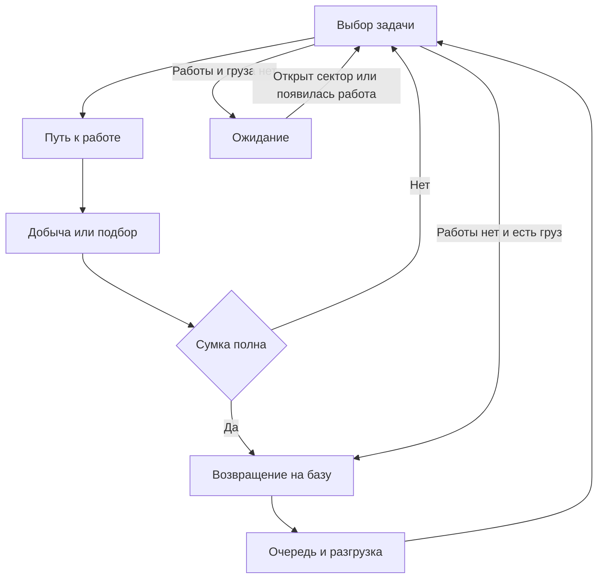

# Cat Miners ТЗ на переход к автоматической инкрементальной игре

Версия 2.0 · 8 октября 2026 года · Исполнитель Opus 5.5 · Unity · Android portrait

Мы перерабатываем существующую игру про котиков-копателей. Новый основной референс игрового цикла — экономический режим **Idle Outpost**. Котики самостоятельно находят препятствия, добывают монеты, наполняют сумки, возвращаются на базу и разгружаются. Игрок вкладывает доставленные монеты в развитие всей команды. После завершения шахты локальные улучшения сбрасываются, а экипировка и её улучшения сохраняются.

Этот документ можно целиком передать Opus 5.5 вместе с текущим Unity-проектом и исходным `json-data.json`. Он описывает новый игровой цикл, перенос существующих уровней, стартовый баланс, интерфейс, техническую реализацию и критерии готовности.

## 1. Задание исполнителю

Переделай существующий проект в соответствии с этим ТЗ. Начни с изучения кода, сцен, данных, сохранений и инструкций репозитория. Используй пригодные компоненты проекта. Результат — запускаемая игра с новым циклом во всех 144 шахтах.

Работай самостоятельно, последовательно реализуй системы и проверяй их в Unity. Не заканчивай на плане, отдельных скриптах или демонстрационной сцене. После компиляции проверь реальные действия и исправь найденные проблемы. Для длинной сессии веди `REWORK_PROGRESS.md` с выполненными этапами, проверками и точкой продолжения.

Приоритеты:

1. Автономная добыча, перенос и сдача монет без ручного назначения работников.
2. Понятные улучшения базы и корректное разделение временного и постоянного прогресса.
3. Проходимость всех исходных планировок в новых правилах.
4. Рабочие экипировка, сохранение, офлайн-симуляция и переходы.
5. Баланс первых уровней и проверка поздних карт.
6. Цельные пиксель-арт, анимации, интерфейс, музыка и звуки.

### Приоритет документов

Этот документ заменяет противоречащие ему требования прежнего `Cat_Miners_Unity_Core_TZ_Opus_5_5.md`. Из документа `Cat_Miners_Opus_5_5_Visual_Polish_Prompt.md` сохраняются художественное направление, качество ассетов, общая система UI, музыка и требования к интеграции. Его указания сохранять merge, старую экономику и прежний core gameplay больше не действуют.

Исходный JSON сохраняется побайтно как источник. **Сохраняются исходные планировки и ID; экономические правила и поведение объектов меняются через отдельные конфигурации нового режима.** Старый баланс Gold & Goblins не объявляется подходящим для новой логистики.

Ни текущий код проекта, ни новый баланс в рамках подготовки этого документа не проверялись запуском Unity. Числа ниже — явно заданная стартовая настройка нашего прототипа, которую исполнитель должен проверить и откалибровать.

## 2. Что берём из Idle Outpost

Официальное описание Trade Mode связывает развитие локации с открытием и улучшением производственных точек, наймом работников и повторным вложением дохода. Описание Trade Gear предусматривает экипировку с бонусами к прибыли, производительности и скорости работников. Эти принципы используем как референс [1][2].

Наша реализация переносит эти принципы в шахту с котиками. Автоматическое разрушение препятствий, физическая доставка добычи на базу, правила завершения шахты и конкретные формулы ниже — **решения для Cat Miners**, а не утверждение о точном устройстве Idle Outpost.

В текущий объём входят шахта, база, автоматические работники, локальные улучшения, постоянная экипировка и последовательное прохождение. Fight Mode, зомби, бои, арена, торговые посетители, реклама, покупки, события, ферма и отдельный город сейчас не реализуются.

## 3. Новый игровой цикл

1. Игрок начинает шахту с работающей базой и двумя котиками.
2. Котики сами выбирают доступные цели и идут к ним.
3. Во время добычи появляются порции монет. Котики складывают их в сумки.
4. Наполнив сумку, котик возвращается на базу и разгружается.
5. Только сданные на базу монеты становятся доступными для покупок.
6. Игрок улучшает силу, численность, перемещение, сумки, разгрузку и ценность добычи.
7. Команда расчищает текущий сектор, автоматически открывает ворота и продолжает работу выше.
8. После полной расчистки и доставки всей добычи игрок получает постоянную награду.
9. Игрок переходит в следующую шахту. Локальная экономика начинается заново; экипировка продолжает усиливать команду.

Без действий игрока котики должны продолжать работу и в конечном счёте завершать текущую шахту. Улучшения заметно ускоряют этот процесс. Прогресс не требует обязательного ручного сбора, кликов по камням, назначения целей или merge.

Игрок управляет эффективностью потока: увеличить добычу, ускорить доставку, расширить сумки, разгрузку или команду. Характерное поведение игры должно быть видно на поле: работающие котики, наполненные сумки, маршруты к базе и сдача монет.

## 4. Что изменить в существующей игре

| Система | Новое поведение |
|---|---|
| Покупка отдельных котиков заданного уровня | Улучшение «Команда» добавляет работника с общими характеристиками |
| Merge котиков | Удалить из обычного игрового режима, обучения, UI и подсказок |
| Ручное перетаскивание и назначение | Заменить автоматическим планировщиком работ |
| Индивидуальные уровни котиков | Заменить общим локальным развитием команды; индивидуального опыта нет |
| Ожидание после разрушения цели | Автоматически подобрать следующую работу или отвезти груз |
| Мгновенное начисление награды камня | Создавать физически переносимый груз; начислять после разгрузки |
| Шахты с пассивным доходом | Использовать как богатые месторождения для той же добывающей команды |
| Карточки автоматизации | Отключить; автоматическая работа доступна с начала игры |
| Исходные manager-карты и эликсир | Не использовать в новой экономике; заменить прогрессию экипировкой и деталями |
| Бесплатная доставка котика по старому таймеру | Отключить; число котиков задаётся локальным наймом |
| Старые случайные доставки и динамит | Отключить в первой версии переработки |
| Бонусы старых ворот | Заменить открытием следующего сектора и добычей по новой конфигурации |
| Сохранение | Новая версия и отдельный профиль режима |
| Офлайн | Продолжение всей автоматической цепочки до завершения текущей шахты |

Переиспользуй геометрию, импорт, готовые спрайты, музыку, сервисы UI и пригодные части сохранения. Старые системы не должны продолжать начислять доход или бонусы невидимо для игрока.

## 5. База и управление

База — компактный шахтёрский лагерь внизу уровня. Это функциональный центр текущей шахты, без отдельной сцены города и строительства по свободным клеткам.

В базе находятся:

- Приёмный склад с двумя местами разгрузки и видимыми ящиками с монетами.
- Доска найма, представляющая размер команды.
- Верстак инструментов, представляющий силу добычи.
- Стеллаж сумок и транспортное оборудование, представляющие логистику.
- Шкаф постоянной экипировки.

Все улучшения доступны через единую панель «База». Постройки отражают развитие визуально, но не требуют отдельно обходить и открывать несколько одинаковых меню. Кнопка «К базе» возвращает камеру к лагерю из любой части шахты. Панель улучшений можно открыть, не возвращая камеру вручную.

Камера прокручивается вертикально. Тап по котику или препятствию показывает сведения и текущую задачу. Тап по монетам на земле не зачисляет их: они являются грузом работников. Перетаскивание фона двигает камеру, а не назначает работу. В первой версии нет ручного управления отдельным котиком и обязательного выбора приоритетной цели.

## 6. Автоматическое поведение котика

### 6.1. Общие характеристики

У всех котиков одинаковые эффективные характеристики команды. Различаются внешность, текущая позиция, задача, заполнение сумки и фаза анимации. Котик не теряет свою индивидуальность визуально, но игроку не нужно отдельно прокачивать каждого.

Характеристики: урон за удар, интервал удара, скорость перемещения, вместимость сумки, скорость разгрузки. Ценность монет — общий параметр экономики команды.

### 6.2. Состояния



В коде раздели выбор задачи, движение, добычу, подбор, возвращение, ожидание свободного места разгрузки, разгрузку и ожидание работы. Не запускай несколько конкурирующих корутин поведения одного котика.

### 6.3. Правила выбора задачи

На старте, после окончания работы и после разгрузки котик выбирает задачу автоматически:

1. Если сумка полна — сразу направиться к базе.
2. Если доступен свободный груз, подобрать подходящую порцию с учётом оставшегося места.
3. Иначе выбрать добываемую цель в открытом секторе с достижимой рабочей позицией.
4. Если достижимой работы нет, а сумка непустая, — сдать частичный груз.
5. Если работы и груза нет — ожидать открытия сектора либо завершения шахты.

Существующие доступные грузы имеют приоритет перед созданием новых. Планировщик сначала рассматривает ближайшие задачи с учётом длины пути, затем избегает лишней концентрации на занятой цели. При равенстве используй стабильный ID. Удалённый невзятый груз не должен навсегда оставаться без внимания.

Рабочие позиции находятся в свободных клетках по сторонам footprint цели. Добыча по диагонали, через стены, из другого сектора или с произвольного расстояния запрещена. На одной цели допускается до четырёх работников при наличии четырёх доступных рабочих позиций. Одна рабочая позиция закрепляется за одним добывающим котиком.

Уже работающий котик не бросает цель из-за появления чуть более выгодного кандидата. Перепланирование требуется после разрушения цели, заполнения сумки, потери пути, открытия сектора или завершения собственной задачи.

### 6.4. Пути и предотвращение зависаний

Используй навигацию по исходной клеточной сетке с перемещением по четырём направлениям. Для небольшого поля достаточно A* либо BFS с кэшированием. Физическая симуляция толпы не нужна.

Котики не являются непроходимыми препятствиями друг для друга. Разреши им расходиться визуально с небольшим смещением внутри прохода; это смещение не меняет логический путь. Узкий коридор не должен создавать встречную блокировку.

Бронируй рабочие позиции, груз и места разгрузки. Снимай бронирование при отмене задачи и исчезновении её цели. Резервирование груза не должно создавать второй экземпляр награды.

При отсутствии движения в течение контрольного интервала пересчитай путь и освободи некорректную задачу. Если нет достижимой работы при незавершённой карте, запиши диагностику с ID зоны, целями и блокирующими клетками. Не скрывай ошибку телепортацией котика, выдачей денег или автоматическим разрушением недоступной цели.

Когда вся добыча закончена, отправь в лагерь и пустых котиков, оставшихся на поле. Их декоративное возвращение не должно создавать новый доход или задерживать уже заслуженную награду, если весь груз доставлен.

## 7. Добыча, сумки и доставка монет

### 7.1. Монеты появляются по мере добычи

Прочный объект должен постепенно давать груз. Игрок получает возможность улучшать команду до его окончательного разрушения.

У каждой цели есть:

- `MaxHp` и `RemainingHp`.
- `TotalCargoUnits` — целое число порций груза на весь объект.
- `ReleasedCargoUnits` — сколько порций уже создано.
- Базовая стоимость одной порции.
- Стабильный ID объекта и счётчик порций.

После нанесения урона рассчитай, сколько порций уже должно быть выдано:

```text
progress = clamp((MaxHp - RemainingHp) / MaxHp, 0, 1)
expectedReleased = floor(TotalCargoUnits * progress)
newUnits = expectedReleased - ReleasedCargoUnits
```

При окончательном разрушении принудительно выдай оставшиеся порции до `TotalCargoUnits`. Защити вычисление от погрешности на границах. Совместная добыча несколькими котиками изменяет один общий объект и один счётчик выдачи.

Это деление общей награды на части. Отдельная полная награда поверх уже выданных порций при разрушении не начисляется.

### 7.2. Груз имеет физическое состояние

Одна порция — условный мешочек с монетами, занимающий одно место в сумке. **Вместимость измеряется числом порций, а не числовой суммой золота.** Поздние большие денежные значения не должны автоматически уменьшать число переносимых порций.

Груз проходит состояния `OnGround → Carried → Delivered`. Резервирование — подстатус груза на земле, а не дополнительная копия. Часть порций разрешено объединять в один визуальный мешок, сохраняя корректный учёт количества и стоимости.

Котик подбирает доступные порции рядом с рабочей позицией. Если места не хватает, остаток лежит на достижимой свободной клетке возле объекта. Груз не блокирует навигацию. Он не должен появляться внутри непроходимой части ещё не разрушенного большого объекта.

Если цель разрушена, а сумка неполная, котик может подобрать соседние монеты и продолжить работу. При отсутствии следующей доступной задачи он везёт частичный груз. После полной расчистки все оставшиеся мешочки должны быть доставлены, включая остаток меньше полной сумки.

### 7.3. Когда начисляется золото

Золото зачисляется в доступный кошелёк только во время разгрузки на базе. В полёте к счётчику иконки показывают уже совершённую транзакцию.

Стоимость порции фиксируется при её создании с учётом действующего бонуса ценности добычи. Последующее улучшение или смена шляпы влияют на новые порции. Существующий груз на земле, в сумке и в очереди не пересчитывается.

Каждая порция или учётная партия имеет уникальный ключ. Повторный callback анимации, перезапуск игры и повторный обработчик разгрузки не зачисляют её второй раз. Начислением управляет симуляция, а не Animation Event.

Инварианты учёта:

- Созданные порции = порции на земле + в сумках + уже сданные порции.
- Стоимость созданного груза = стоимость на земле + в сумках + суммарно зачисленная стоимость этого груза.
- Текущий кошелёк учитывается отдельно: зачисления минус покупки.

### 7.4. Разгрузка

У базы два параллельных места разгрузки. Очередь FIFO хранится логически, котики визуально ждут рядом. Они не перекрывают вход в лагерь.

Монеты зачисляются порциями в течение времени разгрузки. Улучшение разгрузки увеличивает скорость обслуживания каждого места. Закрытие панели базы не влияет на процесс.

## 8. Перенос 144 уровней и препятствий

### 8.1. Что берём из JSON

Основные карты загружаются из `Zones`, по порядку `zone1 … zone144`. `CrusherGrids` не используются. Сохрани исходные ID, размеры поля, якоря и footprint объектов.

По предыдущему аудиту исходных данных ширина всех карт равна 7 клеткам, глубина — от 12 до 64. Токены: `.`, `r`, `s`, `x`, `p`, `e`, `c`.

Линейный индекс разбирается так:

```text
column = index % WidthCells
row = index / WidthCells       // целочисленно, row 0 сверху
occupied = (column + dx, row - dz)
```

Последняя формула — footprint для `r/s/x`: якорь в нижней левой клетке объекта. Например, `amethyst` в `zone2` с якорем `(0, 5)` и размером `2 × 3` занимает столбцы 0–1 и строки 3–5. Сначала импортируй все footprint, потом отмечай свободные клетки. `.` означает отсутствие якоря и не гарантирует свободное место.

### 8.2. Новое значение токенов

| Токен | Поведение в новой игре |
|---|---|
| `r` | Обычный добываемый объект; постепенно выдаёт груз и освобождает footprint после разрушения |
| `x` | Добываемый завал; раньше был недобываемым препятствием, теперь получает HP и груз из новой конфигурации |
| `s` | Богатое месторождение с прежним визуальным типом; добывается той же командой, без пассивного производства и manager-карты |
| `p` | Ворота сектора; становятся задачей после расчистки нижнего сектора, затем открываются автоматически |
| `e` | Маркер завершения и выхода; отдельной покупки или ручной добычи выхода нет |
| `c` | Исходная отметка стартового узла; связывается с новой базой, старый генератор и спавнер отключены |
| `.` | Свободная клетка только после учёта всех footprint |

Все игровые `r/x/s` обязательны к расчистке. Нельзя оставить обычные `x` навсегда неразрушимыми. Границы сцены и декоративные скалы вне игровой сетки могут быть недобываемыми; они не входят в счётчик прогресса.

Начальная геометрия сохраняется, однако проходимость во времени меняется по новым правилам: разрушенный `x` освобождает свои клетки. Это осознанное изменение core gameplay.

### 8.3. Размещение базы

Добавь отдельную навигационную площадку под нижней границей исходной карты. Она не меняет индексы и размещение объектов внутри `Zones.Grid`.

Площадка охватывает ширину карты, обеспечивает подход к нижним граням препятствий и содержит точки появления, разгрузки и ожидания. Старый `c` не создаёт дополнительную непроходимую постройку: его логическая клетка становится подходом к лагерю. Размеры декоративных зданий базы не должны перекрывать рабочие пути.

### 8.4. Секторы и ворота

Котики проходят карту снизу вверх. Сортируй ворота в порядке продвижения, а не по строковому ID.

Закрытые ворота задают логическую границу по всей ширине шахты. Навигация, добыча, подбор и планировщик не используют клетки за ней, даже если сбоку виден свободный проход. Разрушение соседнего завала не снимает эту границу.

Для ворот с якорем в строке `gateRow` задай запрет пересечения между строками `gateRow` и `gateRow - 1`. Нижняя сторона включает строку `gateRow`. Рабочие позиции ворот выбираются на достижимых свободных клетках этой стороны. Токен `p` представляет специальную цель и барьер, а не неизвестный прямоугольный footprint, перекрывающий соседние исходные объекты.

Разбей цели на секторы явно. Объект с footprint, пересекающим границу, целиком отнеси к нижнему сектору по его нижней занятой строке: он должен иметь доступную рабочую сторону до открытия ворот. Зафиксируй это правило в адаптере и валидаторе.

После разрушения всех `r/x/s` текущего сектора ворота становятся доступной задачей. Котики автоматически добывают их с нижней стороны, получают груз и открывают проход. Сдавать весь текущий груз до открытия ворот не требуется. Новые денежные затраты, карточки и нажатие «Открыть» для этого не нужны.

Специальные размеры `c/p/e` не выводи из несуществующих полей JSON. Задай их новым адаптером: площадка базы, логический барьер ворот с достижимыми рабочими позициями, маркер выхода. Проверь их совместимость с каждым footprint.

### 8.5. Проверка доступности

Для каждой зоны выполни проверку последовательной расчистки: от площадки базы найти достижимые рабочие стороны, удалить доступные цели в копии карты, открыть подходящие ворота, повторить до выхода. Все обязательные цели должны оказаться достижимыми.

Если обнаружена проблема, исправляй адаптер или добавляй именованный проверяемый override с ID зоны. Не подменяй карту случайно сгенерированным уровнем. Все исключения перечисли в отчёте. Пустой fallback и мгновенная победа при ошибке загрузки недопустимы.

## 9. Временные улучшения базы

Все покупки выполняются за золото текущей шахты. Они применяются ко всей команде, включая котиков, нанятых позднее. Уровень каждой ветки начинается с 0.

| Ветка | Что меняет | Старт | Стартовый предел уровня |
|---|---|---:|---:|
| Команда | Число работников | 2 котика | 10 улучшений, итого 12 котиков |
| Кирки | Урон за удар | 5 | 60 |
| Обувь | Скорость перемещения | 2.5 клетки/с | 15 |
| Сумки | Вместимость | 4 порции | 16 |
| Разгрузка | Скорость на одно место | 2 порции/с | 20 |
| Оценка добычи | Стоимость новых порций монет | Множитель 1 | 60 |

«Кирки» и «Обувь» в этой панели — местная подготовка команды. Постоянные предметы находятся в отдельной вкладке «Экипировка». В UI явно показывай разницу: «На эту шахту» и «Сохраняется между шахтами».

Покупка нового работника мгновенно создаёт котика в базе и включает его в планировщик. Дополнительное назначение или подтверждение не требуется. Уменьшения численности за обычные действия нет.

Обновление характеристик применяется с ближайшего корректного шага симуляции. Скорость не телепортирует по пути; новый урон действует со следующего удара; вместимость не удаляет груз. Анимация улучшения не блокирует производство.

Сделай покупку ×1, ×10 и «Макс» там, где у ветки достаточно уровней. Стоимость пакетной покупки равна сумме точных последовательных цен. Последовательные бонусы на порогах учитываются. Для найма достаточно ×1.

## 10. Постоянная экипировка

### 10.1. Экипировка команды

Используй **один общий комплект на всю команду**. Игрок выбирает предметы в базе, все котики получают бонусы и соответствующие визуальные детали. Индивидуальный инвентарь каждого работника сейчас не нужен.

| Слот | Основной эффект | Визуальная связь |
|---|---|---|
| Шляпа или каска | Ценность добычи | Головной убор с открытым силуэтом ушей |
| Кирка | Урон добычи | Новый инструмент в лапах |
| Рюкзак | Вместимость | Видимый рюкзак и заполнение сумки |
| Обувь | Скорость движения | Рабочие ботинки и детали одежды |

В первой версии каждый предмет даёт один понятный основной бонус. Подготовь четыре редкости для каждого слота: обычная, редкая, эпическая и легендарная, всего минимум 16 записей и различимых иконок. Случайные дополнительные свойства, комплекты, рецепты и отдельный герой-командир не нужны.

Предметы, их уровни, собранные детали и выбранный комплект сохраняются после перехода. Экипировка не требует локального золота для повторного надевания и не исчезает вместе с нанятыми котиками.

### 10.2. Получение

Постоянная награда выдаётся за первое завершение каждой шахты:

- Шахта 1: гарантированная обычная кирка.
- Шахта 2: гарантированная обычная шляпа.
- Шахта 3: гарантированный обычный рюкзак.
- Шахта 4: гарантированная обычная обувь.
- Далее: один предмет из новой таблицы наград и детали для улучшений.

Детали выдаются при каждом первом завершении, включая шахты 1–4, по формуле раздела 12.3.

На шахтах 10, 25 и 50 награда гарантирует соответственно редкую, эпическую и легендарную кирку; эта гарантия заменяет обычный случайный предмет данного завершения.

Стартовая таблица для остальных шахт: слот выбирается равновероятно; редкости имеют вероятности 70% / 24% / 5% / 1%. Это наша конфигурация прототипа. Не используй непроверенные веса старого `Gacha`.

Результат награды определяй и сохраняй один раз в транзакции завершения. Повторное открытие окна не меняет предмет. Старые сундуки и manager-карты не должны параллельно выдавать второй комплект наград.

### 10.3. Дубликаты и улучшения

Коллекция хранит одну запись каждого предмета. Повторное получение того же предмета превращается в постоянные «Детали»: 5 / 15 / 40 / 120 по редкости. Первая копия добавляется в коллекцию на уровне 1. Максимальный уровень предмета — 20.

Детали тратятся на повышение уровня выбранного предмета. Надевание бесплатно. Повышение редкости через merge предметов и расходование надетой экипировки в этой версии не реализуются. Это осознанное упрощение относительно систем предметов референса.

Сделай сравнение «сейчас → после замены», фильтр по слотам и кнопку «Надеть лучшее». При одном основном свойстве она выбирает наибольший итоговый бонус каждого слота. Замена не требует выбора каждого котика.

Если после смены рюкзака текущий груз превышает новую вместимость, он сохраняется. Котик завершает доставку, затем использует новую вместимость. Экипировка не пересчитывает уже созданные порции золота.

## 11. Сброс и завершение шахты

### 11.1. Условие завершения

Шахта завершена, когда уничтожены все обязательные `r/x/s`, открыты все ворота, на земле нет груза и все сумки разгружены. Маркер выхода становится доступным автоматически. Котики собираются в лагере.

Фаза доставки остатков начинается после уничтожения всех `r/x/s` и открытия всех `p`. Последний обычный камень при оставшихся закрытых воротах ещё не запускает эту фазу. Во время неё запрещено создавать новые задачи добычи, но подбор, движение и разгрузка продолжаются. UI показывает «Доставляем оставшиеся монеты».

После доставки один раз выдай постоянную награду и открой итоговое окно. Переход в следующую шахту выполняется по кнопке «Следующая шахта». Автоматический переход между уровнями и автоматические покупки не входят в первую версию.

### 11.2. Что сбрасывается

| Состояние | При переходе |
|---|---|
| Золото текущей шахты | Обнуляется; конвертации в постоянную валюту нет |
| Локальные уровни шести веток | Сбрасываются до 0 |
| Число работников | Сбрасывается до двух стартовых котиков |
| Местная сила, скорость, сумки и разгрузка | Возвращаются к базовым значениям и заново получают постоянные бонусы |
| HP, открытые клетки, ворота и задачи | Создаются по следующей карте |
| Груз и очередь разгрузки | На переходе уже пусты; не копируются |
| Экипировка и уровни предметов | Сохраняются |
| Надетый комплект и детали | Сохраняются |
| Пройденные шахты и выданные постоянные награды | Сохраняются |
| Настройки, косметика и завершённое обучение | Сохраняются |

Новая шахта сразу запускает двух котиков с учётом надетой экипировки. Возврат локальных уровней к нулю не требует повторно обучать игрока всем действиям.

### 11.3. Транзакция перехода

Фазы: `Running → DrainingCargo → ReadyToContinue → Transitioning → Running`.

`ReadyToContinue` включает уже сохранённую постоянную награду. Храни ID завершённой шахты и факт выдачи независимо от открытости окна. Повторный тап, загрузка после выдачи и закрытие приложения во время перехода не создают дубликаты.

После `zone144` покажи завершение доступной кампании. Не создавай `zone145`, не запускай автоматически первую карту и не выдавай повторно награду за последнюю шахту.

## 12. Стартовая модель баланса

Все значения этого раздела — **новый настраиваемый баланс прототипа**. Не выдавай их за восстановленные формулы Gold & Goblins или Idle Outpost. Храни параметры в `OutpostBalanceConfig`, а не внутри UI и отдельных prefab.

### 12.1. Обозначения и начальное состояние

- `z` — номер шахты от 1 до 144.
- `L` — текущий уровень локальной ветки, начиная с 0.
- `qItem` — уровень предмета от 1 до 20.
- `S(z) = 1.20^(z - 1)` — масштаб денежных значений шахты.
- Стартовое золото — 0; два котика и работающая база бесплатны.
- Интервал удара — 1 секунда. Эта версия улучшает урон за удар, а не сокращает анимацию до бесконечной частоты.

`S(z)` увеличивает порядок отображаемых денежных сумм. Сам по себе он не повышает сложность, поскольку применяется и к базовым ценам, и к наградам. Реальная длительность зависит от карты, препятствий, маршрутов, улучшений и экипировки.

### 12.2. Стоимость следующего локального улучшения

```text
NextCost(z, L) = ceil(S(z) * BaseCost * Growth^L)
```

| Ветка | BaseCost | Growth | Эффект без экипировки |
|---|---:|---:|---|
| Команда | 50 | 1.90 | `Workers = 2 + L` |
| Кирки | 20 | 1.18 | `Damage = 5 * 1.22^L * Milestone(L)` |
| Обувь | 25 | 1.30 | `MoveSpeed = 2.5 * (1 + 0.08 * L)` |
| Сумки | 25 | 1.32 | `Capacity = 4 + L` |
| Разгрузка | 20 | 1.28 | `UnloadRate = 2 * (1 + 0.15 * L)` на одно место |
| Оценка добычи | 30 | 1.24 | `ValueMultiplier = 1.10^L * Milestone(L)` |

`Milestone(L) = 2^k`, где `k` — число достигнутых порогов из `[10, 25, 50]`. Пороговые множители используются только у «Кирок» и «Оценки добычи». Показывай ближайший порог в UI; множитель применяется один раз при достижении и восстанавливается расчётом из уровня.

Все caps задаются таблицей раздела 9. Покупка выше максимума невозможна. Масштабирование цены и её округление выполняет один общий сервис; проверка доступности и списание используют одно и то же значение.

### 12.3. Бонусы постоянных предметов

Для шляпы, кирки и обуви:

```text
ItemBonus = RarityBaseBonus * (1 + 0.05 * (qItem - 1))
RarityBaseBonus = [0.08, 0.18, 0.35, 0.60]

FinalDamage = LocalDamage * (1 + PickaxeBonus)
FinalMoveSpeed = LocalMoveSpeed * (1 + BootsBonus)
FinalValueMultiplier = LocalValueMultiplier * (1 + HatBonus)
```

Отсутствующий предмет даёт бонус 0. Проценты указаны в долях: `0.18` означает +18%.

У рюкзака используй целую прибавку к вместимости, чтобы первое получение и каждое улучшение имели понятный эффект:

```text
BackpackExtra = RarityBaseCapacity + (qItem - 1)
RarityBaseCapacity = [1, 3, 6, 10]
FinalCapacity = LocalCapacity + BackpackExtra
```

Если рюкзак не надет, прибавка равна 0. Два разных предмета одного слота одновременно бонус не дают. Повторная загрузка сцены не добавляет тот же процент заново.

Стоимость улучшения предмета с уровня `qItem` на следующий:

```text
PartsCost = ceil(6 * 1.17^(qItem - 1) * RarityCostMultiplier)
RarityCostMultiplier = [1, 1.5, 2.5, 4]
```

Количество деталей за первое завершение шахты:

```text
CompletionParts(z) = 10 + 5 * floor(z / 5)
```

Эти детали выдаются вместе с предметом независимо от того, новая это копия или дубликат. Конвертация дубликата добавляется к указанной награде.

### 12.4. Новые HP и груз объектов

Прямое сохранение старых огромных HP при удалении merge непригодно. Создай воспроизводимый адаптер `OutpostLevelBalanceAdapter`, который использует относительную сложность исходных объектов.

Для каждого `r/s/p` получи исходный HP из соответствующей таблицы и уровня токена с индексом `level - 1`. Отсутствующее значение — ошибка данных с конкретным ID. Для `x` исходного HP не требуется: он задаётся новым правилом.

В каждой зоне собери отсортированные уникальные исходные HP всех `r/s/p`. Для объекта с индексом `j` в этом списке:

```text
rank01 = j / (uniqueCount - 1)
```

Если уникальное значение одно, `rank01 = 0`. Для всех `x` начальное `rank01 = 0.5`. Таким образом сохраняется относительный порядок прочности исходных добываемых объектов, без переноса их прежнего экспоненциального масштаба.

Стартовая формула:

```text
ZoneHpFactor = 1 + 0.005 * (z - 1)
AreaFactor = min(2.5, sqrt(footprintCellCount))
MaxHp = ceil(20 * ZoneHpFactor * (1 + 5 * rank01) * AreaFactor * TypeHpFactor)
TotalCargoUnits = max(2, ceil(MaxHp / 10))
```

| Тип | TypeHpFactor | BaseCoinValueFactor |
|---|---:|---:|
| `r` | 1.0 | 1.0 |
| `x` | 0.8 | 0.5 |
| `s` | 2.0 | 2.0 |
| `p` | 2.5 | 1.0 |

Для ворот `AreaFactor = 1`: ширина логического барьера не является площадью добываемого объекта. `c` и `e` не участвуют в этих формулах.

Стоимость каждой создаваемой порции:

```text
CargoGoldValue = max(1, ceil(5 * S(z) * BaseCoinValueFactor * FinalValueMultiplier))
```

Старые `RewardCycle`, `Gacha`, `RankMultipliers`, manager-карты и `CheckPoint.StatModifierType` не накладываются поверх этой модели. Их исходные данные остаются в архивном JSON. Текстовое описание старого объекта не должно обещать отключённый бонус.

### 12.5. Контрольные примеры

Без экипировки на шахте 1: два котика, урон 5, скорость 2.5, сумка 4, разгрузка 2 порции/с, стоимость первой «Кирки» — 20. После покупки: урон 6.1; следующая цена — 24.

Обычный объект `r` площадью 1 и `rank01 = 0` на шахте 1 имеет 20 HP, две порции по 5 монет. После суммарного урона 10 создаётся первая порция, после разрушения — вторая. В кошельке всё ещё 0, пока котик не сдаст груз. Полная сдача приносит 10 монет.

Обычная кирка уровня 1 даёт +8%: стартовый урон следующей шахты будет 5.4 при нулевом локальном уровне. Обычный рюкзак уровня 1 увеличит стартовую сумку с 4 до 5. Локальный reset не удаляет эти эффекты.

### 12.6. Проверка темпа

Начальные продуктовые ориентиры, а не уже измеренные результаты:

- Первый старт работы — в первые 1–3 секунды после загрузки.
- Первая доставка на шахте 1 — примерно за 10–20 секунд.
- Первое доступное улучшение — в течение первых 20–35 секунд.
- Первый дополнительный работник — ориентировочно в течение первой минуты при соответствующем выборе покупок.
- Первая шахта — примерно 2–4 минуты с активными улучшениями.
- Следующие ранние шахты — примерно 3–7 минут; первая экипировка должна давать заметное ускорение.
- Более крупные шахты — ориентир 8–15 минут с осмысленными покупками и ожидаемым комплектом. Проверяется симуляцией и игрой, не назначается принудительным таймером.

Если измерения не попадают в ориентиры, меняй открытые параметры профиля и документируй изменения. Не сокращай исходные карты незаметно и не выдавай скрытые монеты для достижения нужного времени.

Сравни минимум три стратегии: без покупок, упор на добычу, сбалансированные добыча/команда/логистика. Отдельно проверь пустую экипировку и достижимый для данного этапа комплект. Покупки должны давать реальное ускорение, а не только увеличивать цифры интерфейса.

Нулевая касса не создаёт тупик: два бесплатных работника всегда способны продолжать добычу. Открытие ворот и завершение не требуют расходования монет. Конечность ресурсов уровня не должна приводить к обязательной платной покупке или отсутствию денег на выход.

## 13. Офлайн-прогресс

Используй ту же симуляцию, что работает онлайн. После возвращения котики должны успеть пройти маршруты, добыть новые цели, собрать и сдать груз, открыть доступные ворота и продолжить работу в следующем секторе текущей шахты.

Лимит отсутствия для первой версии — 8 часов, отдельный параметр нашей конфигурации. В офлайне нет ручных покупок, смены экипировки и перехода на следующую шахту. Если текущая шахта завершена, симуляция доходит до `ReadyToContinue` и останавливается. Пустая завершённая карта больше не производит золото.

Не рассчитывай результат как «последний доход в секунду × время отсутствия»: карта конечная, пути меняются, сумки заполняются, есть очередь и ворота. Используй продвижение до ближайшего события или другой детерминированный ускоренный расчёт с теми же правилами.

Сохраняй единый временной маркер. Отрицательное время равно нулю. После применения ограниченного интервала обработанная временная отметка обновляется до текущего времени, чтобы превышение лимита не начислялось при повторном запуске. Прерывание расчёта не должно приводить к частично начисленному, а затем повторно рассчитанному интервалу.

Показывай «Пока вас не было»: доставленные монеты, расчищенные объекты, открытые секторы и завершение шахты, если оно произошло. Результат уже сохранён до открытия окна. Рекламного удвоения нет.

## 14. Интерфейс нового режима

Сохрани общую тему и переиспользуемые компоненты прежнего визуального ТЗ. Обнови все затронутые окна и их состояния, включая обучение. Старые элементы merge, лимиты карточек автоматизации и пассивный доход шахт не должны оставаться в обычном UI.

| Экран | Обязательное содержание |
|---|---|
| Основной HUD | Номер шахты, доступное золото, прогресс расчистки, число работников |
| Статус доставки | Отдельно от кошелька: монеты в пути/на поле либо компактный индикатор несданного груза |
| Нижняя панель | «База», «Экипировка», «К базе»; настройки могут находиться в верхней части |
| Панель базы | Шесть веток, текущий уровень, эффект сейчас/после, цена, режим покупки и следующий порог |
| Сведения о котике | Текущая задача, заполнение сумки, стоимость груза; без кнопки ручного назначения |
| Сведения о цели | HP, тип, текущие работники, оставшаяся добыча и причина недоступности |
| Экипировка | Четыре слота, коллекция, редкость, уровень, сравнение, детали, улучшение и «Надеть лучшее» |
| Итоги шахты | Расчистка, выданный предмет, детали, объяснение сброса и кнопка перехода |
| Офлайн-окно | Уже начисленные результаты и состояние текущей шахты |
| Настройки | Музыка, SFX, атмосфера, вибрация и уменьшение эффектов |

Показывай прогресс как количество уничтоженных обязательных объектов к общему количеству, включая ворота. Выход и база в счётчик не входят. При 100% и оставшемся грузе отображай фазу доставки, не показывай ложную готовность перехода.

Доступное золото и несданный груз имеют разные подписи и оформление. Цена кнопки сравнивается только с доступным кошельком. Отдельный индикатор текущего темпа дохода допустим как измеренная средняя величина; не используй его в расчёте офлайна.

В панели базы добавь краткую подсказку об ограничении потока, если её можно получить из реальных состояний: много времени на добычу, долгие маршруты, частые рейсы с полной сумкой или очередь разгрузки. Не выводи рекомендацию по неподтверждённой формуле окупаемости.

Во время `ReadyToContinue` локальные покупки отключены: работа завершена и их эффект уже не используется. Панель экипировки остаётся доступной перед следующей шахтой.

UI адаптируется к Safe Area и портретным форматам 9:16, 9:19.5 и 9:20. При модальном окне поле не получает случайные касания. При этом симуляция продолжает работать. Все числовые значения обновляются из общего состояния игры, без отдельных UI-формул.

## 15. Обучение новой игре

Переоформи обучение на реальной первой шахте:

1. При входе два котика уже идут работать; короткая подсказка объясняет автоматическую добычу.
2. Игрок видит наполнение сумки и возвращение на базу.
3. При первой доставке подсветить изменение доступного золота.
4. Когда хватает средств, показать улучшение «Кирки» в базе и изменение силы всей команды.
5. При возможности объяснить найм третьего работника. Не блокировать игру, если игрок потратил монеты иначе.
6. Показать, что котики сами выбирают следующие объекты.
7. После завершения представить гарантированную кирку и кнопку экипировки.
8. Перед переходом объяснить: местные улучшения сбросятся, предмет останется.
9. На следующей шахте показать сохранённый бонус предмета при локальном уровне 0.

Шаги основаны на фактических событиях. Во время подсказок добыча и доставка продолжаются. Обучение можно закрыть; оно не должно мешать прохождению без обязательных кликов по конкретным объектам.

## 16. Пиксель-арт, анимации, звук и музыка

Сохрани уютную кошачью шахту: тёплые фонари, дерево и медь, холодные камни и кристаллы, узнаваемые котики. Используй уже созданные качественные материалы. Если визуальная доработка ещё не выполнена, реализуй её в соответствии с предыдущим художественным ТЗ, адаптированным к новому циклу.

Новые обязательные состояния:

- Ходьба без груза и с наполненной сумкой; груз хорошо заметен на котике.
- Работа, подбор, поворот к базе, ожидание очереди и разгрузка.
- Видимое изменение размера команды и оборудования базы.
- Шляпа, кирка, рюкзак и обувь из надетого комплекта.
- Порционное появление добычи, мешочки на поле, перенос и сдача в склад.
- Открытие сектора и сбор команды после завершения.

Эффект полёта монет к кошельку происходит на базе при зачислении. Во время удара по камню возможны сколы и появление мешочка, но HUD не должен имитировать получение ещё не доставленного золота.

Сохрани или доведи два оригинальных фоновых трека из визуального ТЗ, корректные циклы и плавные переходы. Добавь спокойные звуки шагов, подбора, сумки, склада, разгрузки, найма и смены экипировки. Частые звуки добычи и доставки ограничиваются по числу голосов и частоте.

Игрок должен слышать завершённую доставку, но двенадцать котиков не должны создавать непрерывный шум. Настройки Music/SFX/Ambience сохраняются. Графика и звук не управляют экономическими транзакциями.

## 17. Состояние и сохранения

Раздели постоянное состояние игрока и состояние конкретной шахты.

| Постоянный профиль | Состояние текущей шахты |
|---|---|
| Версия режима и номер доступной шахты | `runId`, `zoneId`, версия баланса |
| Завершённые шахты и журнал их постоянных наград | Локальное золото и уровни шести веток |
| Коллекция предметов, уровни, выбранный комплект | HP и счётчики выданного груза каждого объекта |
| Детали и состояние генератора наград | Состояние ворот и открытые секторы |
| Обучение, звук, вибрация и доступная косметика | Котики, позиции, задачи, сумки и пути |
| Совместимые настройки отображения | Груз на земле, очередь и прогресс разгрузки |
|  | Фаза завершения и временная отметка симуляции |

Используй стабильные ID объектов на основе `zoneId + gridIndex`, а для экземпляра прохождения добавляй `runId`. ID предмета описывает конкретные слот и редкость. Все источники постоянных наград имеют отдельные ключи однократного получения.

Кошелёк, груз и факт разгрузки сохраняются согласованно. Для логической транзакции нельзя записать новую валюту со старой сумкой. Покупка, экипировка, выдача постоянной награды и переход также атомарны.

Сохраняй периодически, после важных изменений и при уходе приложения в фон. Используй временный файл, атомарную замену и резервную копию. Не полагайся только на закрытие Unity-приложения. Восстановление анимации не должно вызывать повторное действие.

### Переход со старых сохранений

Новый режим использует отдельную схему, например `CatOutpostV2`. Старый профиль Gold & Goblins-подобного прототипа архивируется и не перезаписывается новым.

Стартовое решение для этой переработки: новая кампания начинается с `zone1`, без автоматической конвертации старых карточек, эликсира и уровней котиков в экипировку. Совместимые настройки звука и отображения можно перенести. Старые данные остаются доступны для разработки и сравнения.

Если в проекте уже есть профиль новой схемы, продолжай его, не начинай кампанию заново. Политику переноса реальных игроков из опубликованной версии не придумывай: эта задача описывает миграцию прототипа и сохранение его исходных данных.

## 18. Организация кода и данных

Сохрани версию Unity, совместимые пакеты, существующий UI-стек и Android-настройки проекта. Для переработки не требуется обновление движка или смена render pipeline.

Предлагаемое разделение ответственности; названия можно адаптировать к проекту:

| Компонент | Ответственность |
|---|---|
| `SourceLevelImporter` | Чтение исходного JSON и восстановление геометрии |
| `OutpostLevelAdapter` | Новые значения токенов, сектора, база, цели |
| `OutpostLevelBalanceAdapter` | Новые HP, количество груза и базовые награды |
| `WorkerTaskScheduler` | Выбор и резервирование задач |
| `GridNavigationService` | Достижимость, пути и изменения сетки |
| `WorkerSimulation` | Движение, добыча, подбор и возврат |
| `CargoService` | Учёт созданного, лежащего, переносимого и сданного груза |
| `DepotService` | Очередь и два места разгрузки |
| `TeamUpgradeService` | Покупки и эффективные локальные характеристики |
| `EquipmentService` | Коллекция, улучшения, комплект и постоянные бонусы |
| `StageProgressionService` | Ворота, завершение, награда и переход |
| `OfflineSimulator` | Продвижение той же симуляции за время отсутствия |
| `SaveService` | Атомарные сохранения, версии и восстановление |

Игровая симуляция не зависит от FPS, клипов и видимости объектов. Представление подписывается на события, например `CargoReleased`, `CargoPickedUp`, `CargoDeposited`, `TeamUpgradePurchased`, `EquipmentChanged`, `SectorOpened`, `StageCompleted`.

Не делай отдельную упрощённую экономику для офлайна и отдельные формулы в каждом окне. Эффективные характеристики вычисляются централизованно из базовых значений, локальных уровней и выбранного комплекта.

Используй существующий надёжный слой больших чисел либо отдельный числовой тип для цен и валют. Количество порций, клеток и работников хранится целыми. Для денежного слоя проверяй конечность, корректное сравнение и согласованное округление. Отображаемое сокращённое число не участвует в покупке.

Храни отдельно:

- Неизменяемый `json-data.json`.
- `OutpostBalanceConfig` с формулами, коэффициентами и caps.
- `EquipmentCatalog` с минимум 16 предметами.
- `StageRewardConfig` с первыми наградами, гарантиями и весами.
- `LevelOverrides`, если они действительно понадобились.
- Каталог визуального отображения исходных и новых ID.

## 19. Производительность и отладка

Навигация пересчитывается по событиям и необходимости, а не для каждого котика каждый кадр. Используй пул мешочков, частиц и всплывающих чисел. Объединяй визуальные мешочки без потери точного учёта. Не создавай отдельный физический GameObject на каждую монету.

Цель — 60 FPS на выбранном доступном Android-устройстве; при необходимости поддержи профиль 30 FPS. Замеры на Editor указывай отдельно от устройства. Следи за аллокациями, очередями планировщика, загрузкой больших карт и временем офлайн-расчёта.

В Development Build нужны: выбор зоны, отдельный тестовый профиль, скорость симуляции ×1/×5/×20/×100, выдача тестового комплекта, просмотр пути и бронирований, счётчики груза, вклад локальных и постоянных бонусов. Эти инструменты не меняют обычное сохранение и не используются как доказательство честного прохождения.

## 20. Проверки и приёмка

Проверяй поведение, которое может привести к зависанию, потере прогресса или неверной экономике. Не заменяй проверку красивым скриншотом и не называй открытие карты полным прохождением.

| Проверка | Ожидаемый результат |
|---|---|
| Старт без действий | Два котика сами находят работу и доставляют первые монеты |
| Две минуты без касаний | Продолжаются добыча, перенос и выбор новых целей |
| Совместная добыча | Урон складывается, каждая порция создаётся один раз |
| Частичная добыча | Порции появляются до окончательного разрушения прочного объекта |
| Полная сумка | Котик прекращает набор груза и возвращается на базу |
| Большой дроп | Не поместившийся груз остаётся доступным и позже доставляется |
| Неполная последняя сумка | Остаток доставляется, завершение не зависает |
| Учёт монет | Разрушение не увеличивает кошелёк; сдача увеличивает его ровно на стоимость груза |
| Два места склада | Нет потери очереди и блокировки движения через базу |
| Все виды `x` | Получают HP, добываются и освобождают правильный footprint |
| Ворота | Их нельзя обойти; после расчистки сектора они открываются автоматически |
| Обычные улучшения | Меняются реальные характеристики всех текущих и новых котиков |
| Пакетная покупка | Итог совпадает с соответствующими последовательными покупками |
| Пересчёт экипировки | Один бонус применяется один раз, виден на котиках и сохраняется |
| Замена полной сумки | Груз не исчезает и не размножается |
| Смена шляпы | Ранее созданный груз сохраняет стоимость |
| Переход | Все локальные ветки обнулены, работников два, экипировка и детали сохранены |
| Повторное открытие итогов | Предмет и детали не выдаются повторно |
| Перезапуск в середине доставки | Позиция и груз восстановлены согласованно, без двойного начисления |
| Перезапуск во время перехода | Открывается одна корректная шахта с одной постоянной наградой |
| Офлайн и онлайн | При одинаковом исходном состоянии и без действий дают одинаковый результат в допустимой числовой погрешности |
| Завершённая шахта офлайн | Доход останавливается, следующий уровень сам не начинается |
| Поздняя карта | Нет бесконечных маршрутов, забытых объектов и переполнения чисел |
| Последняя шахта | Корректное окончание кампании без повторных наград |

Проверь все 144 зоны валидатором импорта и доступности. Выполни ускоренную автоматическую симуляцию всех карт с ограничением времени и отчётом о проблемах; это проверка завершимости, а не доказательство качества баланса.

Вручную пройди шахты 1–3 в обычном темпе, без читов. На шахтах 5 и 10 проверь ворота и несколько секторов. На 50, 101 и 144 проверь отображение, планировщик, доставку и производительность. Если на реальном Android проверка недоступна, прямо назови фактически использованную среду.

Для каждого измеренного прогона запиши: версию баланса, зону, экипировку, стратегию покупок, время первой доставки, время первой покупки, время расчистки, время окончательной доставки, длительность очереди и результат. Эти данные нужны для следующей настройки экономики.

## 21. Порядок реализации

1. Зафиксируй исходное состояние проекта и старое сохранение. Составь список переиспользуемых и отключаемых систем.
2. Добавь новый режим, адаптер уровней и отдельное состояние. Проверь импорт 144 карт и геометрию базы/ворот.
3. Реализуй на первой карте полный цикл двух котиков: выбор, путь, добыча, груз, возврат, разгрузка, повтор.
4. Подключи все шесть улучшений и централизованные характеристики. Удали участие merge, карточек и старых генераторов в новом режиме.
5. Реализуй расчистку секторов, окончательную доставку, награду и сброс при переходе.
6. Подключи постоянную экипировку, детали, сравнение и обновление внешности.
7. Реализуй атомарное сохранение и офлайн-симуляцию тем же ядром.
8. Обнови весь UI и обучение; добавь ходьбу с грузом, разгрузку, эффекты и звуки.
9. Проверь все карты, измерь темп, скорректируй открытые параметры нового баланса.
10. Доведи визуальную часть, проверь Android-сборку и подготовь демонстрацию.

Не растягивай первый этап на полную перепись архитектуры. Сначала получи работающий полный цикл, затем последовательно распространи его на остальной проект. Финальная сдача включает все обязательные системы этого документа.

## 22. Что передать по результату

- Обновлённый Unity-проект с новым игровым режимом по умолчанию.
- Все 144 исходные карты, пригодные для нового автоматического цикла.
- Конфигурации баланса, каталоги экипировки и наград, описание overrides.
- Обновлённые пиксельные ассеты, анимации, интерфейс, музыка и звуки, подключённые к игре.
- `README_REWORK.md`: запуск, устройство профилей, отличия от прежнего core gameplay.
- `BALANCE_V2.md`: окончательные параметры, контрольные вычисления и результаты прогонов.
- `VALIDATION_V2.md`: проверки, проблемные зоны, производительность и известные ограничения.
- `REWORK_PROGRESS.md`: итоговый статус и оставшиеся конкретные блокеры, если они есть.
- Запись 60–90 секунд реального геймплея со звуком: самостоятельная работа, доставка, покупка, экипировка и переход со сбросом.
- Тестовый APK, если Android toolchain доступен. При отсутствии укажи конкретный недостающий компонент и выполненные проверки проекта.

Готовность означает, что игрок может войти, увидеть самостоятельную работу котиков, улучшить команду в базе, завершить шахту и начать следующую с сохранённой экипировкой. Если какой-то пункт не реализован или не проверен, перечисли его прямо.

## Источники и статус решений

Официальные источники референса просмотрены 8 октября 2026 года. Из них взяты общие принципы экономического развития и постоянной экипировки; конкретная модель Cat Miners описана авторскими правилами этого документа.

1. [Idle Outpost — How to play in Trade Game Mode](https://appquantum.helpshift.com/hc/en/18-idle-outpost/faq/700-how-to-play-in-trade-game-mode/). Развитие производства, найм и вложение дохода.
2. [Idle Outpost — Trade Gear](https://appquantum.helpshift.com/hc/en/18-idle-outpost/faq/544-trade-gear/). Экипировка и её влияние на экономические характеристики.
3. [Idle Outpost — Resources and goodies](https://appquantum.helpshift.com/hc/en/18-idle-outpost/faq/552-resources-and-goodies/). Назначение монет в экономическом режиме.

Документы проекта, использованные как исходная основа: `Cat_Miners_Unity_Core_TZ_Opus_5_5.md` и `Cat_Miners_Opus_5_5_Visual_Polish_Prompt.md`. Геометрические сведения о JSON взяты из актуального исходного ТЗ. Новый баланс требует проверки в проекте; его коэффициенты не подтверждены игровыми измерениями.
